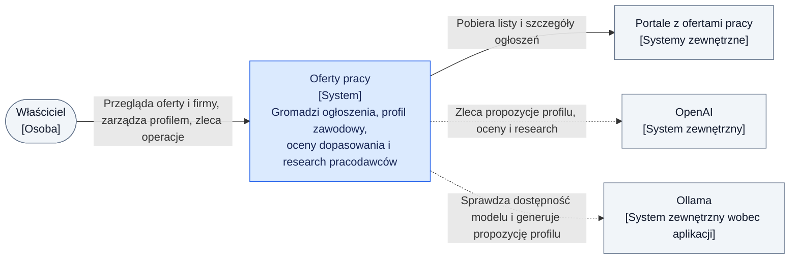
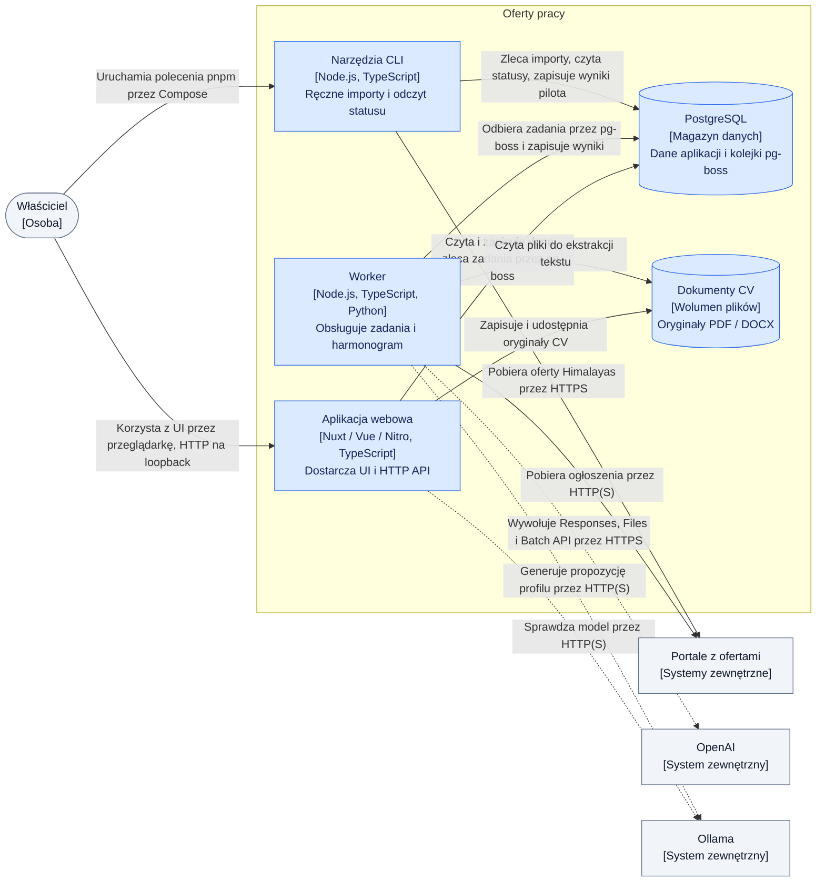
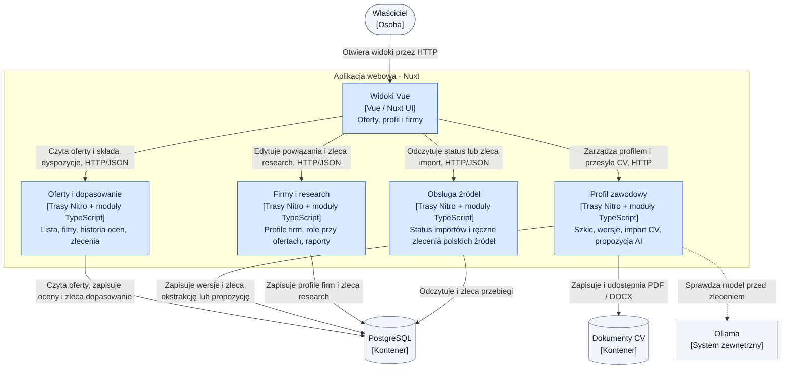
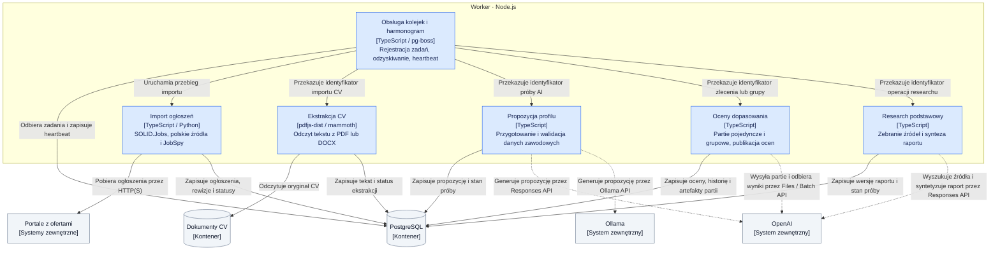
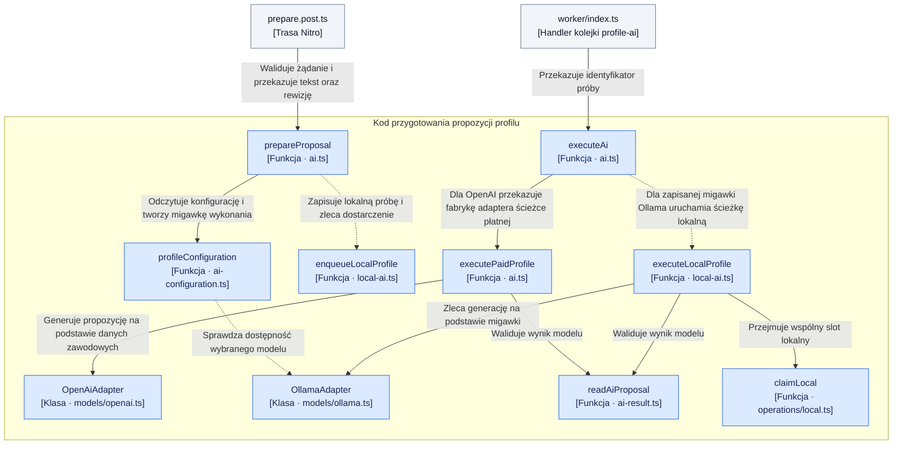

# Architektura Ofert pracy w modelu C4

Oferty pracy to prywatny system jednego właściciela. Zbiera ogłoszenia źródłowe, umożliwia ich przeglądanie i ocenę dopasowania do profilu zawodowego oraz gromadzi informacje o firmach. Diagramy opisują bieżący kod i konfigurację lokalnego Compose, odczytane 11 listopada 2026. Linie przerywane oznaczają ścieżki dostępne po dodatkowej konfiguracji. Strzałki wskazują inicjatora interakcji. [Model C4](https://c4model.com/diagrams)

- [C1 — kontekst systemu](#c1-kontekst-systemu)
- [C2 — kontenery](#c2-kontenery)
- [C3 — komponenty web i workera](#c3-komponenty)
- [C4 — kod przygotowania propozycji profilu](#c4-kod-przygotowanie-propozycji-profilu)
- [Stan lokalnego AI](#stan-lokalnego-ai)

## C1 — kontekst systemu

Wspólna granica portali obejmuje SOLID.Jobs, Bulldogjob, theprotocol.it, Just Join IT, No Fluff Jobs, portale obsługiwane przez JobSpy oraz osobny pilot Himalayas. Zakres importu i sposób uruchomienia zależą od adaptera. Research podstawowy korzysta z wyszukiwania WWW przez OpenAI. Wynik trafia do profilu firmy ze źródłami. [Katalog JobSpy](../../lib/sources/jobspy-catalog.ts) · [Katalog polskich źródeł](../../lib/sources/polish-catalog.ts) · [Pilot Himalayas](../../scripts/himalayas-sync.ts) · [Dostawca researchu](../../lib/companies/research-provider.ts)

## C2 — kontenery

Nuxt dostarcza kod Vue uruchamiany w przeglądarce i obsługuje trasy Nitro w tej samej aplikacji webowej. Compose publikuje jej port na `127.0.0.1`. PostgreSQL działa w sieci Compose. Biblioteki `pg` i `pg-boss` korzystają z PostgreSQL, a zadania pg-boss mają domyślny schemat `pgboss`. Osobna usługa `migrate` przy starcie przygotowuje schemat aplikacji i kolejki przed uruchomieniem web i workera. [Compose](../../compose.yaml) · [Konfiguracja Nuxt](../../nuxt.config.ts) · [Połączenie z bazą](../../lib/db.ts) · [Kolejka](../../lib/queue.ts) · [Inicjalizacja kolejek](../../scripts/init-queue.ts)

Wolumen `documents` jest współdzielony przez web i workera pod `/data/documents`. Baza przechowuje metadane importu, wydobyty tekst, wersje profilu i wyniki operacji. Podprocesy Python służą jako adaptery uruchamiane przez workera. Skrypt Himalayas wykonuje import bezpośrednio z CLI. [Import CV](../../lib/profile/imports.ts) · [Obraz workera](../../Dockerfile) · [Polecenia](../../package.json)

## C3 — komponenty

### Aplikacja webowa

| Komponent | Punkty wejścia i implementacja |
| --- | --- |
| Widoki Vue | [Lista ofert](../../app/pages/offers.vue), [profil zawodowy](../../app/pages/profile.vue), [szczegóły firmy](../../app/pages/companies/%5Bid%5D.vue) |
| Oferty i dopasowanie | [Lista ofert API](../../server/api/offers/index.get.ts), [zapytania ofert](../../lib/offers.ts), [dane ocen na liście](../../lib/matching/list.ts), [zlecenie grupy ocen](../../server/api/matching/index.post.ts) |
| Profil zawodowy | [Potwierdzenie wersji](../../server/api/profile/confirm.post.ts), [import CV](../../server/api/profile/imports/index.post.ts), [zlecenie propozycji](../../server/api/profile/imports/%5Bid%5D/prepare.post.ts), [zapis profilu](../../lib/profile/store.ts) |
| Firmy i research | [Lista firm API](../../server/api/companies/index.get.ts), [powiązania z ofertą](../../server/api/companies/%5Bid%5D/links.post.ts), [zlecenie researchu](../../server/api/companies/%5Bid%5D/research.post.ts), [zapis profilu firmy](../../lib/companies/store.ts) |
| Obsługa źródeł | [Zlecenie importu](../../server/api/sources/polish.post.ts), [status polskich źródeł](../../server/api/sources/polish.get.ts), [status JobSpy](../../server/api/sources/jobspy.get.ts) |

### Worker

| Komponent | Punkty wejścia i implementacja |
| --- | --- |
| Obsługa kolejek i harmonogram | [Punkt wejścia workera](../../worker/index.ts). Przy starcie i co minutę sprawdza zaległości. Harmonogram zleca import SOLID.Jobs. |
| Import ogłoszeń | [SOLID.Jobs](../../lib/sources/sync.ts), [polskie źródła](../../lib/sources/polish-sync.ts), [JobSpy](../../lib/sources/jobspy-sync.ts), [zapis ogłoszeń i rewizji](../../lib/sources/store.ts). |
| Ekstrakcja CV | [`extractImport`](../../lib/profile/imports.ts) obsługuje `profile-parse`. |
| Propozycja profilu | [`executeAi`](../../lib/profile/ai.ts) obsługuje `profile-ai`. Płatna ścieżka korzysta z [budżetu AI](../../lib/ai/budget.ts). |
| Oceny dopasowania | [Pojedyncze zlecenie](../../lib/matching/store.ts) i [grupa](../../lib/matching/groups.ts) używają [klienta Batch](../../lib/matching/batch.ts) oraz [archiwum partii](../../lib/matching/archive.ts). |
| Research podstawowy | [`executeCompanyResearch`](../../lib/companies/research.ts) wykonuje `company-research` i używa [dostawcy OpenAI](../../lib/companies/research-provider.ts). |

## C4 — kod przygotowania propozycji profilu

Widok pokazuje wywołania w komponencie propozycji profilu i jego punkty wejścia. Wybór wykonawcy opiera się na konfiguracji zapisanej z próbą. Wcześniejsza ekstrakcja tekstu należy do osobnego komponentu workera.

`prepareProposal` usuwa dane kontaktowe z przekazanego tekstu i zapisuje jego rewizję. Dla OpenAI tworzy próbę z rezerwacją budżetu i zleca pracę po uzyskaniu środków. Dla Ollama zapisuje lokalną operację i zleca dostarczenie przez tę samą kolejkę pg-boss. Worker odczytuje zapisaną konfigurację. Po walidacji zapisuje propozycję przy imporcie, a zastosowanie propozycji jest osobną operacją właściciela. [Punkt wejścia HTTP](../../server/api/profile/imports/%5Bid%5D/prepare.post.ts) · [Orkiestracja i rozliczenie](../../lib/profile/ai.ts) · [Konfiguracja profilu](../../lib/profile/ai-configuration.ts) · [Wykonanie lokalne](../../lib/profile/local-ai.ts) · [Walidacja propozycji](../../lib/profile/ai-result.ts) · [Zastosowanie propozycji](../../server/api/profile/imports/%5Bid%5D/apply.post.ts)

## Stan lokalnego AI

| Obszar | Stan w bieżącym kodzie |
| --- | --- |
| Profil zawodowy | Trasa przygotowania i handler `profile-ai` prowadzą do lokalnego wykonawcy przy migawce Ollama. [Compose](../../compose.yaml) przekazuje `AI_PROFILE_EXECUTION_JSON` i `AI_ENDPOINTS_JSON` do web i workera. Przykład konfiguracji znajduje się w [pliku środowiskowym](../../.env.example). Dostępność modelu i łączność z kontenerów wymagają osobnej weryfikacji. |
| Lokalna kolejka i odzyskiwanie | [Migracja lokalnego AI](../../migrations/1770000000013_local_ai.cjs) dodaje dane operacji, kolejki i slotu. [Moduł lokalnego profilu](../../lib/profile/local-ai.ts) budzi oczekujące zadania po potwierdzonym zakończeniu generacji. [Worker](../../worker/index.ts) wywołuje `recoverLocalProfiles` przy starcie i w cyklu harmonogramu. |
| Dopasowanie ofert | Podpięty worker używa OpenAI Batch. Lokalna ścieżka ocen jest opisana w [projekcie rozwiązania](../specs/lokalne-ai/solution-design.md). |
| Research pracodawcy | Podpięty research podstawowy korzysta z OpenAI Responses i wyszukiwania WWW. OpenCode i przeglądarka dla lokalnego researchu są opisane w [projekcie rozwiązania](../specs/lokalne-ai/solution-design.md). |

Po zmianie punktu wejścia, magazynu danych lub integracji zewnętrznej zaktualizuj odpowiedni widok razem z odnośnikami do kodu.
