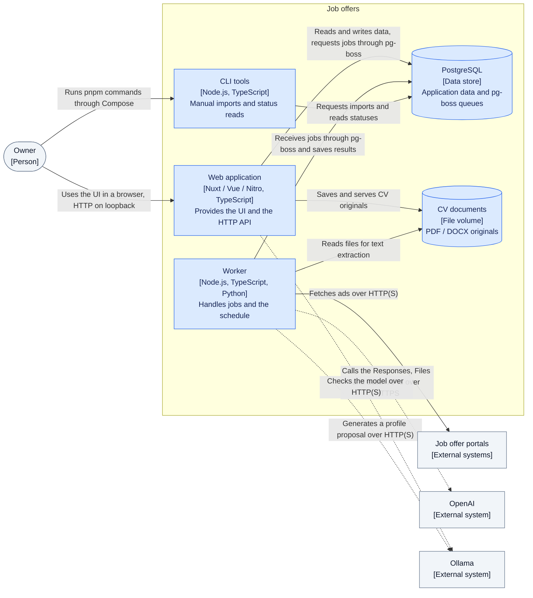
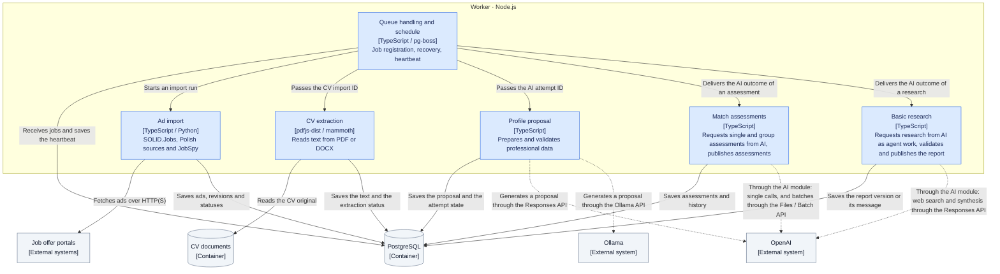
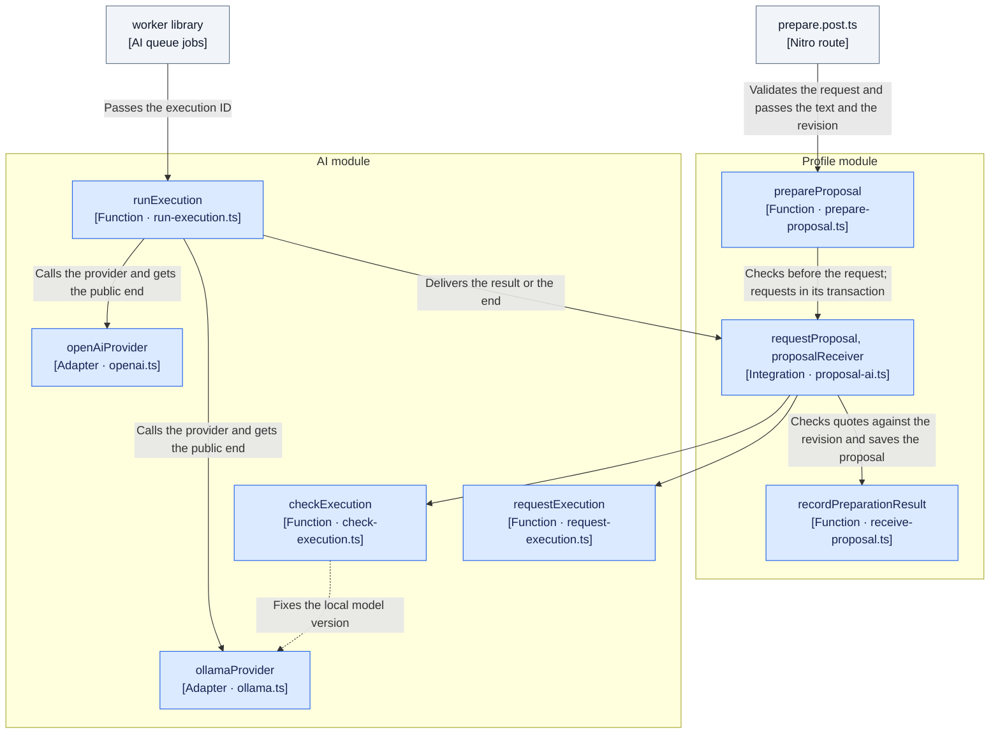

# Job offers architecture in the C4 model

Job offers (Oferty pracy) is a private system with a single owner. It collects source ads, lets the owner browse them and assess their match to the professional profile, and gathers information about companies. The diagrams describe the current code and the local Compose configuration, read on 11 November 2026. Dashed lines mark paths available after additional configuration. Arrows point from the initiator of an interaction. [C4 model](https://c4model.com/diagrams)

- [C1 — system context](#c1-kontekst-systemu)
- [C2 — containers](#c2-kontenery)
- [C3 — web and worker components](#c3-komponenty)
- [C4 — code that prepares a profile proposal](#c4-kod-przygotowanie-propozycji-profilu)
- [State of local AI](#stan-lokalnego-ai)

## C1 — system context

The shared portal boundary covers SOLID.Jobs, Bulldogjob, theprotocol.it, Just Join IT, No Fluff Jobs, the portals handled by JobSpy and the separate Himalayas pilot. The import scope depends on the adapter; every source is requested through one operation to one queue, with at most one unfinished sync per source. Basic research uses web search through OpenAI. The result goes to the company profile with its sources. [JobSpy catalogue](../../modules/sources/domain/jobspy-catalog.ts) · [Polish sources catalogue](../../modules/sources/domain/polish-catalog.ts) · [Himalayas pilot](../../scripts/himalayas-sync.ts) · [Research agent](../../modules/ai/infrastructure/adapters/openai-agent.ts)

## C2 — containers

Nuxt delivers the Vue code that runs in the browser and handles the Nitro routes in the same web application. Compose publishes its port on `127.0.0.1`. PostgreSQL runs in the Compose network. The `pg` and `pg-boss` libraries use PostgreSQL, and pg-boss jobs have the default schema `pgboss`. A separate `migrate` service prepares the application and queue schema at start, before web and the worker start. [Compose](../../compose.yaml) · [Nuxt configuration](../../nuxt.config.ts) · [Database access](../../lib/db.ts) ([rules](moduly-i-zasady-kodu.md#database-access)) · [Queue](../../lib/queue.ts) · [Queue library](../../lib/queues/index.ts) · [Queue initialisation](../../scripts/init-queue.ts)

The `documents` volume is shared by web and the worker under `/data/documents`. The database stores import metadata, extracted text, profile versions and operation results. Python subprocesses serve as adapters started by the worker. [CV import](../../modules/profile/import-cv.ts) · [Worker image](../../Dockerfile) · [Commands](../../package.json)

## C3 — components

### Web application

| Component | Entry points and implementation |
| --- | --- |
| Vue views | [Offer list](../../app/pages/offers.vue), [professional profile](../../app/pages/profile.vue), [company details](../../app/pages/companies/%5Bid%5D.vue) |
| Offers and matching | [Offer list API](../../server/api/offers/index.get.ts), [Offers module](../../modules/offers/index.ts), [assessment data in the list](../../modules/matching/read-offer-assessments.ts), [assessment group request](../../server/api/matching/index.post.ts) |
| Professional profile | [Version confirmation](../../server/api/profile/confirm.post.ts), [CV import](../../server/api/profile/imports/index.post.ts), [proposal request](../../server/api/profile/imports/%5Bid%5D/prepare.post.ts), [profile storage](../../modules/profile/infrastructure/persistence/profile.ts) |
| Companies and research | [Company list API](../../server/api/companies/index.get.ts), [links to an offer](../../server/api/companies/%5Bid%5D/links.post.ts), [research request](../../server/api/companies/%5Bid%5D/research.post.ts), [company commands](../../modules/companies/company-commands.ts), [company reads](../../modules/companies/read-companies.ts) |
| Source handling | [Import request](../../server/api/sources/polish.post.ts), [Polish sources status](../../server/api/sources/polish.get.ts), [JobSpy status](../../server/api/sources/jobspy.get.ts) |
| Shared route handling | [Identifier validation, body limit, error mapping and queue client](../../server/utils/http.ts), used by the routes of every module |

### Worker

| Component | Entry points and implementation |
| --- | --- |
| Periodic work | The [periodic process](../../periodic/index.ts), its own container service beside the worker, repeats a [pass](../../periodic/steps.ts) 60 s after the previous one ended: it funds AI work waiting for budget, sends AI operations waiting for the budget, fails AI assignments past their time limit, polls and cleans up sent provider batches, resumes profile proposals and makes the daily sync request, which requests the SOLID.Jobs import through the [Sources module](../../modules/sources/README.md#requesting-a-sync) once per schedule occurrence. A step's error is logged and the other steps run. |
| Queue and worker libraries | The [worker entry point](../../worker/index.ts) starts the [worker library](../../lib/workers/index.ts): it runs the [module plugins](../../plugins/index.ts), takes jobs of every queue in the database through the [queue library](../../lib/queues/index.ts) and carries each out in a process of a fixed pool, and writes the worker's liveness record. Queue migrations create the queues with their names and key modes written in them; the [queue configuration](../../queues.json) gives the queues' settings, which the migration step applies. The Profile module reads CV text, the Sources module carries out ad syncs and the AI module carries out its executions on them. The [carry-over step](../../scripts/carry-over-jobs.ts) of the migration step requests anew, through the owning module, the work a removed queue of the existing path held. |
| Ad import | The [Sources module plugin](../../plugins/sources.ts) registers the [sync job](../../modules/sources/infrastructure/worker/sync-queue.ts) of queue `source-sync-run` (one job of a source at a time, 3 attempts of 1 hour) with the [shared run executor](../../modules/sources/execute-sync-run.ts), which takes an interrupted sync over, and its failure handler, which ends the sync after the last attempt failed. The [sync request](../../modules/sources/request-sync.ts) returns the source's unfinished sync or creates one with its job; [ad and revision storage](../../modules/sources/infrastructure/persistence/source-ads.ts). |
| CV extraction | The [Profile module plugin](../../plugins/profile.ts) registers the [reading job](../../modules/profile/infrastructure/worker/cv-text-queue.ts) of queue `profile-cv-text` (one reading at a time, 2 attempts of 2 minutes) with [`readCvText`](../../modules/profile/extract-cv-text.ts) and its failure handler, which asks for pasted text after the last attempt failed. |
| Match assessments | The [single request](../../modules/matching/request-assessment.ts) and the [group](../../modules/matching/request-assessment-group.ts) request AI work through [Matching's AI integration](../../modules/matching/infrastructure/adapters/assessment-ai.ts); its [receiver](../../modules/matching/receive-assessment.ts) publishes or rejects each result. Groups run as provider batches in the AI module's [OpenAI Batch adapter](../../modules/ai/infrastructure/adapters/openai-batch.ts), which keeps the batch archive. |
| Basic research | The [research request](../../modules/companies/request-research.ts) requests agent work through [Companies' AI integration](../../modules/companies/infrastructure/adapters/research-ai.ts); its [receiver](../../modules/companies/receive-research.ts) validates and publishes or rejects each report. The search and synthesis run in the AI module's [OpenAI agent adapter](../../modules/ai/infrastructure/adapters/openai-agent.ts). |
| General AI executions | The [AI module plugin](../../plugins/ai.ts) registers [`runExecution`](../../modules/ai/run-execution.ts) and its failure handler for the queues `ai-execution-paid` and `ai-execution-local` (one job of each at a time, 4 attempts of 60 minutes), with the receivers of the clients of the [AI module](../../modules/ai/README.md) contract, today the Profile's proposal preparation on the paid and the local path, Matching's assessments and Companies' research. An execution found running by a later attempt, or left by the last one, ends uncertain with the cause unknown. |

## C4 — code that prepares a profile proposal

The view shows the calls of proposal preparation across the Profile and the AI module. The Profile knows no provider: the AI coordination picks the adapter from the settings fixed with the execution. The earlier text extraction belongs to a separate worker component.

`prepareProposal` removes contact data from the passed text, saves its revision and requests an execution in the same transaction; the AI module reserves the budget for a paid model and sends the job to the queue of paid work or of the local model. The worker runs the execution and delivers the outcome to the Profile's receiver in the transaction that settles the cost. After validation the receiver saves the proposal on the import, and applying the proposal is a separate operation by the owner. [HTTP entry point](../../server/api/profile/imports/%5Bid%5D/prepare.post.ts) · [Preparation request](../../modules/profile/prepare-proposal.ts) · [Integration with AI](../../modules/profile/infrastructure/adapters/proposal-ai.ts) · [Proposal validation](../../modules/profile/receive-proposal.ts) · [AI execution](../../modules/ai/run-execution.ts) · [Applying the proposal](../../server/api/profile/imports/%5Bid%5D/apply.post.ts)

## State of local AI

| Area | State in the current code |
| --- | --- |
| Professional profile | Proposal preparation runs on the local model when the Profile's settings in the AI module name it. The profile settings in the AI module choose the local model; [Compose](../../compose.yaml) passes `AI_ENDPOINTS_JSON` to web and the worker. A configuration example is in the [environment file](../../.env.example). Model availability and connectivity from the containers need separate verification. |
| Local queue | Executions on the local model go to their own queue, carried out one at a time in request order through exclusivity in the queue; a paid execution runs beside them. The [migration](../../migrations/1770000000026_ai_without_local_slot_and_lease.cjs) of task `oferty-pracy-2ba.6` removed the former slot, its waiting line and its lease. An execution found running ends uncertain with the cause unknown; a local process that was ended may still compute when the next one starts. |
| Offer matching | Assessments run through the AI module: a single assessment as one OpenAI call, a group as an OpenAI batch. The local assessment path is described in the [solution design](../specs/lokalne-ai/solution-design.md). |
| Employer research | The connected basic research uses OpenAI Responses and web search. OpenCode and the browser for local research are described in the [solution design](../specs/lokalne-ai/solution-design.md). |

After changing an entry point, a data store or an external integration, update the relevant view together with the links to the code.
