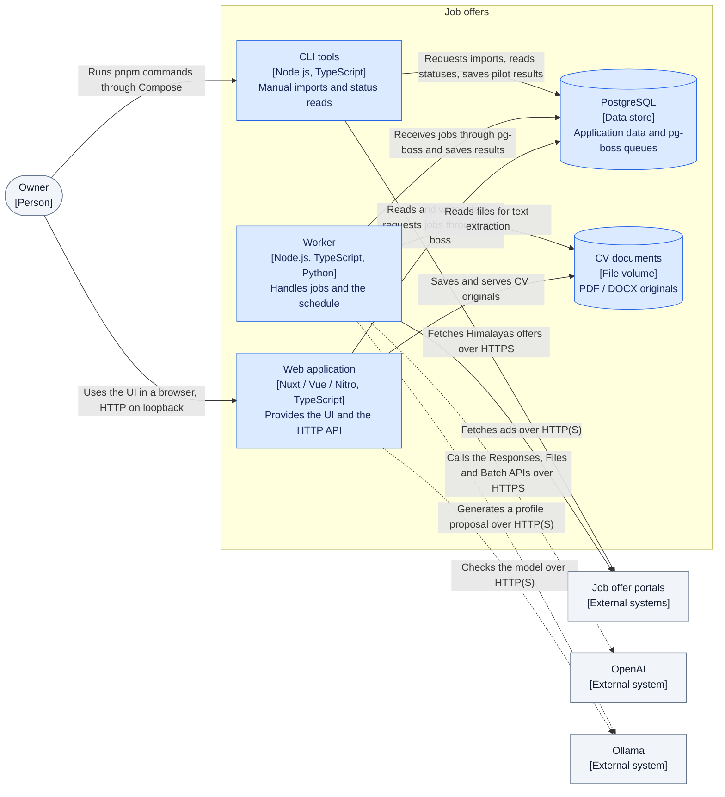
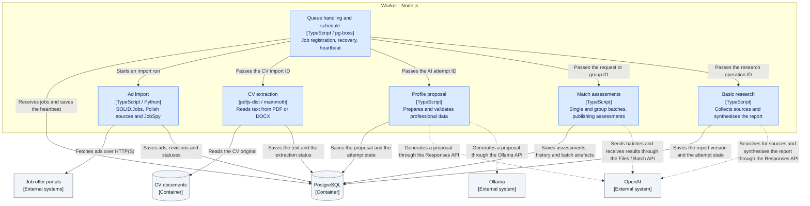
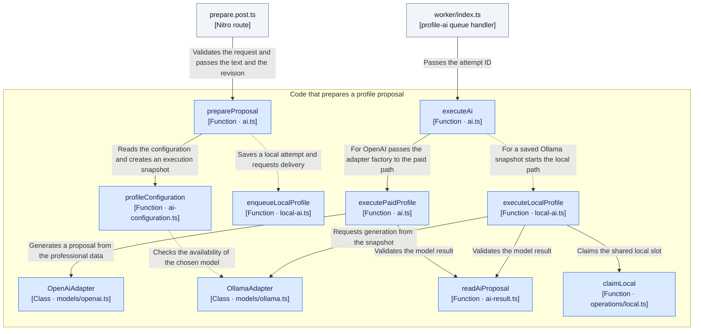

# Job offers architecture in the C4 model

Job offers (Oferty pracy) is a private system with a single owner. It collects source ads, lets the owner browse them and assess their match to the professional profile, and gathers information about companies. The diagrams describe the current code and the local Compose configuration, read on 11 November 2026. Dashed lines mark paths available after additional configuration. Arrows point from the initiator of an interaction. [C4 model](https://c4model.com/diagrams)

- [C1 — system context](#c1-kontekst-systemu)
- [C2 — containers](#c2-kontenery)
- [C3 — web and worker components](#c3-komponenty)
- [C4 — code that prepares a profile proposal](#c4-kod-przygotowanie-propozycji-profilu)
- [State of local AI](#stan-lokalnego-ai)

## C1 — system context

The shared portal boundary covers SOLID.Jobs, Bulldogjob, theprotocol.it, Just Join IT, No Fluff Jobs, the portals handled by JobSpy and the separate Himalayas pilot. The import scope and how it is started depend on the adapter. Basic research uses web search through OpenAI. The result goes to the company profile with its sources. [JobSpy catalogue](../../lib/sources/jobspy-catalog.ts) · [Polish sources catalogue](../../lib/sources/polish-catalog.ts) · [Himalayas pilot](../../scripts/himalayas-sync.ts) · [Research provider](../../lib/companies/research-provider.ts)

## C2 — containers

Nuxt delivers the Vue code that runs in the browser and handles the Nitro routes in the same web application. Compose publishes its port on `127.0.0.1`. PostgreSQL runs in the Compose network. The `pg` and `pg-boss` libraries use PostgreSQL, and pg-boss jobs have the default schema `pgboss`. A separate `migrate` service prepares the application and queue schema at start, before web and the worker start. [Compose](../../compose.yaml) · [Nuxt configuration](../../nuxt.config.ts) · [Database access](../../lib/db.ts) ([rules](moduly-i-zasady-kodu.md#database-access)) · [Queue](../../lib/queue.ts) · [Queue initialisation](../../scripts/init-queue.ts)

The `documents` volume is shared by web and the worker under `/data/documents`. The database stores import metadata, extracted text, profile versions and operation results. Python subprocesses serve as adapters started by the worker. The Himalayas script runs the import directly from the CLI. [CV import](../../lib/profile/imports.ts) · [Worker image](../../Dockerfile) · [Commands](../../package.json)

## C3 — components

### Web application

| Component | Entry points and implementation |
| --- | --- |
| Vue views | [Offer list](../../app/pages/offers.vue), [professional profile](../../app/pages/profile.vue), [company details](../../app/pages/companies/%5Bid%5D.vue) |
| Offers and matching | [Offer list API](../../server/api/offers/index.get.ts), [Offers module](../../modules/offers/index.ts), [assessment data in the list](../../lib/matching/list.ts), [assessment group request](../../server/api/matching/index.post.ts) |
| Professional profile | [Version confirmation](../../server/api/profile/confirm.post.ts), [CV import](../../server/api/profile/imports/index.post.ts), [proposal request](../../server/api/profile/imports/%5Bid%5D/prepare.post.ts), [profile storage](../../lib/profile/store.ts) |
| Companies and research | [Company list API](../../server/api/companies/index.get.ts), [links to an offer](../../server/api/companies/%5Bid%5D/links.post.ts), [research request](../../server/api/companies/%5Bid%5D/research.post.ts), [company profile storage](../../lib/companies/store.ts) |
| Source handling | [Import request](../../server/api/sources/polish.post.ts), [Polish sources status](../../server/api/sources/polish.get.ts), [JobSpy status](../../server/api/sources/jobspy.get.ts) |

### Worker

| Component | Entry points and implementation |
| --- | --- |
| Queue handling and schedule | [Worker entry point](../../worker/index.ts). At start and every minute it checks for overdue work. The schedule requests the SOLID.Jobs import. |
| Ad import | [SOLID.Jobs](../../lib/sources/sync.ts), [Polish sources](../../lib/sources/polish-sync.ts), [JobSpy](../../lib/sources/jobspy-sync.ts), [ad and revision storage](../../lib/sources/store.ts). |
| CV extraction | [`extractImport`](../../lib/profile/imports.ts) handles `profile-parse`. |
| Profile proposal | [`executeAi`](../../lib/profile/ai.ts) handles `profile-ai`. The paid path uses the [AI budget](../../modules/ai/infrastructure/persistence/budget.ts). |
| Match assessments | The [single request](../../lib/matching/store.ts) and the [group](../../lib/matching/groups.ts) use the [Batch client](../../lib/matching/batch.ts) and the [batch archive](../../lib/matching/archive.ts). |
| Basic research | [`executeCompanyResearch`](../../lib/companies/research.ts) runs `company-research` and uses the [OpenAI provider](../../lib/companies/research-provider.ts). |
| General AI executions | [`runExecution`](../../modules/ai/run-execution.ts) handles `ai-execution` for clients of the [AI module](../../modules/ai/README.md) contract; no client uses it yet. |

## C4 — code that prepares a profile proposal

The view shows the calls inside the profile proposal component and its entry points. The choice of executor is based on the configuration saved with the attempt. The earlier text extraction belongs to a separate worker component.

`prepareProposal` removes contact data from the passed text and saves its revision. For OpenAI it creates an attempt with a budget reservation and requests the work once funds are available. For Ollama it saves a local operation and requests delivery through the same pg-boss queue. The worker reads the saved configuration. After validation it saves the proposal on the import, and applying the proposal is a separate operation by the owner. [HTTP entry point](../../server/api/profile/imports/%5Bid%5D/prepare.post.ts) · [Orchestration and settlement](../../lib/profile/ai.ts) · [Profile configuration](../../lib/profile/ai-configuration.ts) · [Local execution](../../lib/profile/local-ai.ts) · [Proposal validation](../../lib/profile/ai-result.ts) · [Applying the proposal](../../server/api/profile/imports/%5Bid%5D/apply.post.ts)

## State of local AI

| Area | State in the current code |
| --- | --- |
| Professional profile | The preparation route and the `profile-ai` handler lead to the local executor when the snapshot is Ollama. [Compose](../../compose.yaml) passes `AI_PROFILE_EXECUTION_JSON` and `AI_ENDPOINTS_JSON` to web and the worker. A configuration example is in the [environment file](../../.env.example). Model availability and connectivity from the containers need separate verification. |
| Local queue and recovery | The [local AI migration](../../migrations/1770000000013_local_ai.cjs) adds operation, queue and slot data. The [local profile module](../../lib/profile/local-ai.ts) wakes pending jobs after the end of a generation is confirmed. The [worker](../../worker/index.ts) calls `recoverLocalProfiles` at start and in the schedule cycle. |
| Offer matching | The connected worker uses OpenAI Batch. The local assessment path is described in the [solution design](../specs/lokalne-ai/solution-design.md). |
| Employer research | The connected basic research uses OpenAI Responses and web search. OpenCode and the browser for local research are described in the [solution design](../specs/lokalne-ai/solution-design.md). |

After changing an entry point, a data store or an external integration, update the relevant view together with the links to the code.
