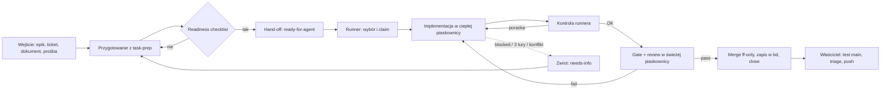
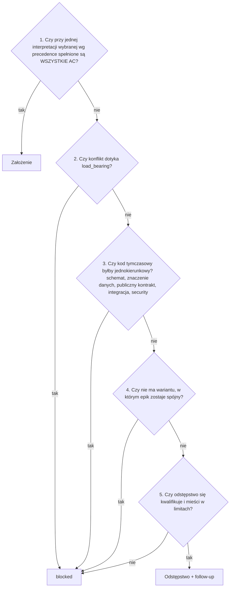
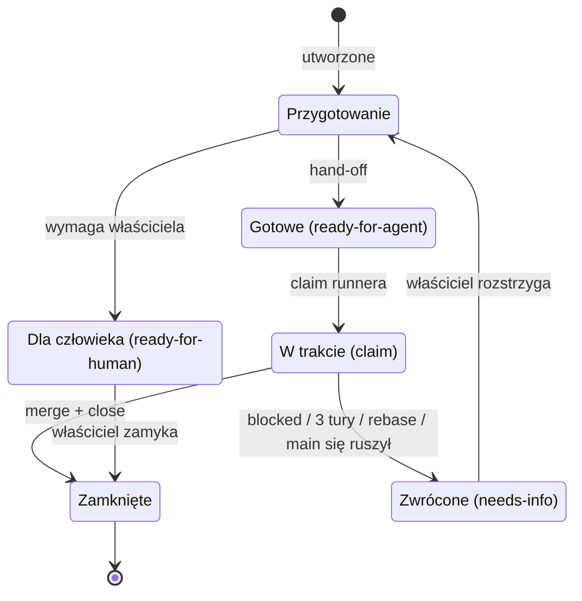
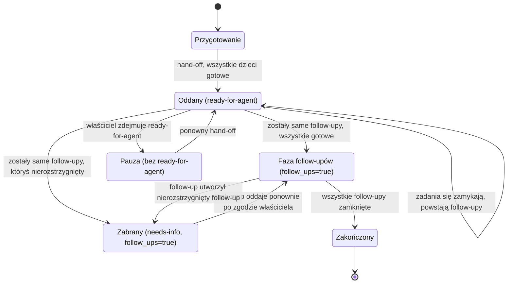

# Proces implementacji zadań przez agentów

## Streszczenie

Ten dokument opisuje, jak praca przechodzi od pomysłu do kodu na `main` w projekcie oferty-pracy, gdy kod piszą agenci bez nadzoru. Proces ma dwie fazy oddzielone **hand-offem**:

- **przygotowanie**, które właściciel prowadzi razem z agentem `task-prep`;
- **wykonanie**, które runner (`.sandcastle/runner.ts`) prowadzi samodzielnie: zadanie po zadaniu, w izolowanych kontenerach, z bramką testów, niezależnym review i automatycznym merge'em.

Główna myśl: **decyzje zapadają przed wykonaniem, a automat może tylko zatrzymywać pracę, nigdy jej poszerzać.** Gdy agent trafi na sprzeczność w specyfikacji, nie zatrzymuje się na każdej. Rozstrzyga ją według stałej kolejności pierwszeństwa i zostawia ślad do decyzji właściciela. Zatrzymuje się tylko wtedy, gdy od odpowiedzi zależy reszta epika.

Dokument służy do odświeżenia wiedzy o procesie i do opowiadania o nim. Umowa wiążąca agentów i runner jest w [docs/agents/implementation-workflow.md](agents/implementation-workflow.md). Gdy oba dokumenty się różnią, rozstrzyga tamten plik i kod runnera.

---

## 1. Zasady, na których opiera się proces

| Zasada | Co oznacza w praktyce |
|---|---|
| **Decyzje przed wykonaniem** | Wszystko, co wymaga osądu właściciela, trafia do dokumentów przed hand-offem. Wykonanie tylko je realizuje. |
| **Automat tylko zawęża** | Runner może zwrócić zadanie, zabrać epik albo zablokować pracę. Oddać epik, zaakceptować założenie czy rozstrzygnąć follow-up może tylko człowiek. Błąd automatu kończy się więc zatrzymaniem, a nie złym kodem. |
| **Każdy stan ma jednego właściciela** | Agent zapisuje tylko swoją gałąź i plik wyniku. bd, `main` i merge należą wyłącznie do runnera. Agent nie może sam siebie zaliczyć. |
| **Blokada proporcjonalna** | Sprzeczność w specyfikacji zatrzymuje tylko pracę zależną od odpowiedzi. Lokalne sprawy idą dalej z jawnym śladem. |
| **Skrypt liczy, agent ocenia** | Wszystko, co da się sprawdzić deterministycznie, sprawdza skrypt. Reviewer dostaje tylko to, czego policzyć się nie da. |
| **Spójność epika** | Na `main` nie trafia fragment epika, którego reszta może jeszcze zmienić decyzje. |

---

## 2. Uczestnicy i odpowiedzialności

| Uczestnik | Odpowiada za | Nie robi |
|---|---|---|
| **Właściciel** (Ty) | decyzje produktowe, wskazanie wymagań nośnych (`load_bearing`), rozstrzyganie follow-upów i założeń, testowanie `main`, push | nie pisze kodu w trakcie wykonania |
| **task-prep** (skill) | zamiana wejścia w PRD, wymagania, solution design i zadania bd; hand-off i ponowny hand-off epika po zgodzie właściciela | nie implementuje |
| **Runner** (skrypt) | wybór i claim zadania, piaskownice, sprawdzenia, merge, zapisy w bd, zwroty do przygotowania | nie podejmuje decyzji merytorycznych, nie robi pushu, nie oddaje epika |
| **Agent implementujący** (skill `implement-task`) | kod, testy, gate, commity, klasyfikacja konfliktów, plik `.agent-result.json` | nie dotyka bd, `main` ani merge'a |
| **Reviewer** (osobny agent) | ocena diffu względem dokumentów, AC, założeń i odstępstw; plik `.agent-review.json` | nie commituje (runner to sprawdza) |

---

## 3. Artefakty procesu

### Dokumenty specyfikacji

| Dokument | Poziom | Zawiera | Nie zawiera |
|---|---|---|---|
| **PRD** | epik | problem, cele, zakres, etapy | rozwiązań technicznych i szczegółowych wymagań |
| **Requirements** | zadanie | zachowanie i kryteria akceptacji (AC) ze stabilnymi ID, sposób sprawdzenia każdego AC | bibliotek, nazw plików i funkcji |
| **Solution design** | zadanie | decyzje techniczne, kontrakty, semantyka danych | konkretnych ścieżek i nazw funkcji (wybiera je implementujący) |

Dokumenty epika leżą w `docs/specs/<epik>-<slug>/`, np. `docs/specs/0mq-architektura-modulow/`. Specyfikacje są po polsku.

### Zadanie w bd

Jedno zadanie to jeden pionowy, demonstrowalny przyrost, który da się przejrzeć za jednym podejściem. Zadanie **wskazuje** dokumenty, ale nie kopiuje ich treści:

- `metadata.prd`, `metadata.requirements`, `metadata.sd`: ścieżki, opcjonalnie z `#sekcją`;
- `acceptance_criteria`: jedna linia na kryterium, `AC-ID: obserwowalny wynik`;
- zależności jako krawędzie bd;
- **small lane** (`metadata.lane=small`): zmiana bez decyzji behawioralnej i bez zmiany kontraktu, wystarczą PRD i własne AC.

Zadanie dzielimy, gdy ma zachowania akceptowalne osobno, więcej niż ok. 15 AC albo zmienia publiczny kontrakt więcej niż jednego modułu.

### Etykiety

| Etykieta | Znaczenie |
|---|---|
| `ready-for-agent` | przygotowane; runner może wziąć zadanie (na epiku: epik oddany) |
| `ready-for-human` | w trakcie implementacji potrzebny jest właściciel; runner pomija, ale epik nie stoi |
| `needs-info` | brakuje decyzji albo runner zwrócił zadanie; runner pomija, a cały epik czeka |
| `needs-triage` | nowe znalezisko do oceny (nowy zakres, zadanie z założeniami) |

### Metadane, które czyta i zapisuje runner

| Gdzie | Klucz | Kto ustawia | Znaczenie |
|---|---|---|---|
| epik | `load_bearing` | przygotowanie | ID wymagań i AC, na których stoi epik; konflikt na nich nie może zostać odroczony |
| epik | `follow_ups` | runner | `true`, gdy zostały otwarte już tylko follow-upy |
| zadanie | `type=follow-up`, `marker`, `origin` | runner | follow-up z odstępstwa: jego znacznik w kodzie i zadanie źródłowe |
| zadanie | `type=assumptions`, `epic` | runner | zadanie triage zbierające założenia agentów dla epika |

### Ślady wykonania

- **Gałąź** `<epik>-<zadanie>-<slug>`, np. `0mq-1-ujednolicic-interfejs-konektorow-zrodel-ofert`. Po porażce zostaje do wglądu.
- **`.agent-result.json`**: status, podsumowanie, dowody dla AC, założenia, odstępstwa i nowy zakres.
- **`.agent-review.json`**: werdykt i uwagi reviewera.
- **Znacznik w kodzie** `FOLLOW-UP(<id zadania>/DEV-<n>)` w każdym miejscu kodu tymczasowego.
- **Logi** w `.sandcastle/logs/`: osobny log implementacji, log bramki z review i `runner.log`.

---

## 4. Przebieg procesu

### Etap 1. Przygotowanie

- **Wejście:** cokolwiek: epik w bd, ticket, dokument, prośba na czacie.
- **Czynności:** `task-prep` z właścicielem pisze PRD, wymagania i solution design, tnie pracę na zadania, nadaje AC ze stabilnymi ID i podpina zależności.
- **Kryterium wyjścia (readiness checklist):**
  - każdy podlinkowany dokument istnieje na `main`, a kotwice się rozwiązują;
  - każde AC jest obserwowalne i mówi, jak je sprawdzić;
  - solution design opisuje kontrakty na tyle dokładnie, że nie trzeba zgadywać;
  - żadne otwarte pytanie nie blokuje; nieblokujące założenia są zapisane w dokumentach;
  - zależności są podpięte w bd.

### Etap 2. Hand-off

- **Zadanie poza epikiem:** właściciel nadaje mu `ready-for-agent`.
- **Epik oddaje się w całości.** `ready-for-agent` na epiku pojawia się dopiero wtedy, gdy każde otwarte dziecko ma `ready-for-agent` albo `ready-for-human`. Do tego czasu runner nie weźmie żadnego zadania z epika, nawet gotowego.
- **Przy hand-offie epika** właściciel wskazuje `load_bearing`: decyzje, na których buduje reszta epika (wspólny model statusów, kontrakty między modułami, limity).

### Etap 3. Wykonanie (runner, bez nadzoru)

Runner uruchamia się z głównego checkoutu, na czystym `main`:

- `node .sandcastle/runner.ts --dry-run`: pokazuje kandydatów i werdykt gotowości, niczego nie zapisuje;
- `node .sandcastle/runner.ts --once`: przetwarza najwyżej jedno zadanie;
- bez `--once` sprawdza kolejkę co `--interval` minut (domyślnie 5);
- `--task <id>`, `--model` (domyślnie `claude-opus-5-5`), `--effort` (domyślnie `medium`) i `--rebuild-image` nadpisują domyślne ustawienia.

#### 3.1. Przed każdym przebiegiem: uzgodnienie epików

Runner aktualizuje stan każdego oddanego epika na podstawie jego dzieci (szczegóły w rozdziale 7).

#### 3.2. Wybór zadania

1. Kandydaci to `bd ready` z etykietą `ready-for-agent`, bez `ready-for-human` i `needs-info`, z pominięciem epików.
2. **Kontrola epika:** najbliższy epik nad zadaniem ma `ready-for-agent`, a żadne jego otwarte dziecko nie jest nieoznaczone ani w `needs-info`. Follow-upy są z tej kontroli wyłączone.
3. **Deterministyczna kontrola gotowości:** wymagane linki w metadanych istnieją i ich pliki są na `main`, a `acceptance_criteria` nie jest puste. Jeśli nie, zadanie wraca jako `needs-info`.
4. Claim zadania w bd. Gdy na `main` zmienił się `pnpm-lock.yaml` albo `.sandcastle/Dockerfile`, runner najpierw przebudowuje obraz piaskownicy.

#### 3.3. Implementacja w ciepłej piaskownicy

- Runner zapamiętuje SHA `main` i tworzy gałąź zadania z `main` w kontenerze Docker. Kontener ma toolchain, PostgreSQL z migracjami i Claude Code. Widzi tylko swój worktree: nie widzi Twojej bazy, Dockera ani plików spoza repo.
- Agent dostaje zadanie, linki do dokumentów i **brief epika**: listę `load_bearing` oraz otwarte follow-upy, na których kodzie nie wolno budować.
- Agent pracuje według skilli `implement-task`, `tdd` i `write-documents`. Na koniec sam uruchamia `scripts/gate.sh`, commituje i zapisuje `.agent-result.json`.

#### 3.4. Kontrola runnera w tej samej piaskownicy

Runner sprawdza po kolei:

1. `main` się nie przesunął (piaskownica ma zapis do współdzielonych danych gita); jeśli się przesunął, runner go przywraca i przerywa;
2. plik wyniku istnieje; status `blocked` kończy pracę od razu;
3. worktree jest czysty, a gałąź ma commity;
4. gałąź rebase'uje się czysto na `main`;
5. kształt wyniku i odstępstwa przechodzą kontrole deterministyczne (rozdział 8);
6. gate przechodzi.

#### 3.5. Weryfikacja w świeżej piaskownicy

- Runner robi kopię gałęzi i nową piaskownicę. Liczy się tylko to, co zostało zacommitowane.
- Gate uruchamia się jeszcze raz. To łapie sytuację „u mnie działa”, czyli niezacommitowane pliki albo stan bazy.
- Reviewer czyta dokumenty w całości, diff, AC, założenia i odstępstwa, po czym zapisuje werdykt:
  - `pass`: wszystko spełnione, brak odstępstw;
  - `pass-with-deferral`: wszystko spełnione poza odroczonymi AC, każde odstępstwo zaakceptowane;
  - `fail`: lista uwag.
- **Werdykt musi dokładnie pasować do wyniku:** z odstępstwami wymagany jest `pass-with-deferral`, bez odstępstw `pass`. Każdy inny werdykt to porażka. Commit reviewera na gałęzi też jest porażką.

#### 3.6. Pętla poprawek

- Każda porażka z kroków 3.4 i 3.5 wraca jako raport **do tej samej sesji agenta** (Sandcastle resume), więc agent zachowuje kontekst.
- Limit to **3 tury poprawek**, wspólny dla wszystkich rodzajów porażek: padnięty gate, brak wyniku, fail review.
- Bez tur poprawek, od razu do zwrotu, kończą pracę: `blocked`, konflikt rebase'u, przesunięty `main` i commit reviewera.

#### 3.7. Zakończenie

**Sukces:**
1. `merge --ff-only` gałęzi do `main`, o ile główny checkout jest na `main` i nie ma niezacommitowanych zmian w śledzonych plikach (eksport `.beads` się nie liczy);
2. komentarz w zadaniu: podsumowanie, dowody dla AC, założenia i znane odstępstwa;
3. dla każdego odstępstwa follow-up jako dziecko epika (`needs-info`, `type=follow-up`, `marker`, `origin`, `discovered-from`), podpięty jako bloker zadań, które wspominają jego ID;
4. założenia dopisane do zadania triage epika (rozdział 5.6);
5. nowy zakres jako zadania `needs-triage` z `discovered-from`;
6. zamknięcie zadania i usunięcie gałęzi.

**Porażka (zwrot do przygotowania):** zadanie traci `ready-for-agent`, dostaje `needs-info` i komentarz z powodem. Zostaje odclaimowane, a gałąź zostaje do wglądu. **Cały epik czeka**, aż przygotowanie to rozwiąże.

Runner nigdy nie robi pushu ani synchronizacji Dolt.

### Etap 4. Po merge'u (właściciel)

- Testujesz `main`. Otwarte follow-upy epika to lista **znanych i zamierzonych** różnic, a nie bugi.
- Defekt znaleziony na `main` to nowy bug z `discovered-from` do zadania źródłowego, który przechodzi przez przygotowanie.
- Przed pushem przeglądasz otwarte follow-upy epika i jego zadanie z założeniami, zaczynając od założeń oznaczonych jako load-bearing.

---

## 5. Ścieżka wyjątków: konflikty w specyfikacji

Konflikt w specyfikacji to luka albo sprzeczność w dokumentach, którą agent odkrywa w trakcie pracy. Proces nie zatrzymuje się na każdym takim konflikcie, ale też nie pozwala agentowi rozstrzygnąć go po cichu.

### 5.1. Klasyfikacja odkryć

| Odkrycie | Co robi agent |
|---|---|
| defekt kodu w ramach zadania | naprawia go w zadaniu |
| konflikt w specyfikacji | klasyfikuje według drzewa (5.3): założenie, odstępstwo albo `blocked` |
| nowy zakres poza zadaniem | zapisuje w `new_scope`; runner zakłada zadanie `needs-triage` |

### 5.2. Kolejność pierwszeństwa (precedence)

Gdy wymagania ciągną w różne strony, tymczasowy wybór idzie zawsze w tej kolejności:

1. **niezmienniki i twarde limity:** limity czasu i rozmiaru, bezpieczeństwo danych, security;
2. **istniejące zachowanie:** bez regresji tego, co aplikacja robi dziś;
3. **nowe zachowanie** wprowadzane przez zadanie.

Sformułowania „najwyżej N” i „do X s” to górne granice, które mają obowiązywać jednocześnie, a nie obowiązek osiągnięcia granicy.

### 5.3. Drzewo decyzyjne

Agent przechodzi pytania po kolei i zatrzymuje się na pierwszym, które rozstrzyga:

**Ważny niuans kolejności:** pytanie 1 pada przed pytaniem 2. Założenie może więc dotyczyć wymagania z `load_bearing`, jeśli spełnia wszystkie AC. Takie założenie dostaje jednak ostrzejsze review i flagę w zadaniu triage (5.6), bo reszta epika buduje na tej interpretacji.

### 5.4. Trzy wyniki

| | Założenie | Odstępstwo (deviation) | Blocked |
|---|---|---|---|
| **AC** | wszystkie spełnione | część świadomie odroczona | — |
| **Warunki** | zgodne z precedence, lokalnie odwracalne, **pokryte testem przypadku, na którym się opiera** | kwalifikacja i limity (5.5) | — |
| **Kod** | normalny | tymczasowy, ze znacznikiem `FOLLOW-UP(...)` | brak merge'a |
| **Werdykt review** | `pass` | `pass-with-deferral` | — |
| **Ślad w bd** | wpis w zadaniu triage z założeniami | follow-up jako dziecko epika, blokujący zadania zależne | zadanie w `needs-info`, epik stoi |
| **Kto i kiedy decyduje** | właściciel, asynchronicznie, w solution design | właściciel, przez przygotowanie follow-upu | właściciel, zanim praca pójdzie dalej |

**Przykład założenia:** jedno wymaganie każe sortować listę po dacie, drugie stawia przypięte elementy na górze. Przypięte najpierw, a każda grupa po dacie, spełnia oba.

**Przykład odstępstwa:** wspólna reguła mówi, że każdy eksport zawiera rekordy archiwalne, a AC zadania zabrania zmiany dzisiejszego eksportu dla jednego klienta. Precedence każe zachować dzisiejszy eksport, więc wspólna reguła dla tego klienta trafia do follow-upu.

### 5.5. Kiedy odstępstwo się kwalifikuje

**Rodzaj** to jedno z:
- sprzeczność między najwyżej dwoma wymaganiami;
- jedno niedookreślone wymaganie bez wpływu na inne;
- zależność od niezrobionego zadania, z tymczasową łatką albo wymaganiem niespełnionym do tego czasu.

**Wszystkie warunki muszą być spełnione:**
- sprawa jest lokalna dla jednego modułu i dotyczy jednego wymagania (w wyniku 1–2 ID);
- kod tymczasowy jest odizolowany, więc follow-up podmienia go bez przeróbek gdzie indziej;
- zmiana dotyka najwyżej 3 plików, nie licząc jednolinijkowych zmian;
- co najmniej jedno AC jest spełnione, a odroczone nie są głównym wynikiem zadania;
- najwyżej 2 inne otwarte zadania epika wspominają te ID (stają się zablokowane przez follow-up).

**Limity:** najwyżej 2 odstępstwa na zadanie i najwyżej 3 otwarte follow-upy na epik. Po przekroczeniu zadanie kończy się jako `blocked`.

### 5.6. Co zostaje po konflikcie

- **Kod tymczasowy:** znacznik `FOLLOW-UP(<id>/DEV-<n>)` w komentarzu w każdym miejscu, które follow-up zmieni. Test tymczasowego zachowania ma znacznik w nazwie, a `it.todo` opisuje zachowanie docelowe.
- **Opis follow-upu** (skill `write-documents`, dla osoby bez kontekstu):
  - kontekst biznesowy i zacytowany konflikt z ID;
  - obecne zachowanie z `plik:linia`;
  - decyzja tymczasowa i dlaczego jest bezpieczna;
  - dlaczego follow-up, a nie blokada;
  - warianty docelowe z kompromisami, decyzja do podjęcia, znacznik i sposób weryfikacji.
- **Założenie** w wyniku: wymagania, luka, decyzja, zastosowana reguła, skutek odwrócenia decyzji i test.
- **Zadanie triage z założeniami:** jedno na epik, `type=assumptions`, `needs-triage`. Leży poza epikiem, więc niczego nie blokuje. Założenia na `load_bearing` są w nim pogrubione z dopiskiem „confirm it first”.
- **Kolejne zadania epika** dostają otwarte follow-upy w prompcie i nie budują na kodzie tymczasowym. Gdy muszą go dotknąć, zostawiają znacznik i zgłaszają miejsce przez `new_scope`.

### 5.7. Czego follow-up nie obejmuje

Zmiana wymagania, która zmieniłaby wynik epika, nie jest follow-upem. Epik kończy się w spójnym wariancie, a zmianę przygotowuje się jako nowy epik.

---

## 6. Cykl życia zadania

Follow-up przechodzi ten sam cykl: rodzi się w `needs-info`, przechodzi przygotowanie (decyzja, aktualizacja dokumentów, AC obejmujące usunięcie znaczników) i dostaje `ready-for-agent`.

---

## 7. Cykl życia epika

Przed każdym przebiegiem runner uzgadnia stan każdego oddanego epika:

- `follow_ups=true` ustawia, gdy wszystkie dzieci poza follow-upami są zamknięte albo odroczone, a jakiś follow-up jest otwarty; w przeciwnym razie usuwa ten klucz;
- gdy ta faza się zaczyna, a któryś follow-up nie ma jeszcze `ready-for-agent`, runner **zabiera epik**: zdejmuje `ready-for-agent` i nadaje `needs-info`.

Kluczowa asymetria: **runner tylko zabiera epik, nigdy go nie oddaje.** Ponowne oddanie zawsze przechodzi przez właściciela i `task-prep`. Zdjęcie `ready-for-agent` pauzuje epik w dowolnej fazie.

Inne zachowania epika:
- `needs-info` na którymkolwiek dziecku zatrzymuje pozostałe zadania epika;
- `ready-for-human` nie zatrzymuje epika, ale zadania od niego zależne czekają w bd;
- otwarty follow-up trzyma epik otwartym, ale nie pauzuje jego zwykłych zadań;
- epik z otwartymi follow-upami nie jest skończony.

---

## 8. Punkty kontrolne: co sprawdza skrypt, a co reviewer

| Skrypt (deterministycznie) | Reviewer (osąd) |
|---|---|
| linki w metadanych i ich pliki na `main`, niepuste AC | czy każde wymaganie jest zrealizowane, a kontrakty zgodne z solution design |
| `main` nieruszony, wynik obecny, czysty worktree, są commity, czysty rebase | czy nie ma zachowania, o które nikt nie prosił |
| kształt wyniku | czy założenie naprawdę spełnia wszystkie AC i ma test swojego przypadku |
| limity odstępstw i follow-upów, 1–2 ID na odstępstwo | czy założenie na `load_bearing` nie ustala znaczenia wymagania dla reszty epika |
| odroczone AC należą do zadania, nie wszystkie, żadne z `load_bearing` | czy odstępstwo się kwalifikuje i czy nie powinno być wcześniejszym krokiem drzewa |
| każde AC ma dowód albo odroczenie | czy wybór tymczasowy idzie zgodnie z precedence |
| znacznik dodany w liniach `+` diffu zadania | czy opis follow-upu jest zrozumiały bez kontekstu |
| ≤2 inne otwarte zadania wspominają ID odstępstwa (także wewnątrz zakresów typu `F2-01–F2-05`) | czy ID odstępstwa obejmują wszystkie dotknięte reguły epika |
| gate w obu piaskownicach, dokładny werdykt | czy diff nie buduje na kodzie tymczasowym innego follow-upu |

Nieudana kontrola skryptu wraca do agenta jako feedback, tak samo jak fail review.

---

## 9. Czynności właściciela

**Przy hand-offie epika**
1. Upewnij się, że każde otwarte dziecko ma `ready-for-agent` albo `ready-for-human`.
2. Wskaż `load_bearing`. Pytanie pomocnicze: na interpretacji których wymagań oprze się więcej niż jedno zadanie?
3. Sprawdź `node .sandcastle/runner.ts --dry-run`.

**Po przebiegu runnera**
1. Zadania zamknięte: komentarz z dowodami, założeniami i odstępstwami.
2. Zadania w `needs-info`: komentarz z powodem i zachowana gałąź. Rozstrzygnij w przygotowaniu, potem przywróć `ready-for-agent`.
3. Nowe zadania `needs-triage`: oceń nowy zakres.

**Triage założeń**
1. Zacznij od założeń oznaczonych jako load-bearing.
2. Każde założenie potwierdź w solution design albo zamień w zmianę (nowe zadanie).

**Follow-upy**
1. Podejmij decyzję opisaną w follow-upie i zaktualizuj dokumenty.
2. Przygotuj follow-up przez `task-prep`: AC obejmują usunięcie znaczników.
3. Gdy runner zabrał epik, a wszystkie follow-upy są gotowe, oddaj epik ponownie przez `task-prep`.

**Przed pushem `main`**
1. Przetestuj `main`.
2. Przejrzyj otwarte follow-upy (znane różnice) i zadanie z założeniami.

---

## 10. Przykład: przebieg zadania 0mq.1

Zadanie `oferty-pracy-0mq.1` (wspólny interfejs konektorów źródeł ofert) było pierwszym testem procesu z obsługą konfliktów:

1. **Implementacja.** Agent napisał 15 konektorów i zgłosił `done`: 0 odstępstw, 4 założenia (wszystkie „precedence 2: istniejące zachowanie”) i 2 pozycje nowego zakresu.
2. **Spodziewana blokada nie nastąpiła i to było poprawne.** Konflikt statusu JobSpy z regułą A5-R03 dotyczył wymagań load-bearing. Zadanie 0mq.1 nie musiało jednak zmieniać statusu, a A5-R03 należy do zadania 0mq.5. Zachowanie dzisiejszego zachowania spełniało wszystkie AC, więc decydowało pytanie 1 drzewa: założenie plus zgłoszenie w nowym zakresie.
3. **Pierwsze review: `fail`.** Żadne założenie nie miało testu swojego przypadku. Reviewer znalazł też realną wadę: `Retry-After` w Himalayas mógł wydłużyć przebieg do ok. 136 s przy limicie 120 s, czego stary kod nie dopuszczał.
4. **Tura poprawek:** agent ograniczył ponowienia pozostałym czasem przebiegu i dopisał testy przypadków brzegowych.
5. **Drugie review: `pass`.** Runner zmergował zadanie, zamknął je i utworzył:
   - zadanie triage z założeniami (`oferty-pracy-abe`);
   - dwa zadania `needs-triage`: ładowanie `modules/*/index.ts` przez Nuxt (`oferty-pracy-8mc`) oraz status pustego przebiegu JobSpy wobec A5-R03 (`oferty-pracy-mqc`).

Wnioski z przebiegu zmieniły proces:
- wymóg testu dla założenia trafił do dokumentu i skilla (wcześniej był tylko w prompcie reviewera);
- założenia na `load_bearing` dostały flagę i ostrzejsze review;
- wyszukiwanie zadań zależnych rozumie zakresy ID.

---

## 11. Mocne strony

1. **Proporcjonalna blokada.** Lokalny konflikt nie zatrzymuje nocnej pracy, a konflikt w fundamentach epika zatrzymuje.
2. **Każda decyzja agenta zostawia ślad do przejrzenia.** Założenia trafiają do triage, odstępstwa do follow-upów ze znacznikami, nowy zakres do `needs-triage`. Nic nie znika w kodzie bez śladu.
3. **Brak samooceny.** Werdykt wydaje inny agent w świeżym kontekście, gate działa w czystym środowisku, a merge i bd należą do skryptu.
4. **Spójność `main`.** Hand-off całego epika, `load_bearing` i zakaz budowania na kodzie tymczasowym.
5. **Brak cichych porażek.** Każda porażka kończy się `needs-info` z powodem i zachowaną gałęzią.
6. **Testowalne reguły.** Logika odstępstw i etykiet epika to czyste funkcje w `.sandcastle/followups.ts` z testami (`npm test` w `.sandcastle/`).

---

## 12. Znane luki i ryzyka

| Luka | Skutek | Możliwe zabezpieczenie |
|---|---|---|
| **Reviewer nie ma pamięci między turami.** Każda tura to nowy reviewer. | Może zgłaszać nowe uwagi zamiast sprawdzić poprawki do starych; przy limicie 3 tur grozi zwrotem mimo postępu. | Przekazywać reviewerowi poprzednie uwagi i kazać najpierw je zweryfikować. |
| **Ten sam model ocenia ten sam model.** | Ślepe plamy implementującego i reviewera są skorelowane. | Inny model albo inny effort dla review. |
| **Zapis po merge'u nie jest atomowy.** Follow-upy powstają po merge'u, a błędy części zapisów są tylko logowane. | Na `main` może zostać znacznik bez follow-upu. | Okresowe uzgadnianie: każdy `FOLLOW-UP(...)` w kodzie ma otwarte zadanie. |
| **Klasyfikację robi strona zainteresowana.** Agent sam decyduje, że coś jest „tylko założeniem”. | Na kroku 1 drzewa nie ma bariery deterministycznej, jedyną kontrolą jest reviewer. | Wymóg testu (już jest) i ostrzejsze review dla load-bearing (już jest); dalej np. limit liczby założeń. |
| **Założenia są na `main` przed akceptacją.** | Błędna interpretacja może pójść dalej, jeśli triage się opóźni. | Przegląd zadania z założeniami przed pushem (wpisany w proces). |
| **Kontrola gotowości nie sprawdza kotwic.** Runner sprawdza istnienie pliku, ale nie `#sekcji`, choć umowa mówi o kotwicach. | Link do nieistniejącej sekcji przejdzie. | Sprawdzanie nagłówka w pliku. |
| **Jedno zablokowane zadanie zatrzymuje epik.** | Mniejsza przepustowość przy dużych epikach. | Świadomy wybór na rzecz spójności; ewentualnie dzielenie epików. |
| **Infrastruktura procesu mieszka w repo, którego pilnuje.** | Testy runnera mogą zepsuć gate projektu; tak było z vitest, naprawione w 0mq.1. | Trzymać testy `.sandcastle/` poza głównym runnerem testów (obecny stan). |
| **Wykrywanie zadań zależnych opiera się na tekście.** | Zadanie, które opisuje regułę słowami bez ID, nie zostanie znalezione. | Wymagać ID reguł w zadaniach (już praktyka przygotowania). |

---

## 13. Granice i niuanse

- **Granicą follow-upu jest odwracalność i zasięg, a nie wielkość problemu.** Mała zmiana schematu blokuje. Spora, ale lokalna i odizolowana zmiana zachowania może być odstępstwem.
- **„Konflikt dotyka load-bearing” nie oznacza automatycznie blokady.** Blokada przychodzi dopiero wtedy, gdy trzeba z czegoś zrezygnować (odroczyć). Interpretacja spełniająca wszystkie AC to założenie, choć pod ostrzejszą kontrolą.
- **Follow-up to nie bug.** Otwarte follow-upy to znana i zamierzona lista różnic na `main`.
- **Runner nie oddaje epika.** Automat poszerza zakres pracy tylko po decyzji człowieka.
- **Pauza jest zawsze możliwa:** zdjęcie `ready-for-agent` z epika zatrzymuje go w dowolnej fazie.
- **Runner nie robi pushu ani synchronizacji Dolt.** `.beads/issues.jsonl` jest tylko eksportem; prawdziwy stan bd jest w lokalnej bazie Dolt.
- **Werdykt review jest ścisły.** `pass` przy wyniku z odstępstwami to porażka, tak samo jak `pass-with-deferral` bez odstępstw.

---

## Podsumowanie

Proces przenosi osąd tam, gdzie jest tani: przed wykonaniem (przygotowanie, `load_bearing`) i po nim (triage założeń, follow-upy, test `main`). Samo wykonanie zostawia automatowi, który może tylko zatrzymywać pracę. Konflikty w specyfikacji nie zatrzymują wszystkiego. Lokalne rozstrzyga się według stałej kolejności pierwszeństwa i zostawia jawny ślad, a nośne blokują.

Na co dzień właściciel ma trzy obowiązki:
- dobrze przygotować epik i wskazać jego wymagania nośne;
- regularnie rozstrzygać założenia i follow-upy;
- przed pushem sprawdzić, jakie znane różnice zawiera `main`.

Największe pozostałe ryzyko leży w kroku „to tylko założenie”, bo to jedyne miejsce, gdzie agent decyduje bez deterministycznej bariery. Dalsze wzmacnianie procesu warto zaczynać właśnie tam.
