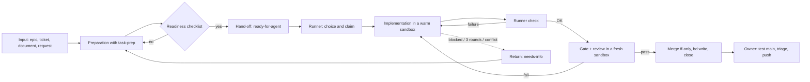
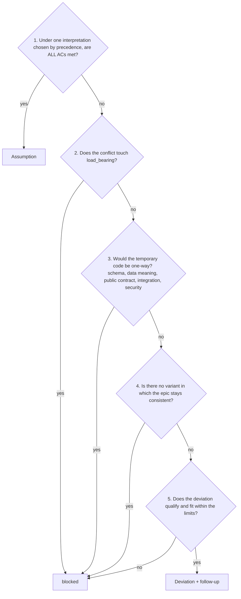
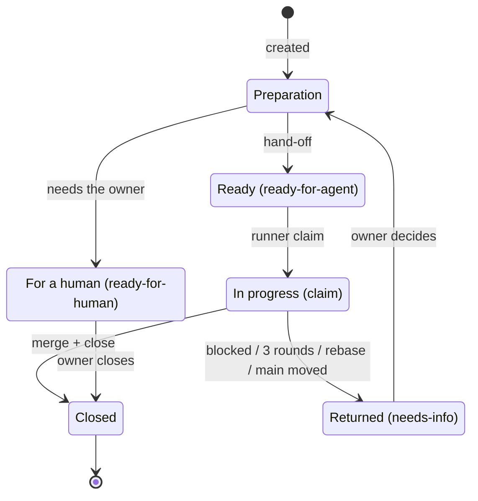
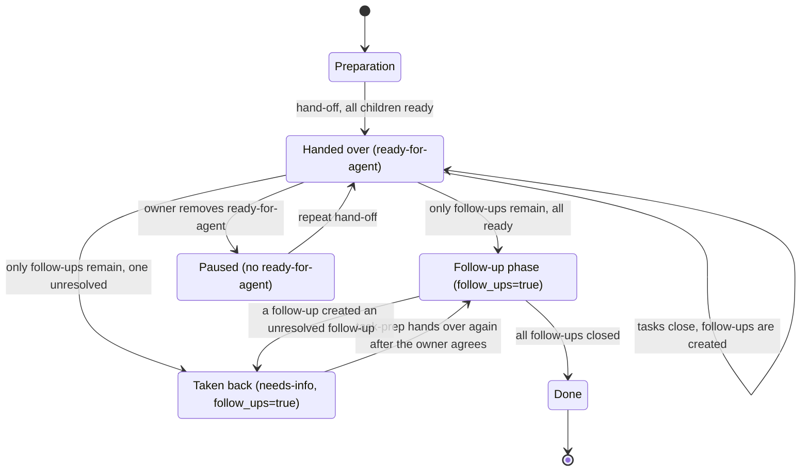

# How agents implement tasks

## Summary

This document describes how work moves from an idea to code on `main` in the oferty-pracy project when agents write the code unsupervised. The process has two phases separated by a **hand-off**:

- **preparation**, which the owner runs together with the `task-prep` agent;
- **execution**, which the runner (`.sandcastle/runner.ts`) runs on its own: task by task, in isolated containers, with a test gate, an independent review and an automatic merge.

The main idea: **decisions are made before execution, and the automation can only stop work, never widen it.** When an agent hits a contradiction in the specification, it does not stop at each one. It settles it by a fixed order of precedence and leaves a trace for the owner's decision. It stops only when the rest of the epic depends on the answer.

The document serves to refresh knowledge of the process and to explain it to others. The contract that binds the agents and the runner is in [docs/agents/implementation-workflow.md](agents/implementation-workflow.md). When the two documents differ, that file and the runner code decide.

---

## 1. Principles the process rests on

| Principle | What it means in practice |
|---|---|
| **Decisions before execution** | Everything that needs the owner's judgement goes into the documents before the hand-off. Execution only carries them out. |
| **The automation only narrows** | The runner can return a task, take back an epic or block work. Only a human can hand an epic over, accept an assumption or settle a follow-up. An automation error therefore ends in a stop, not in bad code. |
| **Each state has one owner** | The agent writes only its branch and the result file. bd, `main` and the merge belong solely to the runner. The agent cannot pass itself. |
| **Proportional blocking** | A contradiction in the specification stops only the work that depends on the answer. Local matters go ahead with an explicit trace. |
| **The script counts, the agent judges** | Everything that can be checked deterministically is checked by a script. The reviewer gets only what cannot be computed. |
| **Epic consistency** | No part of an epic reaches `main` while the rest of the epic can still change the decisions. |

---

## 2. Participants and responsibilities

| Participant | Responsible for | Does not |
|---|---|---|
| **Owner** (you) | product decisions, naming the load-bearing requirements (`load_bearing`), settling follow-ups and assumptions, testing `main`, push | does not write code during execution |
| **task-prep** (skill) | turning the input into a PRD, requirements, solution design and bd tasks; the hand-off and a repeat hand-off of the epic after the owner agrees | does not implement |
| **Runner** (script) | choosing and claiming a task, sandboxes, checks, merge, bd writes, returns to preparation | makes no decisions on substance, does not push, does not hand an epic over |
| **Implementing agent** (skill `implement-task`) | code, tests, gate, commits, conflict classification, the `.agent-result.json` file | does not touch bd, `main` or the merge |
| **Reviewer** (separate agent) | assessing the diff against the documents, ACs, assumptions and deviations; the `.agent-review.json` file | does not commit (the runner checks this) |

---

## 3. Process artefacts

### Specification documents

| Document | Level | Contains | Does not contain |
|---|---|---|---|
| **PRD** | epic | problem, goals, scope, stages | technical solutions and detailed requirements |
| **Requirements** | task | behaviour and acceptance criteria (AC) with stable IDs, how each AC is checked | libraries, file and function names |
| **Solution design** | task | technical decisions, contracts, data semantics | specific paths and function names (the implementer chooses them) |

An epic's documents live in `docs/specs/<epic>-<slug>/`, e.g. `docs/specs/0mq-architektura-modulow/`. Specifications are in English.

### Task in bd

One task is one vertical, demonstrable increment that can be reviewed in one go. A task **points to** the documents, but does not copy their content:

- `metadata.prd`, `metadata.requirements`, `metadata.sd`: paths, optionally with a `#section`;
- `acceptance_criteria`: one line per criterion, `AC-ID: observable result`;
- dependencies as bd edges;
- **small lane** (`metadata.lane=small`): a change with no behavioural decision and no contract change; the PRD and the task's own ACs are enough.

We split a task when it has behaviours that can be accepted separately, more than about 15 ACs, or when it changes the public contract of more than one module.

### Labels

| Label | Meaning |
|---|---|
| `ready-for-agent` | prepared; the runner may take the task (on an epic: the epic has been handed over) |
| `ready-for-human` | the owner is needed during implementation; the runner skips it, but the epic does not stall |
| `needs-info` | a decision is missing or the runner returned the task; the runner skips it, and the whole epic waits |
| `needs-triage` | a new finding to assess (new scope, a task with assumptions) |

### Metadata the runner reads and writes

| Where | Key | Who sets it | Meaning |
|---|---|---|---|
| epic | `load_bearing` | preparation | IDs of the requirements and ACs the epic rests on; a conflict on them cannot be deferred |
| epic | `follow_ups` | runner | `true` when only follow-ups remain open |
| task | `type=follow-up`, `marker`, `origin` | runner | a follow-up from a deviation: its marker in the code and the source task |
| task | `type=assumptions`, `epic` | runner | the triage task that collects the agents' assumptions for the epic |

### Execution traces

- **Branch** `<epic>-<task>-<slug>`, e.g. `0mq-1-ujednolicic-interfejs-konektorow-zrodel-ofert`. After a failure it stays for inspection.
- **`.agent-result.json`**: status, summary, evidence for the ACs, assumptions, deviations and new scope.
- **`.agent-review.json`**: the reviewer's verdict and remarks.
- **Code marker** `FOLLOW-UP(<task id>/DEV-<n>)` at every place of temporary code.
- **Logs** in `.sandcastle/logs/`: a separate implementation log, a gate-and-review log and `runner.log`.

---

## 4. Process flow

### Stage 1. Preparation

- **Input:** anything: an epic in bd, a ticket, a document, a request in chat.
- **Activities:** `task-prep` with the owner writes the PRD, requirements and solution design, cuts the work into tasks, assigns ACs with stable IDs and wires the dependencies.
- **Exit criterion (readiness checklist):**
  - every linked document exists on `main`, and the anchors resolve;
  - every AC is observable and says how to check it;
  - the solution design describes the contracts precisely enough that no guessing is needed;
  - no open question blocks; non-blocking assumptions are recorded in the documents;
  - the dependencies are wired in bd.

### Stage 2. Hand-off

- **Task outside an epic:** the owner gives it `ready-for-agent`.
- **An epic is handed over as a whole.** `ready-for-agent` appears on the epic only when every open child has `ready-for-agent` or `ready-for-human`. Until then the runner takes no task from the epic, even a ready one.
- **At an epic's hand-off** the owner names `load_bearing`: the decisions the rest of the epic builds on (a shared status model, contracts between modules, limits).

### Stage 3. Execution (runner, unsupervised)

The runner works in its own copy of the project, a clone of GitHub, and runs from it. `node .sandcastle/setup.ts`, run once from your copy, prepares that copy beside yours (suffix `-runner`); run again, it updates the runner's program. Your copy can be in any state: another branch, uncommitted changes, unpushed commits. Code and documents reach the runner only through `main` on GitHub, so push the documents before the hand-off. From the runner's copy:

- `node .sandcastle/runner.ts --dry-run`: fetches GitHub, shows the candidates and the readiness verdict, writes nothing to bd;
- `node .sandcastle/runner.ts --once`: processes at most one task;
- without `--once` it checks the queue every `--interval` minutes (default 5);
- `--slots <n>`: how many tasks run at the same time (default 1); each run has its own branch, sandboxes and log, and deliveries go to GitHub one after another;
- `--task <id>`, `--model` (default `claude-opus-5-5`), `--effort` (default `medium`) and `--rebuild-image` override the defaults.

#### 3.1. Before each pass: reconciling epics

The runner fetches `main` from GitHub; when GitHub is unreachable it takes no task this pass. It reports once per version when GitHub holds a newer runner program, rebuilds the sandbox image from the fetched `main` when `pnpm-lock.yaml` or `.sandcastle/Dockerfile` changed, and updates the state of each handed-over epic based on its children (details in chapter 7).

#### 3.2. Choosing a task

1. The candidates are `bd ready` with the label `ready-for-agent`, without `ready-for-human` and `needs-info`, skipping epics.
2. **Epic check:** the nearest epic above the task has `ready-for-agent`, and none of its open children is unlabelled or in `needs-info`. Follow-ups are excluded from this check.
3. **Deterministic readiness check:** the required links in the metadata exist and `acceptance_criteria` is not empty; if not, the task goes back as `needs-info`. A linked document that is not yet on `main` on GitHub makes the task wait, unreturned, while the runner takes the next one.
4. Claiming the task in bd, conditionally: only when nobody holds it. A task another run claimed first is skipped without a comment.

#### 3.3. Implementation in a warm sandbox

- The runner creates the task branch at the `main` commit it fetched, in a Docker container. The container has the toolchain, PostgreSQL with migrations and Claude Code. It sees only its own worktree and the git data of the runner's copy: it does not see your copy, your database, Docker or GitHub credentials.
- The agent gets the task, links to the documents and the **epic brief**: the `load_bearing` list and the open follow-ups whose code must not be built on.
- The agent works by the skills `implement-task`, `tdd` and `write-documents`. At the end it runs `scripts/gate.sh` itself, commits and writes `.agent-result.json`.

#### 3.4. Runner check in the same sandbox

The runner checks in order:

1. the result file exists; the status `blocked` ends the work at once;
2. the worktree is clean, and the branch has commits;
3. the branch rebases cleanly onto the fetched `main` commit (a write to `main` from the sandbox changes nothing: the runner's `main` only mirrors GitHub);
4. the shape of the result and the deviations pass the deterministic checks (chapter 8);
5. the gate passes.

#### 3.5. Verification in a fresh sandbox

- The runner makes a copy of the branch and a new sandbox. Only what has been committed counts.
- The gate runs once more. This catches the "works on my machine" situation, i.e. uncommitted files or database state.
- The reviewer reads the documents in full, the diff, the ACs, the assumptions and the deviations, and then writes a verdict:
  - `pass`: everything met, no deviations;
  - `pass-with-deferral`: everything met except the deferred ACs, every deviation accepted;
  - `fail`: a list of remarks.
- **The verdict must match the result exactly:** with deviations `pass-with-deferral` is required, without deviations `pass`. Any other verdict is a failure. A reviewer commit on the branch is also a failure.

#### 3.6. Fix loop

- Every failure from steps 3.4 and 3.5 goes back as a report **to the same agent session** (Sandcastle resume), so the agent keeps its context.
- The limit is **3 fix rounds**, shared by all kinds of failure: a failed gate, a missing result, a review fail.
- A rebase conflict is a fix round too: the report lists the conflicting files and the commits of `main` that caused them, and the agent resolves it itself.
- These end the work with no fix rounds, going straight to a return: `blocked` and a reviewer commit.

#### 3.7. Completion

**Success:**
1. delivery to `main` on GitHub, while the agent's sandbox is still open. When `main` changed since the last gate, the runner replays the work on top of it and runs the gate again in a fresh sandbox, and the review too when the change touched a task document; then it pushes without forcing. A conflict or a failed check after the replay is a fix round. When GitHub is unreachable, the work waits and the runner retries after each pause, taking no new task. The task goes back after a sixth change of `main` during delivery, or when a fix round would be needed after the change of `main` rebuilt the sandbox image;
2. a comment on the task: summary, evidence for the ACs, assumptions and known deviations;
3. for each deviation a follow-up as a child of the epic (`needs-info`, `type=follow-up`, `marker`, `origin`, `discovered-from`), wired as a blocker of the tasks that mention its ID;
4. assumptions added to the epic's triage task (section 5.6);
5. new scope as `needs-triage` tasks with `discovered-from`;
6. closing the task, deleting the branch, and deleting the `agent/` branch an earlier return left on GitHub.

**Failure (return to preparation):** the task loses `ready-for-agent`, gets `needs-info` and a comment with the reason. It is unclaimed, and the branch goes to GitHub as `agent/<task branch>` for inspection; the comment names it, or says the work stayed only in the runner's copy when GitHub was unreachable. **The whole epic waits** until preparation resolves it.

The runner pushes only to GitHub `main` and `agent/` branches, and never runs a Dolt sync.

### Stage 4. After the merge (owner)

- You pull `main` from GitHub and test it. The epic's open follow-ups are a list of **known and intended** differences, not bugs.
- A defect found on `main` is a new bug with `discovered-from` pointing to the source task, and it goes through preparation.
- You review the epic's open follow-ups and its assumptions task, starting with the assumptions marked as load-bearing.

---

## 5. Exception path: conflicts in the specification

A conflict in the specification is a gap or a contradiction in the documents that an agent discovers while working. The process does not stop at every such conflict, but it does not let the agent settle it silently either.

### 5.1. Classifying findings

| Finding | What the agent does |
|---|---|
| a code defect within the task | fixes it in the task |
| a conflict in the specification | classifies it by the tree (5.3): assumption, deviation or `blocked` |
| new scope outside the task | records it in `new_scope`; the runner creates a `needs-triage` task |

### 5.2. Order of precedence

When requirements pull in different directions, the interim choice always follows this order:

1. **invariants and hard limits:** time and size limits, data safety, security;
2. **existing behaviour:** no regression of what the application does today;
3. **new behaviour** introduced by the task.

Phrases such as "at most N" and "up to X s" are upper bounds that must all hold at the same time, not an obligation to reach the bound.

### 5.3. Decision tree

The agent goes through the questions in order and stops at the first one that decides:

**An important nuance of the order:** question 1 comes before question 2. An assumption may therefore concern a requirement from `load_bearing` if it meets all ACs. Such an assumption, however, gets a stricter review and a flag in the triage task (5.6), because the rest of the epic builds on this interpretation.

### 5.4. Three outcomes

| | Assumption | Deviation | Blocked |
|---|---|---|---|
| **AC** | all met | some deliberately deferred | — |
| **Conditions** | consistent with precedence, locally reversible, **covered by a test of the case it relies on** | qualification and limits (5.5) | — |
| **Code** | normal | temporary, with a `FOLLOW-UP(...)` marker | no merge |
| **Review verdict** | `pass` | `pass-with-deferral` | — |
| **Trace in bd** | an entry in the triage task with assumptions | a follow-up as a child of the epic, blocking dependent tasks | task in `needs-info`, the epic stalls |
| **Who decides and when** | the owner, asynchronously, in the solution design | the owner, by preparing the follow-up | the owner, before work goes on |

**Example of an assumption:** one requirement says to sort the list by date, another puts pinned items at the top. Pinned first, and each group by date, meets both.

**Example of a deviation:** a shared rule says every export contains archived records, and the task's AC forbids changing today's export for one client. Precedence says to keep today's export, so the shared rule for this client goes to a follow-up.

### 5.5. When a deviation qualifies

**The kind** is one of:
- a contradiction between at most two requirements;
- one underspecified requirement with no effect on others;
- a dependency on an unfinished task, with a temporary patch or a requirement left unmet until then.

**All conditions must hold:**
- the matter is local to one module and concerns one requirement (1–2 IDs in the result);
- the temporary code is isolated, so the follow-up replaces it without rework elsewhere;
- the change touches at most 3 files, not counting one-line changes;
- at least one AC is met, and the deferred ones are not the main result of the task;
- at most 2 other open tasks of the epic mention these IDs (they become blocked by the follow-up).

**Limits:** at most 2 deviations per task and at most 3 open follow-ups per epic. Beyond that the task ends as `blocked`.

### 5.6. What remains after a conflict

- **Temporary code:** a `FOLLOW-UP(<id>/DEV-<n>)` marker in a comment at every place the follow-up will change. A test of the temporary behaviour has the marker in its name, and an `it.todo` describes the target behaviour.
- **Follow-up description** (skill `write-documents`, for a person without context):
  - the business context and the quoted conflict with IDs;
  - the current behaviour with `file:line`;
  - the interim decision and why it is safe;
  - why a follow-up and not a block;
  - the target variants with trade-offs, the decision to be made, the marker and how to verify.
- **Assumption** in the result: the requirements, the gap, the decision, the rule applied, the effect of reversing the decision and the test.
- **Triage task with assumptions:** one per epic, `type=assumptions`, `needs-triage`. It sits outside the epic, so it blocks nothing. Assumptions on `load_bearing` are in bold in it, with the note "confirm it first".
- **Later tasks of the epic** get the open follow-ups in their prompt and do not build on temporary code. When they must touch it, they leave a marker and report the place through `new_scope`.

### 5.7. What a follow-up does not cover

A requirement change that would change the epic's result is not a follow-up. The epic ends in a consistent variant, and the change is prepared as a new epic.

---

## 6. Task life cycle

A follow-up goes through the same cycle: it is born in `needs-info`, goes through preparation (decision, document update, ACs that cover removing the markers) and gets `ready-for-agent`.

---

## 7. Epic life cycle

Before each pass the runner reconciles the state of each handed-over epic:

- it sets `follow_ups=true` when all children other than follow-ups are closed or deferred and some follow-up is open; otherwise it removes this key;
- when this phase begins and some follow-up does not yet have `ready-for-agent`, the runner **takes back the epic**: it removes `ready-for-agent` and adds `needs-info`.

The key asymmetry: **the runner only takes an epic back, it never hands it over.** Handing it over again always goes through the owner and `task-prep`. Removing `ready-for-agent` pauses the epic in any phase.

Other epic behaviours:
- `needs-info` on any child stops the epic's other tasks;
- `ready-for-human` does not stop the epic, but the tasks that depend on it wait in bd;
- an open follow-up keeps the epic open, but does not pause its regular tasks;
- an epic with open follow-ups is not finished.

---

## 8. Checkpoints: what the script checks and what the reviewer checks

| Script (deterministic) | Reviewer (judgement) |
|---|---|
| links in the metadata and their files on `main`, non-empty ACs | whether every requirement is implemented and the contracts match the solution design |
| `main` untouched, result present, clean worktree, commits exist, clean rebase | whether there is behaviour nobody asked for |
| shape of the result | whether an assumption really meets all ACs and has a test of its case |
| limits on deviations and follow-ups, 1–2 IDs per deviation | whether an assumption on `load_bearing` fixes the meaning of a requirement for the rest of the epic |
| deferred ACs belong to the task, not all of them, none from `load_bearing` | whether a deviation qualifies and whether it should not be an earlier step of the tree |
| every AC has evidence or a deferral | whether the interim choice follows precedence |
| marker added in the `+` lines of the task's diff | whether the follow-up description is understandable without context |
| ≤2 other open tasks mention the deviation ID (also inside ranges such as `F2-01–F2-05`) | whether the deviation IDs cover all affected rules of the epic |
| gate in both sandboxes, exact verdict | whether the diff builds on another follow-up's temporary code |

A failed script check goes back to the agent as feedback, just like a review fail.

---

## 9. Owner's activities

**At an epic's hand-off**
1. Make sure every open child has `ready-for-agent` or `ready-for-human`.
2. Name `load_bearing`. A helper question: the interpretation of which requirements will more than one task rely on?
3. Check `node .sandcastle/runner.ts --dry-run`.

**After a runner pass**
1. Closed tasks: a comment with evidence, assumptions and deviations.
2. Tasks in `needs-info`: a comment with the reason and a kept branch. Settle it in preparation, then restore `ready-for-agent`.
3. New `needs-triage` tasks: assess the new scope.

**Assumption triage**
1. Start with the assumptions marked as load-bearing.
2. Confirm each assumption in the solution design or turn it into a change (a new task).

**Follow-ups**
1. Make the decision described in the follow-up and update the documents.
2. Prepare the follow-up through `task-prep`: the ACs cover removing the markers.
3. When the runner has taken back the epic and all follow-ups are ready, hand the epic over again through `task-prep`.

**Before pushing `main`**
1. Test `main`.
2. Review the open follow-ups (known differences) and the assumptions task.

---

## 10. Example: the run of task 0mq.1

Task `oferty-pracy-0mq.1` (a shared interface for offer source connectors) was the first test of the process with conflict handling:

1. **Implementation.** The agent wrote 15 connectors and reported `done`: 0 deviations, 4 assumptions (all "precedence 2: existing behaviour") and 2 new scope items.
2. **The expected block did not happen, and that was correct.** The conflict between the JobSpy status and rule A5-R03 concerned load-bearing requirements. Task 0mq.1, however, did not have to change the status, and A5-R03 belongs to task 0mq.5. Keeping today's behaviour met all ACs, so question 1 of the tree decided: an assumption plus a new scope report.
3. **First review: `fail`.** No assumption had a test of its case. The reviewer also found a real defect: `Retry-After` in Himalayas could extend a run to about 136 s with a limit of 120 s, which the old code did not allow.
4. **Fix round:** the agent limited retries to the remaining run time and added tests for the edge cases.
5. **Second review: `pass`.** The runner merged the task, closed it and created:
   - the triage task with assumptions (`oferty-pracy-abe`);
   - two `needs-triage` tasks: loading `modules/*/index.ts` through Nuxt (`oferty-pracy-8mc`) and the status of an empty JobSpy run with respect to A5-R03 (`oferty-pracy-mqc`).

Lessons from the run changed the process:
- the requirement of a test for an assumption went into the document and the skill (before, it was only in the reviewer's prompt);
- assumptions on `load_bearing` got a flag and a stricter review;
- the search for dependent tasks understands ID ranges.

---

## 11. Strengths

1. **Proportional blocking.** A local conflict does not stop the overnight work, and a conflict in the epic's foundations does.
2. **Every agent decision leaves a trace to review.** Assumptions go to triage, deviations to follow-ups with markers, new scope to `needs-triage`. Nothing disappears into the code without a trace.
3. **No self-assessment.** Another agent in a fresh context gives the verdict, the gate runs in a clean environment, and the merge and bd belong to the script.
4. **Consistency of `main`.** Handing over the whole epic, `load_bearing` and the ban on building on temporary code.
5. **No silent failures.** Every failure ends in `needs-info` with a reason and a kept branch.
6. **Testable rules.** The logic of deviations and epic labels is pure functions in `.sandcastle/followups.ts` with tests (`npm test` in `.sandcastle/`).

---

## 12. Known gaps and risks

| Gap | Effect | Possible safeguard |
|---|---|---|
| **The reviewer has no memory between rounds.** Each round is a new reviewer. | It may raise new remarks instead of checking the fixes to the old ones; with the limit of 3 rounds, a return threatens despite progress. | Pass the previous remarks to the reviewer and have it verify them first. |
| **The same model assesses the same model.** | The blind spots of the implementer and the reviewer are correlated. | A different model or a different effort for the review. |
| **The write after the merge is not atomic.** Follow-ups are created after the merge, and errors in some writes are only logged. | A marker without a follow-up may remain on `main`. | Periodic reconciliation: every `FOLLOW-UP(...)` in the code has an open task. |
| **The interested party does the classification.** The agent itself decides that something is "only an assumption". | There is no deterministic barrier at step 1 of the tree; the only check is the reviewer. | The test requirement (already in place) and a stricter review for load-bearing (already in place); next, e.g. a limit on the number of assumptions. |
| **Assumptions are on `main` before acceptance.** | A wrong interpretation may spread if triage is delayed. | Reviewing the assumptions task before pushing (written into the process). |
| **The readiness check does not check anchors.** The runner checks that the file exists, but not the `#section`, although the contract talks about anchors. | A link to a non-existent section will pass. | Checking the heading in the file. |
| **One blocked task stops the epic.** | Lower throughput for large epics. | A deliberate choice in favour of consistency; possibly splitting epics. |
| **The process infrastructure lives in the repo it guards.** | The runner's tests may break the project gate; this happened with vitest, fixed in 0mq.1. | Keep the `.sandcastle/` tests outside the main test runner (current state). |
| **Detecting dependent tasks relies on text.** | A task that describes a rule in words without an ID will not be found. | Require rule IDs in tasks (already a preparation practice). |

---

## 13. Boundaries and nuances

- **The boundary of a follow-up is reversibility and reach, not the size of the problem.** A small schema change blocks. A sizeable but local and isolated behaviour change may be a deviation.
- **"The conflict touches load-bearing" does not automatically mean a block.** A block comes only when something has to be given up (deferred). An interpretation that meets all ACs is an assumption, though under stricter checking.
- **A follow-up is not a bug.** Open follow-ups are a known and intended list of differences on `main`.
- **The runner does not hand an epic over.** The automation widens the scope of work only after a human decision.
- **A pause is always possible:** removing `ready-for-agent` from an epic stops it in any phase.
- **The runner does not push or run a Dolt sync.** `.beads/issues.jsonl` is only an export; the real bd state is in the local Dolt database.
- **The review verdict is strict.** `pass` on a result with deviations is a failure, just like `pass-with-deferral` without deviations.

---

## Summary

The process moves judgement to where it is cheap: before execution (preparation, `load_bearing`) and after it (assumption triage, follow-ups, testing `main`). It leaves the execution itself to an automation that can only stop work. Conflicts in the specification do not stop everything. Local ones are settled by a fixed order of precedence and leave an explicit trace, and load-bearing ones block.

Day to day, the owner has three duties:
- prepare the epic well and name its load-bearing requirements;
- settle assumptions and follow-ups regularly;
- before pushing, check which known differences `main` contains.

The biggest remaining risk lies in the "it's only an assumption" step, because it is the only place where the agent decides without a deterministic barrier. Further strengthening of the process is best started there.
