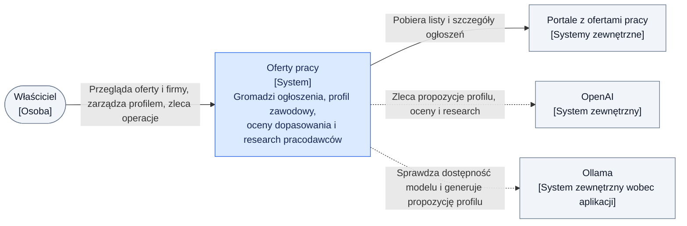
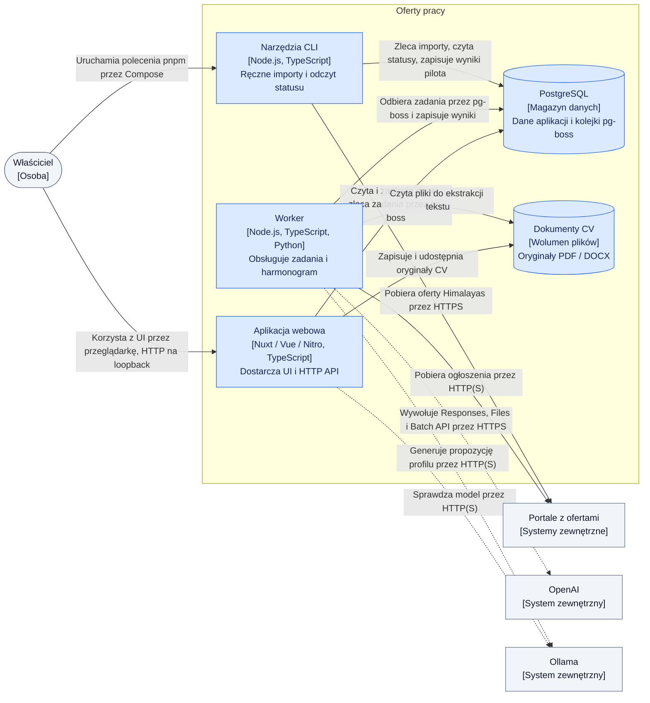
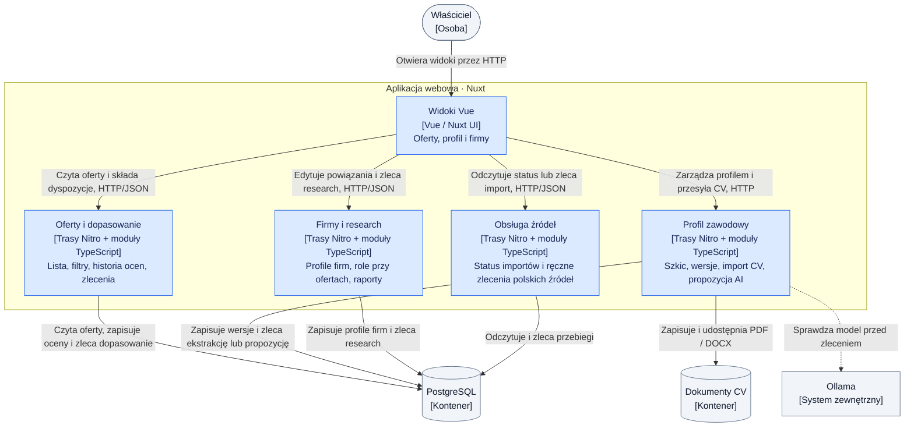
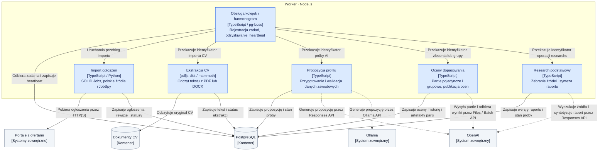
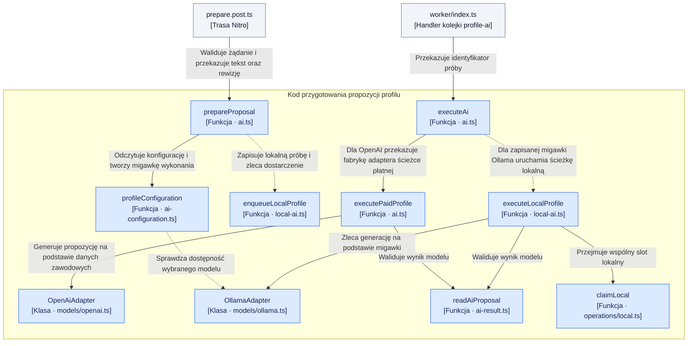

> Aktualizacja ustalenia F8: moduł Oferty odpowiada za grupowanie ogłoszeń tej samej rekrutacji w jedną ofertę. Wdrożenie grupowania jest poza zakresem obecnego refaktoru. Poniższy historyczny zrzut zadania `.8`, nazywający ten model kierunkiem rozwoju, nie określa już aktualnego ustalenia.

# Architecture refactoring review input

Snapshot: 2026-11-13. Beads remains the source of task state.

## Architecture rules


### Source: docs/architecture/README.md


# Architektura Ofert pracy w modelu C4

Oferty pracy to prywatny system jednego właściciela. Zbiera ogłoszenia źródłowe, umożliwia ich przeglądanie i ocenę dopasowania do profilu zawodowego oraz gromadzi informacje o firmach. Diagramy opisują bieżący kod i konfigurację lokalnego Compose, odczytane 11 listopada 2026. Linie przerywane oznaczają ścieżki dostępne po dodatkowej konfiguracji. Strzałki wskazują inicjatora interakcji. [Model C4](https://c4model.com/diagrams)

- [C1 — kontekst systemu](#c1-kontekst-systemu)
- [C2 — kontenery](#c2-kontenery)
- [C3 — komponenty web i workera](#c3-komponenty)
- [C4 — kod przygotowania propozycji profilu](#c4-kod-przygotowanie-propozycji-profilu)
- [Stan lokalnego AI](#stan-lokalnego-ai)

<a id="c1-kontekst-systemu"></a>

## C1 — kontekst systemu



Wspólna granica portali obejmuje SOLID.Jobs, Bulldogjob, theprotocol.it, Just Join IT, No Fluff Jobs, portale obsługiwane przez JobSpy oraz osobny pilot Himalayas. Zakres importu i sposób uruchomienia zależą od adaptera. Research podstawowy korzysta z wyszukiwania WWW przez OpenAI. Wynik trafia do profilu firmy ze źródłami. [Katalog JobSpy](../../lib/sources/jobspy-catalog.ts) · [Katalog polskich źródeł](../../lib/sources/polish-catalog.ts) · [Pilot Himalayas](../../scripts/himalayas-sync.ts) · [Dostawca researchu](../../lib/companies/research-provider.ts)

<a id="c2-kontenery"></a>

## C2 — kontenery



Nuxt dostarcza kod Vue uruchamiany w przeglądarce i obsługuje trasy Nitro w tej samej aplikacji webowej. Compose publikuje jej port na `127.0.0.1`. PostgreSQL działa w sieci Compose. Biblioteki `pg` i `pg-boss` korzystają z PostgreSQL, a zadania pg-boss mają domyślny schemat `pgboss`. Osobna usługa `migrate` przy starcie przygotowuje schemat aplikacji i kolejki przed uruchomieniem web i workera. [Compose](../../compose.yaml) · [Konfiguracja Nuxt](../../nuxt.config.ts) · [Połączenie z bazą](../../lib/db.ts) · [Kolejka](../../lib/queue.ts) · [Inicjalizacja kolejek](../../scripts/init-queue.ts)

Wolumen `documents` jest współdzielony przez web i workera pod `/data/documents`. Baza przechowuje metadane importu, wydobyty tekst, wersje profilu i wyniki operacji. Podprocesy Python służą jako adaptery uruchamiane przez workera. Skrypt Himalayas wykonuje import bezpośrednio z CLI. [Import CV](../../lib/profile/imports.ts) · [Obraz workera](../../Dockerfile) · [Polecenia](../../package.json)

<a id="c3-komponenty"></a>

## C3 — komponenty

### Aplikacja webowa



| Komponent | Punkty wejścia i implementacja |
| --- | --- |
| Widoki Vue | [Lista ofert](../../app/pages/offers.vue), [profil zawodowy](../../app/pages/profile.vue), [szczegóły firmy](../../app/pages/companies/%5Bid%5D.vue) |
| Oferty i dopasowanie | [Lista ofert API](../../server/api/offers/index.get.ts), [zapytania ofert](../../lib/offers.ts), [dane ocen na liście](../../lib/matching/list.ts), [zlecenie grupy ocen](../../server/api/matching/index.post.ts) |
| Profil zawodowy | [Potwierdzenie wersji](../../server/api/profile/confirm.post.ts), [import CV](../../server/api/profile/imports/index.post.ts), [zlecenie propozycji](../../server/api/profile/imports/%5Bid%5D/prepare.post.ts), [zapis profilu](../../lib/profile/store.ts) |
| Firmy i research | [Lista firm API](../../server/api/companies/index.get.ts), [powiązania z ofertą](../../server/api/companies/%5Bid%5D/links.post.ts), [zlecenie researchu](../../server/api/companies/%5Bid%5D/research.post.ts), [zapis profilu firmy](../../lib/companies/store.ts) |
| Obsługa źródeł | [Zlecenie importu](../../server/api/sources/polish.post.ts), [status polskich źródeł](../../server/api/sources/polish.get.ts), [status JobSpy](../../server/api/sources/jobspy.get.ts) |

### Worker



| Komponent | Punkty wejścia i implementacja |
| --- | --- |
| Obsługa kolejek i harmonogram | [Punkt wejścia workera](../../worker/index.ts). Przy starcie i co minutę sprawdza zaległości. Harmonogram zleca import SOLID.Jobs. |
| Import ogłoszeń | [SOLID.Jobs](../../lib/sources/sync.ts), [polskie źródła](../../lib/sources/polish-sync.ts), [JobSpy](../../lib/sources/jobspy-sync.ts), [zapis ogłoszeń i rewizji](../../lib/sources/store.ts). |
| Ekstrakcja CV | [`extractImport`](../../lib/profile/imports.ts) obsługuje `profile-parse`. |
| Propozycja profilu | [`executeAi`](../../lib/profile/ai.ts) obsługuje `profile-ai`. Płatna ścieżka korzysta z [budżetu AI](../../lib/ai/budget.ts). |
| Oceny dopasowania | [Pojedyncze zlecenie](../../lib/matching/store.ts) i [grupa](../../lib/matching/groups.ts) używają [klienta Batch](../../lib/matching/batch.ts) oraz [archiwum partii](../../lib/matching/archive.ts). |
| Research podstawowy | [`executeCompanyResearch`](../../lib/companies/research.ts) wykonuje `company-research` i używa [dostawcy OpenAI](../../lib/companies/research-provider.ts). |

<a id="c4-kod-przygotowanie-propozycji-profilu"></a>

## C4 — kod przygotowania propozycji profilu

Widok pokazuje wywołania w komponencie propozycji profilu i jego punkty wejścia. Wybór wykonawcy opiera się na konfiguracji zapisanej z próbą. Wcześniejsza ekstrakcja tekstu należy do osobnego komponentu workera.



`prepareProposal` usuwa dane kontaktowe z przekazanego tekstu i zapisuje jego rewizję. Dla OpenAI tworzy próbę z rezerwacją budżetu i zleca pracę po uzyskaniu środków. Dla Ollama zapisuje lokalną operację i zleca dostarczenie przez tę samą kolejkę pg-boss. Worker odczytuje zapisaną konfigurację. Po walidacji zapisuje propozycję przy imporcie, a zastosowanie propozycji jest osobną operacją właściciela. [Punkt wejścia HTTP](../../server/api/profile/imports/%5Bid%5D/prepare.post.ts) · [Orkiestracja i rozliczenie](../../lib/profile/ai.ts) · [Konfiguracja profilu](../../lib/profile/ai-configuration.ts) · [Wykonanie lokalne](../../lib/profile/local-ai.ts) · [Walidacja propozycji](../../lib/profile/ai-result.ts) · [Zastosowanie propozycji](../../server/api/profile/imports/%5Bid%5D/apply.post.ts)

<a id="stan-lokalnego-ai"></a>

## Stan lokalnego AI

| Obszar | Stan w bieżącym kodzie |
| --- | --- |
| Profil zawodowy | Trasa przygotowania i handler `profile-ai` prowadzą do lokalnego wykonawcy przy migawce Ollama. [Compose](../../compose.yaml) przekazuje `AI_PROFILE_EXECUTION_JSON` i `AI_ENDPOINTS_JSON` do web i workera. Przykład konfiguracji znajduje się w [pliku środowiskowym](../../.env.example). Dostępność modelu i łączność z kontenerów wymagają osobnej weryfikacji. |
| Lokalna kolejka i odzyskiwanie | [Migracja lokalnego AI](../../migrations/1770000000013_local_ai.cjs) dodaje dane operacji, kolejki i slotu. [Moduł lokalnego profilu](../../lib/profile/local-ai.ts) budzi oczekujące zadania po potwierdzonym zakończeniu generacji. [Worker](../../worker/index.ts) wywołuje `recoverLocalProfiles` przy starcie i w cyklu harmonogramu. |
| Dopasowanie ofert | Podpięty worker używa OpenAI Batch. Lokalna ścieżka ocen jest opisana w [projekcie rozwiązania](../specs/lokalne-ai/solution-design.md). |
| Research pracodawcy | Podpięty research podstawowy korzysta z OpenAI Responses i wyszukiwania WWW. OpenCode i przeglądarka dla lokalnego researchu są opisane w [projekcie rozwiązania](../specs/lokalne-ai/solution-design.md). |

Po zmianie punktu wejścia, magazynu danych lub integracji zewnętrznej zaktualizuj odpowiedni widok razem z odnośnikami do kodu.


### Source: docs/architecture/moduly-i-zasady-kodu.md


# Zasady architektury i pisania kodu

Punkty wejścia aplikacji przekazują polecenia i zapytania do modułów przez ich publiczne operacje.

## Reguły zależności

1. **Tylko moduł będący właścicielem danych wykonuje operacje na tych danych.** Inne moduły, API, CLI i worker przekazują zapytanie lub polecenie przez publiczny interfejs właściciela. Właściciel odczytuje dane, sprawdza reguły, wykonuje operację i zwraca wynik albo zdefiniowany błąd. Zapytania do tabel, w tym złączenia, repozytoria, adaptery i schemat zapisu są wewnętrzne. W TypeScripcie publiczne operacje i ich kontrakty eksportujemy jawnie z `modules/<moduł>/index.ts`.

   - **Operacje są domyślnie wewnętrzne.** Przed dodaniem publicznej operacji wskazujemy konkretnego klienta spoza modułu i przypadek użycia, którego istniejący kontrakt nie obsługuje. Operacja wyraża cel klienta i udostępnia tylko potrzebne dane. Dopasowanie może odczytać aktywną zatwierdzoną wersję profilu wraz z jej identyfikatorem przez publiczny serwis Profilu. [Kontrakt Profilu zawodowego](../../modules/profile/README.md#publiczne-operacje)
   - **Każda publiczna operacja chroni niezmienniki modułu.** Moduł sprawdza dopuszczalność polecenia w aktualnym stanie i zabezpiecza sprawdzenie oraz zapis przed równoległą zmianą. Gdy polecenie opiera się na stanie odczytanym wcześniej przez klienta, podaje oczekiwaną rewizję. Jeśli warunki przestały być spełnione, moduł zwraca konflikt bez częściowego zapisu. Przy zatwierdzeniu profilu Profil sprawdza rewizję szkicu, tworzy zatwierdzoną wersję i ustawia ją jako aktywną w jednej transakcji.

2. **Widoki składają dane przez publiczne operacje odczytu.** Każdy moduł udostępnia dane potrzebne do konkretnego widoku i sam wylicza wartości wynikające z jego reguł. Widok łączy odpowiedzi po identyfikatorach oraz odpowiada za prezentację, filtrowanie i sortowanie. Lista Ofert przekazuje identyfikatory ogłoszeń do zbiorczego odczytu Dopasowania. Dopasowanie zwraca rating, kompletność i aktualność oceny, a Oferty korzystają z ratingu przed sortowaniem i paginacją.

3. **Przypadek użycia wyznacza granicę transakcji.** Operacja realizująca przypadek użycia określa, które zmiany muszą zostać zatwierdzone albo wycofane razem, i koordynuje transakcję. Jeśli uczestniczy w niej kilka modułów, każdy zapisuje własne dane przez publiczną operację w tym samym kontekście transakcji. Mechanizm transakcji należy do wspólnej infrastruktury. [Martin Fowler, Service Layer](https://martinfowler.com/eaaCatalog/serviceLayer.html) · [Unit of Work](https://martinfowler.com/eaaCatalog/unitOfWork.html)

## Reguły struktury kodu

### Katalog modułu

Najmniejszy moduł ma opis odpowiedzialności, publiczne wejście i plik z implementacją operacji. Nazwa pliku mówi, co można zrobić, np. `read-active-profile.ts`.

```text
modules/<moduł>/
├── README.md
├── index.ts
└── <nazwa-operacji>.ts
```

- **`README.md`** opisuje główny cel modułu i dane, za które odpowiada. Istotne warunki użycia publicznych operacji opisujemy przy ich kontraktach.
- **`index.ts`** jawnie eksportuje operacje i typy potrzebne klientom modułu. Klienci importują stąd, a kod wewnętrzny korzysta bezpośrednio z plików implementacji. Typy wejścia i wyniku trzymamy przy operacji lub w osobnym pliku, jeśli korzysta z nich kilka operacji.
- **Plik operacji** prowadzi przypadek użycia od przyjęcia polecenia lub zapytania do wyniku. Określa też, które zmiany muszą zostać zapisane razem. Powiązane operacje mogą współdzielić plik nazwany według ich odpowiedzialności.

Podkatalog dodajemy, gdy jest co w nim zebrać i można jasno nazwać jego odpowiedzialność.

| Katalog | Kiedy pomaga | Przykład |
| --- | --- | --- |
| `operations/` | Moduł ma kilka przypadków użycia i warto zebrać ich punkty wejścia w jednym miejscu. | `confirm-profile.ts`, `apply-cv-proposal.ts` |
| `domain/` | Moduł ma reguły, które można wyrazić na podstawie przekazanych danych, bez odczytu bazy lub wywołania usługi. | Obliczenie ratingu z ocen i wag, sprawdzenie poprawności widełek wynagrodzenia |

`infrastructure/` zawiera kod, który łączy operacje modułu z bazą danych, usługami zewnętrznymi i mechanizmami uruchamiania. Dodajemy podkatalogi odpowiadające temu, czego moduł używa.

```text
infrastructure/
├── persistence/   # zapytania, zapis i mapowanie danych z bazy
├── adapters/      # integracje i implementacje portów
├── http/          # kontrolery HTTP
├── worker/        # obsługa zadań z kolejki
└── cli/           # polecenia CLI
```

Operacja łączy odczyt, reguły domeny i zapis. Reguły domeny pracują na przekazanych danych. Kod w `persistence/` zna schemat danych własnego modułu. Adapter tłumaczy dane na kontrakt zdefiniowany przy operacji, która z niego korzysta.

Kontroler, handler workera lub polecenie CLI przekazuje dane do publicznej operacji modułu i obsługuje jej wynik. Gdy kilka modułów zapisuje dane w jednej transakcji, operacja koordynująca przekazuje wspólny kontekst ich publicznym operacjom. Każdy moduł wykonuje własny zapis.

### Operacja modułu prowadzi cały przypadek użycia

Publiczna operacja odpowiada za pełny przebieg konkretnego polecenia. Odczytuje potrzebne dane, sprawdza warunki, wykonuje zmianę i zwraca wynik. Punkt wejścia aplikacji tłumaczy żądanie na polecenie i wynik na odpowiedź.

Przy zastosowaniu propozycji z CV trasa przekazuje wybór pozycji i oczekiwaną rewizję szkicu. Profil odczytuje propozycję, sprawdza rewizje i zapisuje szkic w ramach jednej operacji. Dzięki temu każdy punkt wejścia stosuje te same reguły. [Service Layer](https://martinfowler.com/eaaCatalog/serviceLayer.html)

### Wymienni wykonawcy korzystają ze wspólnego kontraktu

Port opisuje, czego potrzebuje przypadek użycia. Adapter realizuje ten kontrakt przy pomocy konkretnej technologii. Implementację adaptera wybieramy w miejscu, które składa zależności. Kod przypadku użycia korzysta z kontraktu portu.

W Źródłach port konektora przyjmuje zakres i dostarcza ogłoszenia oraz informację o kompletności pobrania. Adapter obsługuje szczegóły portalu, a operacja wykonania przebiegu używa tego samego portu do pobrania danych i ustalenia końcowego stanu. [Ports and Adapters](https://alistair.cockburn.us/hexagonal-architecture) · [The Clean Architecture](https://blog.cleancoder.com/uncle-bob/2012/08/13/the-clean-architecture.html)

### Dane zewnętrzne tłumaczymy przy integracji

Warstwa antykorupcyjna zamienia model zewnętrznego systemu na pojęcia używane w aplikacji. Przy integracji portalu tłumaczenie należy do konektora. Kontrakt Źródeł określa znaczenie pól, a odbiorcy korzystają z tych znaczeń przy stosowaniu własnych reguł.

Jeśli portal odróżnia widełki pracodawcy od własnego szacunku, konektor przekazuje kwotę wraz z pochodzeniem. Dopasowanie stosuje jedną regułę porównania wynagrodzenia na podstawie pochodzenia kwoty. Zmiana pola w odpowiedzi portalu dotyczy wtedy kodu tłumaczenia w konektorze. [Eric Evans, Domain-Driven Design Reference, s. 34](https://www.domainlanguage.com/wp-content/uploads/2016/05/DDD_Reference_2015-03.pdf)

### Obiekt wartości grupuje dane, które mają wspólne znaczenie

Obiekt wartości reprezentuje pojęcie przez jego dane i reguły. Dwie takie wartości są równe, jeśli mają te same istotne cechy. Poprawność sprawdzamy przy tworzeniu wartości, a zmiana tworzy nową wartość.

Widełki wynagrodzenia obejmują granice kwoty, walutę, okres, podstawę i rodzaj kontraktu. Reguła tworzenia widełek sprawdza między innymi kolejność granic, jeśli podano obie. Kod porównujący wynagrodzenia otrzymuje całe widełki, dzięki czemu może sprawdzić ich porównywalność. [Eric Evans, Domain-Driven Design Reference, s. 12](https://www.domainlanguage.com/wp-content/uploads/2016/05/DDD_Reference_2015-03.pdf)

### Agregat chroni stan, który musi zmieniać się razem

Agregat grupuje dane, dla których określone warunki muszą być spełnione po każdej zmianie. Zmiany przechodzą przez główny obiekt agregatu, który pilnuje tych warunków. Zakres agregatu wyznacza stan potrzebny do sprawdzenia reguł i wykonania zmiany. Pełną historię można pobierać osobno.

Przy zatwierdzaniu profilu nowa wersja i wskazanie jej jako aktywnej są częścią jednej zmiany. Operacja zatwierdzenia sprawdza oczekiwaną rewizję szkicu i zapisuje oba elementy atomowo. [Eric Evans, Domain-Driven Design Reference, s. 16](https://www.domainlanguage.com/wp-content/uploads/2016/05/DDD_Reference_2015-03.pdf)

### Reguły obliczeniowe oddzielamy od odczytu i zapisu

Funkcja obliczeniowa otrzymuje dane potrzebne do podjęcia decyzji i zwraca wynik. Kod realizujący przypadek użycia pobiera wejście, wywołuje tę funkcję i decyduje o zapisie. To podział znany jako funkcyjny rdzeń i imperatywna otoczka.

Funkcja licząca rating przyjmuje oceny kryteriów i wagi. Zwraca rating i kompletność, które można sprawdzić na przekazanych danych. Operacja zapisująca ocenę odpowiada za odczyt wag i utrwalenie wyniku. [Functional Core, Imperative Shell](https://www.destroyallsoftware.com/screencasts/catalog/functional-core-imperative-shell)

### Funkcja opisuje kroki na jednym poziomie szczegółowości

W funkcji prowadzącej przypadek użycia widać kolejność działań istotnych dla jego wyniku. Szczegół wydzielamy, gdy nazwana operacja pozwala zrozumieć krok bez czytania jej implementacji.

Zatwierdzenie profilu można opisać jako sprawdzenie rewizji, zapis zatwierdzonej wersji i jej aktywację. Instrukcje SQL i mapowanie wierszy należą do kodu wykonującego te kroki. [Clean Code, rozdział Functions](https://www.informit.com/store/clean-code-a-handbook-of-agile-software-craftsmanship-9780132639408)

## Zasady pisania kodu

- **Nazwy opisują operację i przedmiot.** `enqueueMatching`, `publishAiRating` i `readRatings` wskazują, które wywołanie zleca pracę, zapisuje wynik lub czyta historię. Nazwy typów i statusów opieramy na pojęciach ze [słownika domeny](../../GLOSSARY.md).
- **Dane wejściowe walidujemy przy wejściu.** Trasa sprawdza kształt żądania HTTP, adapter sprawdza odpowiedź zewnętrzną, moduł pilnuje reguł domeny. Po walidacji przekazujemy typowany wynik. Na przykład poprawny JSON oceny nadal wymaga sprawdzenia dowodów względem zapisanej wersji profilu i rewizji ogłoszenia.
- **Diagnostyka zawiera tylko dane potrzebne do ustalenia, co się stało.** Zapisujemy stan, przyczynę i identyfikatory pozwalające powiązać zdarzenia. Komunikaty diagnostyczne i logi pomijają dane wrażliwe i sekrety. [OWASP, Logging Cheat Sheet](https://cheatsheetseries.owasp.org/cheatsheets/Logging_Cheat_Sheet.html#data-to-exclude)
- **Nowa warstwa ma określoną odpowiedzialność.** Wydzielamy ją, jeśli ukrywa regułę lub szczegóły wykonania, które mogą się różnić między wykonawcami.


### Source: docs/architecture/moduly.md


# Mapa modułów

**Ogłoszenie** to wpis opublikowany na portalu. **Oferta pracy** może łączyć kilka ogłoszeń dotyczących tej samej rekrutacji.

| Moduł | Główny cel | Docelowy katalog |
| --- | --- | --- |
| [Źródła ofert](../../modules/sources/README.md) | Pobiera ogłoszenia z portali i śledzi zmiany ich treści oraz dostępności. | `modules/sources/` |
| Oferty | Umożliwia przeglądanie ofert pracy i grupuje ogłoszenia dotyczące tej samej rekrutacji. | `modules/offers/` |
| [Profil zawodowy](../../modules/profile/README.md) | Pozwala opracować i zatwierdzić opis doświadczenia, umiejętności i oczekiwań wobec przyszłej pracy. | `modules/profile/` |
| Dopasowanie | Ocenia, na ile ogłoszenie pasuje do zatwierdzonego profilu zawodowego, i uzasadnia wynik. | `modules/matching/` |
| Firmy | Gromadzi informacje o firmach i zapisuje ich role w rekrutacjach. | `modules/companies/` |
| [AI](../../modules/ai/README.md) | Wykonuje zadania AI na zlecenie innych modułów, zwraca wyniki i rozlicza koszty. | `modules/ai/` |


## Detailed Implementation Plan


### oferty-pracy-0mq


○ oferty-pracy-0mq [EPIC] · Poprawki architektury kodu   [P2 · OPEN]
Created by: Piotr Ziółkowski · Type: epic
Created: 2026-11-12 · Updated: 2026-11-12

DESCRIPTION

  Porządkowanie architektury aplikacji według uzgodnionego podziału na moduły.
  Każde podzadanie opisuje jeden konkretny punkt do naprawienia i ma własne   
  kryteria odbioru. Mapa modułów: docs/architecture/moduly-i-zasady-kodu.md.  


CHILDREN
  ↳ ○ oferty-pracy-0mq.5: Wydzielić serwis uruchamiania kolektora P2
  ↳ ○ oferty-pracy-0mq.2: Dodać ConnectorProvider i rejestr konektorów źródeł ofert P2
  ↳ ○ oferty-pracy-0mq.4: Wydzielić serwis zapisu wyników pobierania P2
  ↳ ○ oferty-pracy-0mq.10: Udostępnić publiczny serwis odczytu Profilu zawodowego P2
  ↳ ○ oferty-pracy-0mq.7: Wydzielić wspólną regułę dostępności ogłoszeń po pełnym przebiegu P2
  ↳ ○ oferty-pracy-0mq.8: Zebrać moduł Oferty w katalogu modules/offers P2
  ↳ ○ oferty-pracy-0mq.12: Dostosować struktury katalogów i plików modułów P2
  ↳ ○ oferty-pracy-0mq.9: Przenieść wykonanie propozycji profilu za interfejs modułu AI P2
  ↳ ○ oferty-pracy-0mq.6: Udostępnić wspólny interfejs odczytu ogłoszeń źródłowych P1
  ↳ ○ oferty-pracy-0mq.3: Wydzielić serwis zapisu metadanych przebiegu pobierania P2
  ↳ ○ oferty-pracy-0mq.11: Usunąć pozostałe obejścia publicznych interfejsów modułów P2
  ↳ ○ oferty-pracy-0mq.1: Ujednolicić interfejs konektorów źródeł ofert P2
  ◐ 0/12 complete (0%)


💡 Tip: Install the beads plugin for automatic workflow context, or run 'bd setup claude' for CLI-only mode


### oferty-pracy-0mq.1


○ oferty-pracy-0mq.1 · Ujednolicić interfejs konektorów źródeł ofert   [P2 · OPEN]
Created by: Piotr Ziółkowski · Type: task
Created: 2026-11-12 · Updated: 2026-11-12

DESCRIPTION

  Cel: moduł Źródła ofert uruchamia każdy kolektor przez ten sam interfejs,   
  niezależnie od tego, czy kolektor parsuje HTML, wywołuje API, korzysta z    
  paginacji lub uruchamia proces Python.                                      
                                                                              
  Kryteria odbioru:                                                           
                                                                              
  1. Każdy istniejący kolektor udostępnia implementację wspólnego interfejsu  
  konektora. Interfejs przyjmuje zakres pobierania i przekazuje ujednolicone  
  ogłoszenia źródłowe w jednej lub wielu porcjach oraz informację o tym, czy  
  cały zakres został sprawdzony.                                              
  2. Każdy konkretny kolektor ma własny podkatalog pod                        
  modules/sources/infrastructure/adapters/connectors/. Wspólny interfejs jest 
  dostępny poza podkatalogami konkretnych kolektorów.                         
  3. Moduł Źródła ofert używa wspólnego interfejsu. Szczegóły transportu,     
  paginacji i pobierania treści pozostają w kolektorze. Moduł odpowiada za    
  zapis ogłoszeń i rewizji oraz reguły dostępności.                           
  4. Zachowane są zapis przyrostowy tam, gdzie działa obecnie, wyniki         
  częściowe oraz dotychczasowe reguły aktualizacji dostępności po             
  synchronizacji.                                                             


PARENT
  ↑ ○ oferty-pracy-0mq: (EPIC) Poprawki architektury kodu P2

BLOCKS
  ← ○ oferty-pracy-0mq.2: Dodać ConnectorProvider i rejestr konektorów źródeł ofert P2


### oferty-pracy-0mq.2


○ oferty-pracy-0mq.2 · Dodać ConnectorProvider i rejestr konektorów źródeł ofert   [P2 · OPEN]
Created by: Piotr Ziółkowski · Type: task
Created: 2026-11-12 · Updated: 2026-11-12

DESCRIPTION

  Cel: kod uruchamiający pobieranie odnajduje konektor po jego stałej nazwie  
  przez ConnectorProvider i korzysta ze wspólnego interfejsu konektora.       
                                                                              
  Kryteria odbioru:                                                           
                                                                              
  1. Rejestracja konkretnych konektorów odbywa się w jednym miejscu w module  
  Źródła ofert. Każdy konektor ma unikalną, stałą nazwę, niezależną od ścieżki
  pliku. Istniejące identyfikatory źródeł zachowują znaczenie.                
  2. ConnectorProvider pozwala pobrać konektor po nazwie i wylistować         
  zarejestrowane nazwy. Rozwiązany konektor udostępnia wspólny interfejs z    
  oferty-pracy-0mq.1. Nieznana nazwa i podwójna rejestracja mają jawne        
  zachowanie.                                                                 
  3. Kod wywołujący pobieranie odwołuje się do ConnectorProvider i wspólnego  
  interfejsu. Importy implementacji konkretnych kolektorów są skupione w      
  miejscu rejestracji.                                                        
  4. Dodanie konektora polega na utworzeniu jego podkatalogu, implementacji   
  interfejsu i rejestracji pod stałą nazwą. Istniejące miejsca wywołujące     
  korzystają z niego przez tę samą operację wyszukiwania.                     


PARENT
  ↑ ○ oferty-pracy-0mq: (EPIC) Poprawki architektury kodu P2

DEPENDS ON
  → ○ oferty-pracy-0mq.1: Ujednolicić interfejs konektorów źródeł ofert P2

BLOCKS
  ← ○ oferty-pracy-0mq.5: Wydzielić serwis uruchamiania kolektora P2


### oferty-pracy-0mq.3


○ oferty-pracy-0mq.3 · Wydzielić serwis zapisu metadanych przebiegu pobierania   [P2 · OPEN]
Created by: Piotr Ziółkowski · Type: task
Created: 2026-11-12 · Updated: 2026-11-12

DESCRIPTION

  Serwis utrwala metadane przebiegu synchronizacji: identyfikator źródła i    
  zakres, przyczynę uruchomienia, daty, identyfikator zadania, status i       
  diagnostykę przebiegu. Udostępnia operacje utworzenia, przejęcia i          
  zakończenia przebiegu oraz odczytu stanu potrzebnego do odzyskiwania.       
  Kryteria odbioru: zmiany stanu przebiegu przechodzą przez ten serwis,       
  zachowane są atomowość utworzenia przebiegu i wpisu kolejki oraz odporność  
  na podwójne przejęcie. Serwis przyjmuje decyzje o przebiegu od kodu, który  
  nim zarządza. Powiązany kontekst o zlecaniu synchronizacji: oferty-pracy-   
  slu.                                                                        


PARENT
  ↑ ○ oferty-pracy-0mq: (EPIC) Poprawki architektury kodu P2

BLOCKS
  ← ○ oferty-pracy-0mq.5: Wydzielić serwis uruchamiania kolektora P2


### oferty-pracy-0mq.4


○ oferty-pracy-0mq.4 · Wydzielić serwis zapisu wyników pobierania   [P2 · OPEN]
Created by: Piotr Ziółkowski · Type: task
Created: 2026-11-12 · Updated: 2026-11-12

DESCRIPTION

  Serwis przyjmuje ujednolicone porcje ogłoszeń źródłowych i identyfikator    
  przebiegu. Zapisuje ogłoszenia, obserwacje w przebiegu i rewizje treści, po 
  czym zwraca liczniki potrzebne do podsumowania. Wykorzystuje obecną logikę  
  saveOffers. Kryteria odbioru: zachowane są zapis przyrostowy, wyniki        
  częściowe, tożsamość źródło plus identyfikator w źródle i brak nowych       
  rewizji dla identycznej treści. Aktualizację dostępności wykonuje na jawne  
  polecenie po potwierdzeniu kompletności i tylko w zakresie przebiegu, który 
  na to pozwala.                                                              


PARENT
  ↑ ○ oferty-pracy-0mq: (EPIC) Poprawki architektury kodu P2

BLOCKS
  ← ○ oferty-pracy-0mq.5: Wydzielić serwis uruchamiania kolektora P2


### oferty-pracy-0mq.5


○ oferty-pracy-0mq.5 · Wydzielić serwis uruchamiania kolektora   [P2 · OPEN]
Created by: Piotr Ziółkowski · Type: task
Created: 2026-11-12 · Updated: 2026-11-12

DESCRIPTION

  Serwis wykonuje przebieg pobierania na podstawie jego identyfikatora.       
  Odczytuje zapisane źródło i zakres, rozwiązuje konektor przez               
  ConnectorProvider, uruchamia go przez wspólny interfejs i przekazuje porcje 
  ogłoszeń do serwisu zapisu wyników. Na podstawie zakończenia pobierania     
  wyznacza status przebiegu, zleca zapis metadanych i decyduje o aktualizacji 
  dostępności według zasad źródła. Kryteria odbioru: handler workera deleguje 
  wykonanie po odebraniu zadania, a serwis używa ConnectorProvider i obu      
  serwisów zapisu. Zachowane są reguły wykonania pełnego, częściowego i       
  nieudanego oraz rozpoznawanie przebiegu już przejętego lub zakończonego.    


PARENT
  ↑ ○ oferty-pracy-0mq: (EPIC) Poprawki architektury kodu P2

DEPENDS ON
  → ○ oferty-pracy-0mq.4: Wydzielić serwis zapisu wyników pobierania P2
  → ○ oferty-pracy-0mq.3: Wydzielić serwis zapisu metadanych przebiegu pobierania P2
  → ○ oferty-pracy-0mq.2: Dodać ConnectorProvider i rejestr konektorów źródeł ofert P2

BLOCKS
  ← ○ oferty-pracy-0mq.7: Wydzielić wspólną regułę dostępności ogłoszeń po pełnym przebiegu P2


### oferty-pracy-0mq.6


○ oferty-pracy-0mq.6 · Udostępnić wspólny interfejs odczytu ogłoszeń źródłowych   [P1 · OPEN]
Created by: Piotr Ziółkowski · Type: task
Created: 2026-11-12 · Updated: 2026-11-12

DESCRIPTION

  Wymagany element podziału modułów. Źródła ofert udostępniają Ofertom,       
  Dopasowaniu i Firmom stabilny interfejs odczytu ogłoszeń źródłowych oraz ich
  rewizji. Moduł odpowiada za sposób przechowywania i odczytu danych.         


ACCEPTANCE CRITERIA

  Interfejs pozwala pobrać aktualne ogłoszenie wraz z identyfikatorem rewizji 
  i odczytać wskazaną wersję. Lista i szczegóły ofert oraz odczyty            
  wykorzystywane przez Dopasowanie i Firmy korzystają z interfejsu Źródeł     
  ofert. Zachowane są dotychczasowe dane widoku oraz spójność treści i        
  identyfikatora rewizji przy ocenie.                                         


PARENT
  ↑ ○ oferty-pracy-0mq: (EPIC) Poprawki architektury kodu P2

COMMENTS
  2026-11-12 13:58 Piotr Ziółkowski
    
      Osobny temat do rozważenia przy dalszych pracach nad Dopasowaniem. Źródła   
      ofert zachowują rewizje ogłoszenia, a Dopasowanie powinno ustalać aktualność
      oceny na podstawie zmiany danych istotnych dla oceny. Dziś zmiana           
      identyfikatora rewizji wystarcza, więc korekta formatowania może oznaczyć   
      ocenę jako nieaktualną. Por. definicje w GLOSSARY.md. Ta uwaga jest         
      powiązana z odczytem rewizji, poza kryteriami odbioru tego zadania.         


### oferty-pracy-0mq.7


○ oferty-pracy-0mq.7 · Wydzielić wspólną regułę dostępności ogłoszeń po pełnym przebiegu   [P2 · OPEN]
Created by: Piotr Ziółkowski · Type: task
Created: 2026-11-12 · Updated: 2026-11-12

DESCRIPTION

  Przenieść regułę wykrywania niewidzianych ogłoszeń z synchronizacji         
  SOLID.Jobs do wspólnej logiki modułu Źródła ofert. Konektor przekazuje      
  znalezione ogłoszenia i informację o kompletności przebiegu. Konfiguracja   
  źródła określa, czy pełny wynik dla zakresu pozwala wnioskować o            
  niedostępności. Serwis uruchamiania kolektora wywołuje wspólną regułę przy  
  zakończeniu przebiegu, a zapis korzysta z obserwacji zarejestrowanych dla   
  tego przebiegu.                                                             


ACCEPTANCE CRITERIA

                                                                              
  1. Po pełnym przebiegu SOLID.Jobs wspólna reguła porównuje zapisane         
  ogłoszenia dla tego samego źródła i zakresu z obserwacjami bieżącego        
  przebiegu. Brakujące oznacza jako niedostępne w źródle.                     
  2. Niepełne i nieudane przebiegi pozostawiają dostępność niewidzianych      
  ogłoszeń bez zmian. Ta sama zasada obowiązuje przy pełnym przebiegu dla     
  źródła, którego konfiguracja nie pozwala wnioskować z braku w wynikach, jak 
  Himalayas.                                                                  
  3. Oznaczenie niedostępności i zapis pełnego zakończenia przebiegu są       
  atomowe.                                                                    
  4. Konektor SOLID.Jobs zgłasza wynik i kompletność. Porównanie z historią i 
  decyzja o zmianie dostępności odbywają się we wspólnej logice modułu.       


PARENT
  ↑ ○ oferty-pracy-0mq: (EPIC) Poprawki architektury kodu P2

DEPENDS ON
  → ○ oferty-pracy-0mq.5: Wydzielić serwis uruchamiania kolektora P2


### oferty-pracy-0mq.8


○ oferty-pracy-0mq.8 · Zebrać moduł Oferty w katalogu modules/offers   [P2 · OPEN]
Created by: Piotr Ziółkowski · Type: task
Created: 2026-11-12 · Updated: 2026-11-12

DESCRIPTION

  Kod Ofert jest obecnie rozproszony między lib/offers.ts, obsługą API,       
  widokiem i testami. Przenieść pliki należące do Ofert do modules/offers/ i  
  uporządkować publiczne operacje modułu. Zachować działanie obecnej listy i  
  szczegółów. Docelowy model łączenia ogłoszeń w ofertę opisać w dokumentacji 
  jako kierunek rozwoju.                                                      


ACCEPTANCE CRITERIA

                                                                              
  • Wszystkie pliki należące do modułu Oferty znajdują się w modules/offers/, 
  w tym logika odczytu i prezentacji, filtrowanie, sortowanie, kod widoków i  
  testy dedykowane modułowi. W punktach wejścia aplikacji pozostaje           
  rejestracja wymagana przez framework i delegowanie do modułu.               
  • Kod spoza modułu korzysta z jego publicznego interfejsu. Lista i szczegóły
  zachowują dotychczasowe działanie, w tym filtry, sortowanie, paginację i    
  prezentację wynagrodzeń.                                                    
  • Na koniec, po uporządkowaniu kodu i sprawdzeniu istniejących testów,      
  powstaje modules/offers/README.md. Opisuje odpowiedzialność modułu,         
  publiczne operacje, strukturę katalogu i zależności oraz wskazuje, które    
  elementy docelowego modelu ofert są jeszcze do wdrożenia.                   


LABELS: ready-for-agent

PARENT
  ↑ ○ oferty-pracy-0mq: (EPIC) Poprawki architektury kodu P2


### oferty-pracy-0mq.9


○ oferty-pracy-0mq.9 · Przenieść wykonanie propozycji profilu za interfejs modułu AI   [P2 · OPEN]
Created by: Piotr Ziółkowski · Type: task
Created: 2026-11-12 · Updated: 2026-11-12

DESCRIPTION

  Profil zawodowy nadal tworzy adaptery OpenAI i Ollamy oraz koordynuje ich   
  wykonanie w lib/profile/ai.ts, local-ai.ts i ai-configuration.ts. Wydzielić 
  zarządzanie wykonaniem do modułu AI i wprowadzić cienką warstwę integrującą 
  przypadek użycia Profilu z AI. Wykorzystać istniejące adaptery, wspólny     
  budżet i mechanizmy operacji z oferty-pracy-334.2, oferty-pracy-334.3 i     
  oferty-pracy-334.6. Zakres obejmuje orkiestrację ponad adapterami.          


ACCEPTANCE CRITERIA

                                                                              
  • Profil zleca przygotowanie propozycji z oczyszczonego tekstu CV i         
  otrzymuje identyfikator wykonania. Przez ten sam interfejs odczytuje        
  ujednolicony stan oraz wynik w ustalonym formacie. Konfiguracja dostawcy i  
  modelu nie wymaga zmiany kodu Profilu.                                      
  • Moduł AI wybiera dostawcę i model, zarządza konfiguracją próby,           
  komunikacją, kolejką, wspólnym slotem lokalnym, ponowieniami, odzyskiwaniem 
  oraz budżetem i rozliczeniem. Zachowuje historię prób i dotychczasowe zasady
  obsługi niepewnego wykonania oraz kosztu.                                   
  • Warstwa integrująca przekłada zlecenie przygotowania propozycji na        
  instrukcję i schemat odpowiedzi oraz przekazuje ujednolicony wynik. Profil  
  utrzymuje powiązanie z rewizją tekstu, sprawdza cytaty i zapisuje propozycję.
  Właściciel nadal wybiera zmiany do szkicu i osobno zatwierdza wersję profilu.
  • Sprawdzone są obie ścieżki wykonania, odrzucony wynik, wynik dla starszej 
  rewizji oraz odzyskiwanie przerwanej próby. Zachowane są dotychczasowe      
  zachowanie importu i dostęp do zapisanych propozycji.                       


LABELS: ready-for-agent

PARENT
  ↑ ○ oferty-pracy-0mq: (EPIC) Poprawki architektury kodu P2


### oferty-pracy-0mq.10


○ oferty-pracy-0mq.10 · Udostępnić publiczny serwis odczytu Profilu zawodowego   [P2 · OPEN]
Created by: Piotr Ziółkowski · Type: task
Created: 2026-11-12 · Updated: 2026-11-12

DESCRIPTION

  Dopasowanie odczytuje aktywny profil i historię wersji bezpośrednio z tabel 
  modułu Profil zawodowy. Umieścić odczyt zatwierdzonych wersji za publicznym 
  serwisem Profilu zgodnie z modules/profile/README.md. Profil odpowiada za   
  dostęp do wersji i ukrywa sposób przechowywania danych. Dopasowanie nadal   
  odpowiada za regułę aktualności oceny i używa identyfikatora profilu        
  zwróconego przez serwis.                                                    
                                                                              
  Miejsca do migracji w Dopasowaniu obejmują lib/matching/store.ts, groups.ts,
  ratings.ts i list.ts. To zadanie obejmuje odczyt profilu. Wykonanie         
  propozycji AI ma osobne zadanie oferty-pracy-0mq.9.                         


ACCEPTANCE CRITERIA

                                                                              
  • Publiczny serwis Profilu udostępnia dane aktywnej zatwierdzonej wersji    
  wraz z jej identyfikatorem oraz jawny wynik, gdy aktywnej wersji jeszcze nie
  ma. Udostępnia też odczyt wskazanej zatwierdzonej wersji na potrzeby        
  historii i oceny ręcznej.                                                   
  • Dopasowanie korzysta z publicznego odczytu przy zlecaniu ocen pojedynczych
  i grupowych, ocenie ręcznej, odczycie historii, sprawdzaniu gotowości       
  profilu i ustalaniu aktualności ocen. Kod Dopasowania nie odczytuje         
  bezpośrednio tabel profile_head ani profile_versions.                       
  • Nowe oceny w grupie używają tej samej wersji profilu. Zlecenia nadal      
  zapisują identyfikator wersji i przygotowane wejście. Brak zatwierdzonego   
  profilu zachowuje dotychczasowy komunikat.                                  
  • Odczyty używane przy zapisie i publikacji zachowują ochronę przed         
  równoległym zatwierdzeniem innej wersji profilu. Widoki listy i historii    
  pobierają metadane wersji zbiorczo, bez dodatkowego odczytu dla każdej      
  pozycji.                                                                    


LABELS: ready-for-agent

PARENT
  ↑ ○ oferty-pracy-0mq: (EPIC) Poprawki architektury kodu P2


### oferty-pracy-0mq.11


○ oferty-pracy-0mq.11 · Usunąć pozostałe obejścia publicznych interfejsów modułów   [P2 · OPEN]
Created by: Piotr Ziółkowski · Type: task
Created: 2026-11-12 · Updated: 2026-11-12

DESCRIPTION

  Cel to zastąpienie bezpośredniego dostępu do tabel oraz wewnętrznych        
  implementacji innych modułów ich publicznymi operacjami zgodnie z           
  docs/architecture/moduly-i-zasady-kodu.md. Zachować obecne zachowanie       
  aplikacji.                                                                  
                                                                              
  Miejsca z audytu do poprawy w tym zadaniu                                   
                                                                              
  • server/api/profile/index.get.ts:7–12 czyta importy Profilu i wylicza      
  wspólny budżet AI. server/api/profile/versions/[id].get.ts:5–8 i            
  server/api/profile/imports/[id].get.ts:5–9 odczytują tabele Profilu.        
  server/api/profile/imports/[id]/apply.post.ts:30–50 czyta propozycję,       
  pilnuje rewizji, waliduje wynik i zapisuje szkic. Całą operację zastosowania
  propozycji powinien prowadzić Profil.                                       
  • lib/matching/store.ts:55,159,340, lib/matching/groups.ts:300 i            
  lib/companies/research.ts:33,159,181,235,253 czytają lub aktualizują próby  
  AI. Moduł AI powinien udostępnić operacje na próbach i rozliczeniach, które 
  można wywołać w istniejącej transakcji publikacji. Obecne wspólne funkcje   
  budżetu są punktem wyjścia.                                                 
  • lib/matching/store.ts:109, lib/matching/ratings.ts:199,321 i              
  lib/companies/store.ts:198 korzystają z projectOffer oraz kształtu wierszy i
  payloadu Źródeł. lib/offers.ts:1–8,203–216 korzysta z wewnętrznych katalogów
  JobSpy i polskich źródeł oraz kwalifikacji zdalności. Wykorzystać odczyt    
  Źródeł rozwijany w oferty-pracy-0mq.6. Składanie listy ofert z podsumowaniem
  ocen jest dozwolone przez kontrakt odczytu.                                 
  • lib/matching/store.ts:8–9, groups.ts:6, ratings.ts:4–5, model.ts:3–5 i    
  lib/companies/research.ts:7 zależą od wewnętrznych schematów, oczyszczania  
  tekstu albo helpera transakcji Profilu. Trasy ocen i archiwum biorą UUID z  
  lib/profile/model.ts. Trasy Dopasowania, Firm i Źródeł oraz                 
  server/utils/{companies,ratings}.ts używają wspólnych helperów z            
  server/utils/profile.ts. Wydzielić tylko współdzielone mechanizmy, a dane   
  domenowe pobierać przez kontrakty właścicieli.                              
                                                                              
  Pozostałe miejsca z audytu są już objęte istniejącymi zadaniami             
                                                                              
  • SQL Ofert, Dopasowania i Firm w source_ads i source_ad_revisions          
  (lib/offers.ts:519, lib/matching/{store,list,ratings}.ts,                   
  lib/companies/store.ts:109,205,220,252) należy do oferty-pracy-0mq.6. SQL   
  Dopasowania w profile_head i profile_versions (store.ts:98,554,561, groups. 
  ts:143, ratings.ts:131,202,327,440–441 i list.ts:18,65) należy do oferty-   
  pracy-0mq.10.                                                               
  • Wybór i uruchamianie konektorów w worker/index.ts, scripts/init-queue.ts, 
  skryptach JobSpy, polskich źródeł i Himalayas oraz w server/api/sources/ są 
  objęte oferty-pracy-0mq.2 i oferty-pracy-0mq.5.                             
  • Wykonanie propozycji CV, w tym operacje na tabelach AI w lib/profile/{ai, 
  local-ai}.ts, należy do oferty-pracy-0mq.9. Protokoły OpenAI Batch i        
  wykonawcy researchu śledzą oferty-pracy-334.4 i oferty-pracy-334.5. Uzgodnić
  ich integrację z operacjami rozliczenia AI.                                 
                                                                              
  Punkty wejścia mogą składać wyniki publicznych operacji. Klucze obce w      
  migracjach są zależnościami schematu. Zadanie dotyczy dostępu i             
  odpowiedzialności w kodzie wykonawczym.                                     


ACCEPTANCE CRITERIA

                                                                              
  • Trasy Profilu delegują odczyt listy i szczegółów importów, odczyt wersji  
  oraz zastosowanie propozycji do operacji Profilu. Podsumowanie budżetu      
  pochodzi z operacji AI. Trasy zachowują dotychczasowe odpowiedzi i obsługę  
  konfliktów rewizji.                                                         
  • Dopasowanie i Firmy korzystają z operacji AI do rejestrowania i           
  aktualizacji prób oraz odczytu i rozliczania kosztów. Ich kod i trasy       
  aplikacji nie odwołują się bezpośrednio do ai_attempts ani ai_budget_months.
  Zachowane są atomowość rozliczenia i publikacji, rozliczenie przy odrzuconej
  treści, stan niepewnego kosztu i rezerwacja grupy w całości.                
  • Dopasowanie i Firmy pobierają dane ogłoszenia przez kontrakt Źródeł       
  zamiast projektować cudzy wiersz przez projectOffer. Oferty pobierają       
  metadane źródła i kwalifikację zdalności przez udostępniony kontrakt.       
  Zachowane są identyfikatory rewizji, istniejące widoki i zbiorcze odczyty.  
  • Wspólny mechanizm transakcji, walidacja UUID i pomocniczy kod HTTP oraz   
  kolejki mają neutralnych właścicieli. Dopasowanie, Firmy i Źródła nie       
  importują w tym celu wewnętrznych plików Profilu. Dopasowanie otrzymuje dane
  zatwierdzonego profilu przez jego kontrakt, a oczyszczanie tekstu nie zależy
  od implementacji importu CV.                                                
  • Weryfikacja regresji obejmuje import i zastosowanie propozycji, zlecenia  
  pojedyncze i grupowe, ocenę ręczną, listę i historię ocen, powiązania firm z
  ogłoszeniami oraz rozliczenie AI. Przy zastępowaniu złączeń zachowane są    
  dotychczasowe granice transakcji i blokady używane przy zapisie oraz        
  publikacji.                                                                 


LABELS: ready-for-agent

PARENT
  ↑ ○ oferty-pracy-0mq: (EPIC) Poprawki architektury kodu P2


### oferty-pracy-0mq.12


○ oferty-pracy-0mq.12 · Dostosować struktury katalogów i plików modułów   [P2 · OPEN]
Created by: Piotr Ziółkowski · Type: task
Created: 2026-11-12 · Updated: 2026-11-12

DESCRIPTION

  Uporządkować kod modułów zgodnie z sekcją Katalog modułu w                  
  docs/architecture/moduly-i-zasady-kodu.md. Uwzględnić Źródła ofert, Oferty, 
  Profil zawodowy, Dopasowanie, Firmy i AI. Skoordynować prace z istniejącymi 
  zadaniami epiku, szczególnie oferty-pracy-0mq.8 dotyczącym Ofert oraz       
  oferty-pracy-0mq.1 dotyczącym konektorów.                                   


ACCEPTANCE CRITERIA

  Kod każdego modułu znajduje się w jego katalogu pod modules/, z publicznym  
  index.ts i opisem w README.md. Operacje i reguły domenowe są rozmieszczone  
  zgodnie z ich odpowiedzialnością. Kod dostępu do danych i adaptery oraz     
  kontrolery, handlery workerów i polecenia CLI należą do infrastructure/     
  właściwego modułu. Podkatalogi tworzone są tam, gdzie istnieje odpowiadający
  im kod. Wymagana przez framework rejestracja punktów wejścia może pozostać  
  poza modułem i deleguje do niego wykonanie. Importy i konfiguracja są       
  dostosowane do nowych lokalizacji, istniejące zachowanie aplikacji jest     
  zachowane i zweryfikowane odpowiednimi kontrolami.                          


LABELS: ready-for-agent

PARENT
  ↑ ○ oferty-pracy-0mq: (EPIC) Poprawki architektury kodu P2

