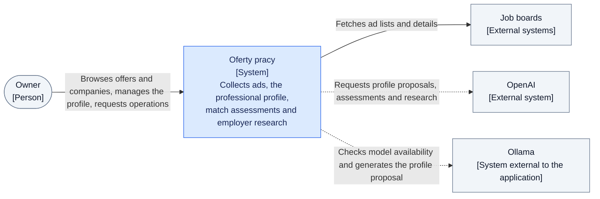
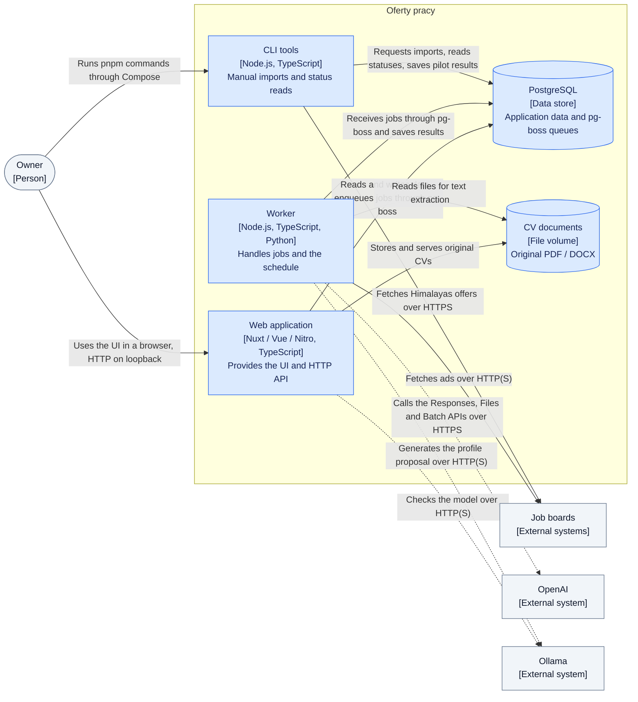
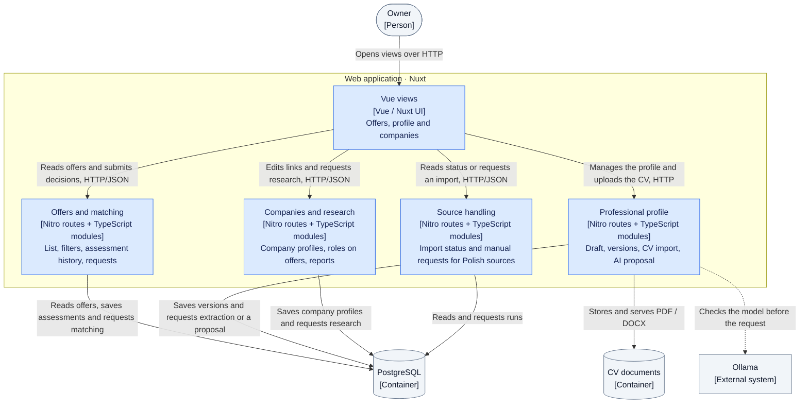
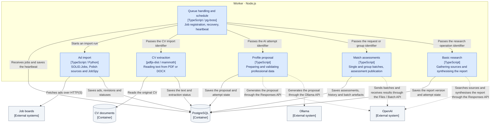
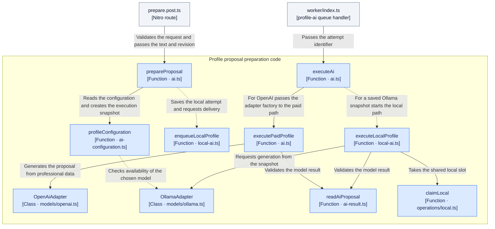

> Update to finding F8: the Offers module is responsible for grouping ads of the same recruitment into one offer. Implementing grouping is outside the scope of the current refactor. The historical snapshot of task `.8` below, which calls this model a direction of development, no longer states the current finding.

# Architecture refactoring review input

Snapshot: 2026-11-13. Beads remains the source of task state.

## Architecture rules


### Source: docs/architecture/README.md


# Job offers architecture in the C4 model

Oferty pracy (Job offers) is a private system with a single owner. It collects source ads, lets the owner browse them and assess how they match the professional profile, and gathers information about companies. The diagrams describe the current code and the local Compose configuration, as read on 11 November 2026. Dashed lines mark paths available after extra configuration. Arrows point from the initiator of an interaction. [C4 model](https://c4model.com/diagrams)

- [C1 — system context](#c1-kontekst-systemu)
- [C2 — containers](#c2-kontenery)
- [C3 — web and worker components](#c3-komponenty)
- [C4 — profile proposal preparation code](#c4-kod-przygotowanie-propozycji-profilu)
- [State of local AI](#stan-lokalnego-ai)

<a id="c1-kontekst-systemu"></a>

## C1 — system context



The shared boundary of the job boards covers SOLID.Jobs, Bulldogjob, theprotocol.it, Just Join IT, No Fluff Jobs, the boards supported by JobSpy and the separate Himalayas pilot. The import scope and the way it is started depend on the adapter. Basic research uses web search through OpenAI. The result goes into the company profile with its sources. [JobSpy catalogue](../../lib/sources/jobspy-catalog.ts) · [Polish sources catalogue](../../lib/sources/polish-catalog.ts) · [Himalayas pilot](../../scripts/himalayas-sync.ts) · [Research provider](../../lib/companies/research-provider.ts)

<a id="c2-kontenery"></a>

## C2 — containers



Nuxt delivers the Vue code that runs in the browser and handles Nitro routes in the same web application. Compose publishes its port on `127.0.0.1`. PostgreSQL runs in the Compose network. The `pg` and `pg-boss` libraries use PostgreSQL, and pg-boss jobs use the default schema `pgboss`. A separate `migrate` service prepares the application and queue schema at startup, before web and worker start. [Compose](../../compose.yaml) · [Nuxt configuration](../../nuxt.config.ts) · [Database connection](../../lib/db.ts) · [Queue](../../lib/queue.ts) · [Queue initialisation](../../scripts/init-queue.ts)

The `documents` volume is shared by web and worker under `/data/documents`. The database stores import metadata, extracted text, profile versions and operation results. Python subprocesses serve as adapters started by the worker. The Himalayas script runs the import directly from the CLI. [CV import](../../lib/profile/imports.ts) · [Worker image](../../Dockerfile) · [Commands](../../package.json)

<a id="c3-komponenty"></a>

## C3 — components

### Web application



| Component | Entry points and implementation |
| --- | --- |
| Vue views | [Offer list](../../app/pages/offers.vue), [professional profile](../../app/pages/profile.vue), [company details](../../app/pages/companies/%5Bid%5D.vue) |
| Offers and matching | [Offer list API](../../server/api/offers/index.get.ts), [offer queries](../../lib/offers.ts), [assessment data on the list](../../lib/matching/list.ts), [assessment group request](../../server/api/matching/index.post.ts) |
| Professional profile | [Version confirmation](../../server/api/profile/confirm.post.ts), [CV import](../../server/api/profile/imports/index.post.ts), [proposal request](../../server/api/profile/imports/%5Bid%5D/prepare.post.ts), [profile store](../../lib/profile/store.ts) |
| Companies and research | [Company list API](../../server/api/companies/index.get.ts), [links to an offer](../../server/api/companies/%5Bid%5D/links.post.ts), [research request](../../server/api/companies/%5Bid%5D/research.post.ts), [company profile store](../../lib/companies/store.ts) |
| Source handling | [Import request](../../server/api/sources/polish.post.ts), [Polish sources status](../../server/api/sources/polish.get.ts), [JobSpy status](../../server/api/sources/jobspy.get.ts) |

### Worker



| Component | Entry points and implementation |
| --- | --- |
| Queue handling and schedule | [Worker entry point](../../worker/index.ts). Checks for backlog at startup and every minute. The schedule requests the SOLID.Jobs import. |
| Ad import | [SOLID.Jobs](../../lib/sources/sync.ts), [Polish sources](../../lib/sources/polish-sync.ts), [JobSpy](../../lib/sources/jobspy-sync.ts), [saving ads and revisions](../../lib/sources/store.ts). |
| CV extraction | [`extractImport`](../../lib/profile/imports.ts) handles `profile-parse`. |
| Profile proposal | [`executeAi`](../../lib/profile/ai.ts) handles `profile-ai`. The paid path uses the [AI budget](../../lib/ai/budget.ts). |
| Match assessments | The [single request](../../lib/matching/store.ts) and the [group](../../lib/matching/groups.ts) use the [Batch client](../../lib/matching/batch.ts) and the [batch archive](../../lib/matching/archive.ts). |
| Basic research | [`executeCompanyResearch`](../../lib/companies/research.ts) runs `company-research` and uses the [OpenAI provider](../../lib/companies/research-provider.ts). |

<a id="c4-kod-przygotowanie-propozycji-profilu"></a>

## C4 — profile proposal preparation code

The view shows the calls within the profile proposal component and its entry points. The choice of executor is based on the configuration saved with the attempt. The earlier text extraction belongs to a separate worker component.



`prepareProposal` removes contact details from the passed text and saves its revision. For OpenAI it creates an attempt with a budget reservation and requests the work once funds are secured. For Ollama it saves a local operation and requests delivery through the same pg-boss queue. The worker reads the saved configuration. After validation it saves the proposal on the import; applying the proposal is a separate owner operation. [HTTP entry point](../../server/api/profile/imports/%5Bid%5D/prepare.post.ts) · [Orchestration and settlement](../../lib/profile/ai.ts) · [Profile configuration](../../lib/profile/ai-configuration.ts) · [Local execution](../../lib/profile/local-ai.ts) · [Proposal validation](../../lib/profile/ai-result.ts) · [Applying the proposal](../../server/api/profile/imports/%5Bid%5D/apply.post.ts)

<a id="stan-lokalnego-ai"></a>

## State of local AI

| Area | State in the current code |
| --- | --- |
| Professional profile | The preparation route and the `profile-ai` handler lead to the local executor when the snapshot is for Ollama. [Compose](../../compose.yaml) passes `AI_PROFILE_EXECUTION_JSON` and `AI_ENDPOINTS_JSON` to web and worker. An example configuration is in the [environment file](../../.env.example). Model availability and connectivity from the containers need separate verification. |
| Local queue and recovery | The [local AI migration](../../migrations/1770000000013_local_ai.cjs) adds operation, queue and slot data. The [local profile module](../../lib/profile/local-ai.ts) wakes waiting jobs after generation has confirmed its end. The [worker](../../worker/index.ts) calls `recoverLocalProfiles` at startup and in the schedule cycle. |
| Offer matching | The wired worker uses OpenAI Batch. The local assessment path is described in the [solution design](../specs/lokalne-ai/solution-design.md). |
| Employer research | The wired basic research uses OpenAI Responses and web search. OpenCode and the browser for local research are described in the [solution design](../specs/lokalne-ai/solution-design.md). |

After changing an entry point, a data store or an external integration, update the relevant view together with its links to the code.


### Source: docs/architecture/moduly-i-zasady-kodu.md


# Architecture and coding rules

Application entry points pass commands and queries to modules through their public operations.

## Dependency rules

1. **Only the module that owns the data performs operations on that data.** Other modules, the API, the CLI and the worker pass a query or command through the owner's public interface. The owner reads the data, checks the rules, performs the operation and returns a result or a defined error. Table queries, including joins, repositories, adapters and the storage schema, are internal. In TypeScript we export public operations and their contracts explicitly from `modules/<module>/index.ts`.

   - **Operations are internal by default.** Before adding a public operation we name a concrete client outside the module and the use case that the existing contract does not support. The operation expresses the client's goal and exposes only the data it needs. Matching may read the active confirmed profile version together with its identifier through the public Profile service. [Professional profile contract](../../modules/profile/README.md#publiczne-operacje)
   - **Every public operation protects the module's invariants.** The module checks whether the command is allowed in the current state and protects the check and the save against concurrent change. When a command relies on state the client read earlier, it gives the expected revision. If the conditions no longer hold, the module returns a conflict without a partial save. When confirming a profile, Profile checks the draft revision, creates the confirmed version and sets it as active in one transaction.

2. **Views assemble data through public read operations.** Each module exposes the data a specific view needs and computes the values that follow from its own rules. The view joins the responses by identifier and is responsible for presentation, filtering and sorting. The Offers list passes ad identifiers to a bulk read in Matching. Matching returns the rating, completeness and currency of the assessment, and Offers use the rating before sorting and pagination.

3. **The use case sets the transaction boundary.** The operation that carries out a use case decides which changes must be committed or rolled back together, and coordinates the transaction. If several modules take part, each saves its own data through a public operation in the same transaction context. The transaction mechanism belongs to shared infrastructure. [Martin Fowler, Service Layer](https://martinfowler.com/eaaCatalog/serviceLayer.html) · [Unit of Work](https://martinfowler.com/eaaCatalog/unitOfWork.html)

## Code structure rules

### Module directory

The smallest module has a description of its responsibility, a public entry and a file with the operation's implementation. The file name says what can be done, e.g. `read-active-profile.ts`.

```text
modules/<module>/
├── README.md
├── index.ts
└── <operation-name>.ts
```

- **`README.md`** describes the module's main purpose and the data it is responsible for. Significant conditions of use for public operations are described next to their contracts.
- **`index.ts`** explicitly exports the operations and types the module's clients need. Clients import from here, and internal code uses the implementation files directly. Input and result types are kept next to the operation, or in a separate file if several operations use them.
- **The operation file** drives the use case from accepting the command or query to the result. It also decides which changes must be saved together. Related operations may share a file named after their responsibility.

We add a subdirectory when there is something to collect in it and its responsibility can be named clearly.

| Directory | When it helps | Example |
| --- | --- | --- |
| `operations/` | The module has several use cases and it is worth collecting their entry points in one place. | `confirm-profile.ts`, `apply-cv-proposal.ts` |
| `domain/` | The module has rules that can be expressed from the passed data, without reading the database or calling a service. | Computing the rating from assessments and weights, checking that a salary range is valid |

`infrastructure/` holds the code that connects the module's operations with the database, external services and startup mechanisms. We add subdirectories matching what the module uses.

```text
infrastructure/
├── persistence/   # queries, saving and mapping data from the database
├── adapters/      # integrations and port implementations
├── http/          # HTTP controllers
├── worker/        # handling jobs from the queue
└── cli/           # CLI commands
```

An operation combines reading, domain rules and saving. Domain rules work on the passed data. Code in `persistence/` knows the data schema of its own module. An adapter translates data into the contract defined next to the operation that uses it.

A controller, worker handler or CLI command passes data to the module's public operation and handles its result. When several modules save data in one transaction, the coordinating operation passes a shared context to their public operations. Each module performs its own save.

### A module operation drives the whole use case

A public operation is responsible for the full flow of a specific command. It reads the needed data, checks the conditions, makes the change and returns the result. The application entry point translates the request into a command and the result into a response.

When applying a CV proposal, the route passes the choice of items and the expected draft revision. Profile reads the proposal, checks the revisions and saves the draft within one operation. This way every entry point applies the same rules. [Service Layer](https://martinfowler.com/eaaCatalog/serviceLayer.html)

### Interchangeable executors use a shared contract

A port describes what the use case needs. An adapter fulfils this contract with a specific technology. We choose the adapter implementation in the place that assembles dependencies. The use case code uses the port contract.

In Sources, the connector port accepts a scope and delivers ads plus information about fetch completeness. The adapter handles the board's details, and the operation that executes a run uses the same port to fetch data and to set the final state. [Ports and Adapters](https://alistair.cockburn.us/hexagonal-architecture) · [The Clean Architecture](https://blog.cleancoder.com/uncle-bob/2012/08/13/the-clean-architecture.html)

### We translate external data at the integration

An anti-corruption layer turns the external system's model into the concepts used in the application. For a board integration, the translation belongs to the connector. The Sources contract defines the meaning of the fields, and recipients use these meanings when applying their own rules.

If a board distinguishes the employer's salary range from its own estimate, the connector passes the amount together with its origin. Matching applies one salary comparison rule based on the origin of the amount. A change of a field in the board's response then concerns the translation code in the connector. [Eric Evans, Domain-Driven Design Reference, p. 34](https://www.domainlanguage.com/wp-content/uploads/2016/05/DDD_Reference_2015-03.pdf)

### A value object groups data that share a meaning

A value object represents a concept through its data and rules. Two such values are equal if they have the same significant attributes. Validity is checked when the value is created, and a change creates a new value.

A salary range covers the amount bounds, currency, period, basis and contract type. The rule that creates a salary range checks, among other things, the order of the bounds if both are given. Code that compares salaries receives the whole range, so it can check whether ranges are comparable. [Eric Evans, Domain-Driven Design Reference, p. 12](https://www.domainlanguage.com/wp-content/uploads/2016/05/DDD_Reference_2015-03.pdf)

### An aggregate protects state that must change together

An aggregate groups data for which certain conditions must hold after every change. Changes go through the aggregate's root object, which enforces these conditions. The aggregate's scope is the state needed to check the rules and make the change. The full history can be fetched separately.

When a profile is confirmed, the new version and marking it as active are part of one change. The confirmation operation checks the expected draft revision and saves both elements atomically. [Eric Evans, Domain-Driven Design Reference, p. 16](https://www.domainlanguage.com/wp-content/uploads/2016/05/DDD_Reference_2015-03.pdf)

### We separate computational rules from reading and saving

A computational function receives the data needed to make a decision and returns a result. The code that carries out the use case fetches the input, calls this function and decides on the save. This split is known as functional core, imperative shell.

The function that computes the rating accepts criterion assessments and weights. It returns the rating and completeness, which can be checked against the passed data. The operation that saves the assessment is responsible for reading the weights and persisting the result. [Functional Core, Imperative Shell](https://www.destroyallsoftware.com/screencasts/catalog/functional-core-imperative-shell)

### A function describes steps at one level of detail

In a function that drives a use case, you can see the order of the actions that matter for its result. We extract a detail when a named operation lets the reader understand the step without reading its implementation.

Confirming a profile can be described as checking the revision, saving the confirmed version and activating it. SQL statements and row mapping belong to the code that performs these steps. [Clean Code, chapter Functions](https://www.informit.com/store/clean-code-a-handbook-of-agile-software-craftsmanship-9780132639408)

## Coding rules

- **Names describe the operation and its subject.** `enqueueMatching`, `publishAiRating` and `readRatings` show which call requests work, saves a result or reads history. Type and status names are based on concepts from the [domain glossary](../../GLOSSARY.md).
- **We validate input at the entry.** The route checks the shape of the HTTP request, the adapter checks the external response, the module enforces domain rules. After validation we pass a typed result. For example, valid assessment JSON still needs its evidence checked against the saved profile version and the ad revision.
- **Diagnostics contain only the data needed to establish what happened.** We record the state, the cause and the identifiers that link events. Diagnostic messages and logs leave out sensitive data and secrets. [OWASP, Logging Cheat Sheet](https://cheatsheetseries.owasp.org/cheatsheets/Logging_Cheat_Sheet.html#data-to-exclude)
- **A new layer has a defined responsibility.** We extract it if it hides a rule or execution details that may differ between executors.


### Source: docs/architecture/moduly.md


# Module map

An **ad** is an entry published on a job board. A **job offer** may combine several ads that concern the same recruitment.

| Module | Main purpose | Target directory |
| --- | --- | --- |
| [Offer sources](../../modules/sources/README.md) | Fetches ads from job boards and tracks changes to their content and availability. | `modules/sources/` |
| Offers | Lets the owner browse job offers and groups ads that concern the same recruitment. | `modules/offers/` |
| [Professional profile](../../modules/profile/README.md) | Lets the owner draft and confirm a description of experience, skills and expectations for a future job. | `modules/profile/` |
| Matching | Assesses how well an ad fits the confirmed professional profile and justifies the result. | `modules/matching/` |
| Companies | Collects information about companies and records their roles in recruitments. | `modules/companies/` |
| [AI](../../modules/ai/README.md) | Runs AI tasks on request from other modules, returns results and settles costs. | `modules/ai/` |


## Detailed Implementation Plan


### oferty-pracy-0mq


○ oferty-pracy-0mq [EPIC] · Code architecture fixes   [P2 · OPEN]
Created by: Piotr Ziółkowski · Type: epic
Created: 2026-11-12 · Updated: 2026-11-12

DESCRIPTION

  Tidying the application architecture according to the agreed split into
  modules. Each subtask describes one specific point to fix and has its own
  acceptance criteria. Module map: docs/architecture/moduly-i-zasady-kodu.md.


CHILDREN
  ↳ ○ oferty-pracy-0mq.5: Extract the collector run service P2
  ↳ ○ oferty-pracy-0mq.2: Add ConnectorProvider and the offer source connector registry P2
  ↳ ○ oferty-pracy-0mq.4: Extract the fetch results save service P2
  ↳ ○ oferty-pracy-0mq.10: Expose a public read service for the Professional profile P2
  ↳ ○ oferty-pracy-0mq.7: Extract a shared ad availability rule after a complete run P2
  ↳ ○ oferty-pracy-0mq.8: Gather the Offers module in the modules/offers directory P2
  ↳ ○ oferty-pracy-0mq.12: Adjust module directory and file structures P2
  ↳ ○ oferty-pracy-0mq.9: Move profile proposal execution behind the AI module interface P2
  ↳ ○ oferty-pracy-0mq.6: Expose a shared read interface for source ads P1
  ↳ ○ oferty-pracy-0mq.3: Extract the fetch run metadata save service P2
  ↳ ○ oferty-pracy-0mq.11: Remove the remaining workarounds of module public interfaces P2
  ↳ ○ oferty-pracy-0mq.1: Unify the offer source connector interface P2
  ◐ 0/12 complete (0%)


💡 Tip: Install the beads plugin for automatic workflow context, or run 'bd setup claude' for CLI-only mode


### oferty-pracy-0mq.1


○ oferty-pracy-0mq.1 · Unify the offer source connector interface   [P2 · OPEN]
Created by: Piotr Ziółkowski · Type: task
Created: 2026-11-12 · Updated: 2026-11-12

DESCRIPTION

  Goal: the Offer sources module runs every collector through the same
  interface, regardless of whether the collector parses HTML, calls an API,
  uses pagination or starts a Python process.

  Acceptance criteria:

  1. Every existing collector provides an implementation of the shared
  connector interface. The interface accepts a fetch scope and passes unified
  source ads in one or more chunks, plus information about whether the
  whole scope was checked.
  2. Each concrete collector has its own subdirectory under
  modules/sources/infrastructure/adapters/connectors/. The shared interface is
  available outside the subdirectories of concrete collectors.
  3. The Offer sources module uses the shared interface. Details of transport,
  pagination and content fetching stay in the collector. The module is
  responsible for saving ads and revisions and for the availability rules.
  4. Incremental saving where it works today, partial results, and the
  existing rules for updating availability after a sync are
  preserved.


PARENT
  ↑ ○ oferty-pracy-0mq: (EPIC) Code architecture fixes P2

BLOCKS
  ← ○ oferty-pracy-0mq.2: Add ConnectorProvider and the offer source connector registry P2


### oferty-pracy-0mq.2


○ oferty-pracy-0mq.2 · Add ConnectorProvider and the offer source connector registry   [P2 · OPEN]
Created by: Piotr Ziółkowski · Type: task
Created: 2026-11-12 · Updated: 2026-11-12

DESCRIPTION

  Goal: the code that starts a fetch finds the connector by its fixed name
  through ConnectorProvider and uses the shared connector interface.

  Acceptance criteria:

  1. Concrete connectors are registered in one place in the Offer sources
  module. Each connector has a unique, fixed name, independent of the file
  path. Existing source identifiers keep their meaning.
  2. ConnectorProvider can fetch a connector by name and list the
  registered names. The resolved connector exposes the shared interface from
  oferty-pracy-0mq.1. An unknown name and a double registration have explicit
  behaviour.
  3. The code that calls the fetch refers to ConnectorProvider and the shared
  interface. Imports of concrete collector implementations are concentrated in
  the registration place.
  4. Adding a connector means creating its subdirectory, implementing the
  interface and registering it under a fixed name. Existing call sites
  use it through the same lookup operation.


PARENT
  ↑ ○ oferty-pracy-0mq: (EPIC) Code architecture fixes P2

DEPENDS ON
  → ○ oferty-pracy-0mq.1: Unify the offer source connector interface P2

BLOCKS
  ← ○ oferty-pracy-0mq.5: Extract the collector run service P2


### oferty-pracy-0mq.3


○ oferty-pracy-0mq.3 · Extract the fetch run metadata save service   [P2 · OPEN]
Created by: Piotr Ziółkowski · Type: task
Created: 2026-11-12 · Updated: 2026-11-12

DESCRIPTION

  The service persists sync run metadata: the source identifier and
  scope, the start reason, dates, the job identifier, the status and the
  run diagnostics. It exposes operations to create, claim and
  finish a run and to read the state needed for recovery.
  Acceptance criteria: run state changes go through this service,
  the atomicity of creating a run and its queue entry is preserved, and so is
  resistance to a double claim. The service accepts decisions about the run from the code that
  manages it. Related context on requesting syncs: oferty-pracy-
  slu.


PARENT
  ↑ ○ oferty-pracy-0mq: (EPIC) Code architecture fixes P2

BLOCKS
  ← ○ oferty-pracy-0mq.5: Extract the collector run service P2


### oferty-pracy-0mq.4


○ oferty-pracy-0mq.4 · Extract the fetch results save service   [P2 · OPEN]
Created by: Piotr Ziółkowski · Type: task
Created: 2026-11-12 · Updated: 2026-11-12

DESCRIPTION

  The service accepts unified chunks of source ads and the run
  identifier. It saves ads, observations in the run and content revisions, and
  then returns the counters needed for the summary. It uses the current
  saveOffers logic. Acceptance criteria: incremental saving, partial
  results, the identity of source plus in-source identifier, and no new
  revisions for identical content are preserved. It performs the availability update on an explicit
  command after completeness is confirmed, and only within the scope of a run that
  allows it.


PARENT
  ↑ ○ oferty-pracy-0mq: (EPIC) Code architecture fixes P2

BLOCKS
  ← ○ oferty-pracy-0mq.5: Extract the collector run service P2


### oferty-pracy-0mq.5


○ oferty-pracy-0mq.5 · Extract the collector run service   [P2 · OPEN]
Created by: Piotr Ziółkowski · Type: task
Created: 2026-11-12 · Updated: 2026-11-12

DESCRIPTION

  The service executes a fetch run based on its identifier.
  It reads the saved source and scope, resolves the connector through
  ConnectorProvider, runs it through the shared interface and passes chunks of
  ads to the results save service. Based on how the fetch ended,
  it sets the run status, requests the metadata save and decides on updating
  availability according to the source's rules. Acceptance criteria: the worker handler delegates
  execution after receiving the job, and the service uses ConnectorProvider and both
  save services. The rules for complete, partial and
  failed execution are preserved, as is detecting a run already claimed or finished.


PARENT
  ↑ ○ oferty-pracy-0mq: (EPIC) Code architecture fixes P2

DEPENDS ON
  → ○ oferty-pracy-0mq.4: Extract the fetch results save service P2
  → ○ oferty-pracy-0mq.3: Extract the fetch run metadata save service P2
  → ○ oferty-pracy-0mq.2: Add ConnectorProvider and the offer source connector registry P2

BLOCKS
  ← ○ oferty-pracy-0mq.7: Extract a shared ad availability rule after a complete run P2


### oferty-pracy-0mq.6


○ oferty-pracy-0mq.6 · Expose a shared read interface for source ads   [P1 · OPEN]
Created by: Piotr Ziółkowski · Type: task
Created: 2026-11-12 · Updated: 2026-11-12

DESCRIPTION

  A required element of the module split. Offer sources give Offers,
  Matching and Companies a stable read interface for source ads and their
  revisions. The module is responsible for how the data is stored and read.


ACCEPTANCE CRITERIA

  The interface can fetch the current ad together with its revision identifier
  and read a given version. The offer list and details, and the reads
  used by Matching and Companies, use the Offer sources
  interface. The existing view data and the consistency of content and
  revision identifier during assessment are preserved.


PARENT
  ↑ ○ oferty-pracy-0mq: (EPIC) Code architecture fixes P2

COMMENTS
  2026-11-12 13:58 Piotr Ziółkowski
    
      A separate topic to consider in further work on Matching. Offer
      sources keep ad revisions, and Matching should decide whether an
      assessment is current based on a change in the data that matters for it. Today a change of the
      revision identifier is enough, so a formatting fix may mark the
      assessment as stale. Cf. the definitions in GLOSSARY.md. This note is
      related to reading revisions and is outside this task's acceptance criteria.


### oferty-pracy-0mq.7


○ oferty-pracy-0mq.7 · Extract a shared ad availability rule after a complete run   [P2 · OPEN]
Created by: Piotr Ziółkowski · Type: task
Created: 2026-11-12 · Updated: 2026-11-12

DESCRIPTION

  Move the rule that detects unseen ads from the SOLID.Jobs
  sync into the shared logic of the Offer sources module. The connector passes
  the ads it found and information about run completeness. The source
  configuration says whether a complete result for a scope allows inferring
  unavailability. The collector run service calls the shared rule when
  the run ends, and the save uses the observations recorded for
  that run.


ACCEPTANCE CRITERIA

  
  1. After a complete SOLID.Jobs run, the shared rule compares the saved
  ads for the same source and scope with the observations of the current
  run. It marks the missing ones as unavailable at the source.
  2. Incomplete and failed runs leave the availability of unseen
  ads unchanged. The same rule applies to a complete run for a
  source whose configuration does not allow inference from absence in results, such as
  Himalayas.
  3. Marking unavailability and saving the complete end of the run are
  atomic.
  4. The SOLID.Jobs connector reports the result and completeness. The comparison with history and
  the decision to change availability happen in the module's shared logic.


PARENT
  ↑ ○ oferty-pracy-0mq: (EPIC) Code architecture fixes P2

DEPENDS ON
  → ○ oferty-pracy-0mq.5: Extract the collector run service P2


### oferty-pracy-0mq.8


○ oferty-pracy-0mq.8 · Gather the Offers module in the modules/offers directory   [P2 · OPEN]
Created by: Piotr Ziółkowski · Type: task
Created: 2026-11-12 · Updated: 2026-11-12

DESCRIPTION

  The Offers code is currently scattered between lib/offers.ts, API handling,
  the view and tests. Move the files that belong to Offers to modules/offers/ and
  tidy the module's public operations. Keep the current list and
  details working. Describe the target model of combining ads into an offer in the documentation
  as a direction of development.


ACCEPTANCE CRITERIA

  
  • All files that belong to the Offers module are in modules/offers/,
  including the read and presentation logic, filtering, sorting, view code and
  tests dedicated to the module. The application entry points keep
  the registration the framework requires and delegation to the module.
  • Code outside the module uses its public interface. The list and details
  keep their current behaviour, including filters, sorting, pagination and
  salary presentation.
  • Finally, after the code is tidied and the existing tests are checked,
  modules/offers/README.md is created. It describes the module's responsibility,
  public operations, directory structure and dependencies, and states which
  elements of the target offer model are still to be implemented.


LABELS: ready-for-agent

PARENT
  ↑ ○ oferty-pracy-0mq: (EPIC) Code architecture fixes P2


### oferty-pracy-0mq.9


○ oferty-pracy-0mq.9 · Move profile proposal execution behind the AI module interface   [P2 · OPEN]
Created by: Piotr Ziółkowski · Type: task
Created: 2026-11-12 · Updated: 2026-11-12

DESCRIPTION

  The Professional profile still creates the OpenAI and Ollama adapters and coordinates their
  execution in lib/profile/ai.ts, local-ai.ts and ai-configuration.ts. Extract
  execution management into the AI module and introduce a thin layer that integrates
  the Profile use case with AI. Use the existing adapters, the shared
  budget and the operation mechanisms from oferty-pracy-334.2, oferty-pracy-334.3 and
  oferty-pracy-334.6. The scope covers orchestration above the adapters.


ACCEPTANCE CRITERIA

  
  • Profile requests preparation of a proposal from the cleaned CV text and
  receives an execution identifier. Through the same interface it reads
  the unified state and the result in a set format. Changing the provider and
  model configuration does not require changing Profile code.
  • The AI module chooses the provider and model, manages the attempt configuration,
  communication, the queue, the shared local slot, retries, recovery
  and the budget and settlement. It keeps the attempt history and the existing rules
  for handling uncertain execution and cost.
  • The integrating layer turns the proposal preparation request into
  an instruction and a response schema and passes on the unified result. Profile
  keeps the link to the text revision, checks quotations and saves the proposal.
  The owner still chooses changes for the draft and confirms the profile version separately.
  • Both execution paths, a rejected result, a result for an older
  revision and recovery of an interrupted attempt are checked. The existing
  import behaviour and access to saved proposals are preserved.


LABELS: ready-for-agent

PARENT
  ↑ ○ oferty-pracy-0mq: (EPIC) Code architecture fixes P2


### oferty-pracy-0mq.10


○ oferty-pracy-0mq.10 · Expose a public read service for the Professional profile   [P2 · OPEN]
Created by: Piotr Ziółkowski · Type: task
Created: 2026-11-12 · Updated: 2026-11-12

DESCRIPTION

  Matching reads the active profile and version history directly from the tables
  of the Professional profile module. Put the read of confirmed versions behind a public
  Profile service in line with modules/profile/README.md. Profile is responsible for
  access to versions and hides how the data is stored. Matching remains
  responsible for the assessment currency rule and uses the profile identifier
  returned by the service.
  
  The places to migrate in Matching include lib/matching/store.ts, groups.ts,
  ratings.ts and list.ts. This task covers reading the profile. Execution of
  the AI proposal has a separate task, oferty-pracy-0mq.9.


ACCEPTANCE CRITERIA

  
  • The public Profile service exposes the data of the active confirmed version
  together with its identifier, and an explicit result when there is no active version
  yet. It also exposes a read of a given confirmed version for
  history and manual assessment.
  • Matching uses the public read when requesting single and group
  assessments, in manual assessment, reading history, checking profile
  readiness and deciding assessment currency. Matching code does not read
  the profile_head or profile_versions tables directly.
  • New assessments in a group use the same profile version. Requests still
  save the version identifier and the prepared input. The absence of a confirmed
  profile keeps the existing message.
  • Reads used when saving and publishing keep the protection against
  concurrent confirmation of another profile version. The list and history views
  fetch version metadata in bulk, without an extra read for each
  item.


LABELS: ready-for-agent

PARENT
  ↑ ○ oferty-pracy-0mq: (EPIC) Code architecture fixes P2


### oferty-pracy-0mq.11


○ oferty-pracy-0mq.11 · Remove the remaining workarounds of module public interfaces   [P2 · OPEN]
Created by: Piotr Ziółkowski · Type: task
Created: 2026-11-12 · Updated: 2026-11-12

DESCRIPTION

  The goal is to replace direct access to tables and to the internal
  implementations of other modules with their public operations, in line with
  docs/architecture/moduly-i-zasady-kodu.md. Keep the current application
  behaviour.
  
  Places from the audit to fix in this task
  
  • server/api/profile/index.get.ts:7–12 reads Profile imports and computes the
  shared AI budget. server/api/profile/versions/[id].get.ts:5–8 and
  server/api/profile/imports/[id].get.ts:5–9 read Profile tables.
  server/api/profile/imports/[id]/apply.post.ts:30–50 reads the proposal,
  guards the revision, validates the result and saves the draft. The whole operation of applying
  the proposal should be driven by Profile.
  • lib/matching/store.ts:55,159,340, lib/matching/groups.ts:300 and
  lib/companies/research.ts:33,159,181,235,253 read or update AI
  attempts. The AI module should expose operations on attempts and settlements that
  can be called within the existing publication transaction. The current shared
  budget functions are the starting point.
  • lib/matching/store.ts:109, lib/matching/ratings.ts:199,321 and
  lib/companies/store.ts:198 use projectOffer and the shape of Sources rows and
  payload. lib/offers.ts:1–8,203–216 uses the internal catalogues of
  JobSpy and the Polish sources, and the remote-work qualification. Use the Sources
  read developed in oferty-pracy-0mq.6. Assembling the offer list with an assessment summary
  is allowed by the read contract.
  • lib/matching/store.ts:8–9, groups.ts:6, ratings.ts:4–5, model.ts:3–5 and
  lib/companies/research.ts:7 depend on internal schemas, text cleaning
  or the Profile transaction helper. The assessment and archive routes take UUID from
  lib/profile/model.ts. The Matching, Companies and Sources routes and
  server/utils/{companies,ratings}.ts use shared helpers from
  server/utils/profile.ts. Extract only the shared mechanisms, and fetch domain
  data through the owners' contracts.
  
  Remaining places from the audit are already covered by existing tasks
  
  • SQL of Offers, Matching and Companies on source_ads and source_ad_revisions
  (lib/offers.ts:519, lib/matching/{store,list,ratings}.ts,
  lib/companies/store.ts:109,205,220,252) belongs to oferty-pracy-0mq.6. Matching
  SQL on profile_head and profile_versions (store.ts:98,554,561, groups.
  ts:143, ratings.ts:131,202,327,440–441 and list.ts:18,65) belongs to oferty-
  pracy-0mq.10.
  • Selecting and starting connectors in worker/index.ts, scripts/init-queue.ts,
  the JobSpy, Polish sources and Himalayas scripts and in server/api/sources/ is
  covered by oferty-pracy-0mq.2 and oferty-pracy-0mq.5.
  • Execution of the CV proposal, including operations on AI tables in lib/profile/{ai,
  local-ai}.ts, belongs to oferty-pracy-0mq.9. The OpenAI Batch and
  research executor protocols are tracked by oferty-pracy-334.4 and oferty-pracy-334.5. Agree
  their integration with the AI settlement operations.
  
  Entry points may assemble the results of public operations. Foreign keys in
  migrations are schema dependencies. The task concerns access and
  responsibility in the executing code.


ACCEPTANCE CRITERIA

  
  • Profile routes delegate reading the list and details of imports, reading versions
  and applying the proposal to Profile operations. The budget summary
  comes from an AI operation. The routes keep their current responses and handling of
  revision conflicts.
  • Matching and Companies use AI operations to record and
  update attempts and to read and settle costs. Their code and the application
  routes do not refer directly to ai_attempts or ai_budget_months.
  The atomicity of settlement and publication, settlement for rejected
  content, the uncertain-cost state and reservation of the whole group are preserved.
  • Matching and Companies fetch ad data through the Sources contract
  instead of projecting another module's row through projectOffer. Offers fetch
  source metadata and the remote-work qualification through the exposed contract.
  Revision identifiers, existing views and bulk reads are preserved.
  • The shared transaction mechanism, UUID validation and helper code for HTTP and
  the queue have neutral owners. Matching, Companies and Sources do not
  import internal Profile files for this purpose. Matching receives the data
  of the confirmed profile through its contract, and text cleaning does not depend
  on the CV import implementation.
  • Regression verification covers importing and applying the proposal, single and
  group requests, manual assessment, the assessment list and history, links between companies and
  ads, and AI settlement. When joins are replaced, the existing
  transaction boundaries and locks used for saving and
  publication are preserved.


LABELS: ready-for-agent

PARENT
  ↑ ○ oferty-pracy-0mq: (EPIC) Code architecture fixes P2


### oferty-pracy-0mq.12


○ oferty-pracy-0mq.12 · Adjust module directory and file structures   [P2 · OPEN]
Created by: Piotr Ziółkowski · Type: task
Created: 2026-11-12 · Updated: 2026-11-12

DESCRIPTION

  Tidy the module code according to the section Module directory in
  docs/architecture/moduly-i-zasady-kodu.md. Include Offer sources, Offers,
  Professional profile, Matching, Companies and AI. Coordinate the work with the existing
  tasks of the epic, especially oferty-pracy-0mq.8 on Offers and
  oferty-pracy-0mq.1 on connectors.


ACCEPTANCE CRITERIA

  The code of each module is in its directory under modules/, with a public
  index.ts and a description in README.md. Operations and domain rules are placed
  according to their responsibility. Data access code and adapters, and
  controllers, worker handlers and CLI commands belong to infrastructure/
  of the relevant module. Subdirectories are created where there is matching
  code. Entry point registration required by the framework may stay
  outside the module and delegates execution to it. Imports and configuration are
  adjusted to the new locations, and the existing application behaviour is
  preserved and verified by the relevant checks.


LABELS: ready-for-agent

PARENT
  ↑ ○ oferty-pracy-0mq: (EPIC) Code architecture fixes P2

