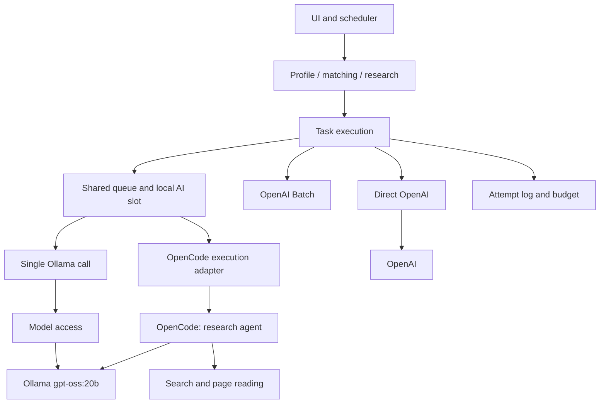

# Local AI — boundaries and cross-cutting design

Status: **design after the implementation review**, 2026-11-05. The [requirements LA-01–LA-21](requirements.md) define the behaviour; the [plan](README.md) describes the order. This document maintains the cross-cutting boundaries. At the owner's request, separate [requirements/SD for all nine stages](README.md#requirements-and-sd-for-each-stage) were prepared; their contracts were clarified after the review. The chosen variant, headless Chrome in a container, has a separate qualification task before stage 7; details below.

Confirmed update: local model `gpt-oss:20b`, the OpenCode agent and no quotas on Ollama use. This choice replaces the earlier proposal of a custom agent loop and limits on rounds/calls. We do not duplicate the OpenCode loop in the application.

## Observed state

Snapshot of the local directory from 2026-11-04, with existing uncommitted changes; this is not a description of HEAD alone.

| Location | Current responsibility and coupling |
| --- | --- |
| [profile/ai.ts](../../../lib/profile/ai.ts) | `AiConfiguration`, prices, `chargeCeiling`, `budgetMonth`, `reserve`, profile preparation and execution. The configuration requires an OpenAI key, and the execution knows the Responses API. |
| [matching/store.ts](../../../lib/matching/store.ts) | Data preparation, reservation, batch execution and assessment publication sit close together. `prepareMatching` saves the OpenAI payload and creates `matching_batches`. |
| [matching/groups.ts](../../../lib/matching/groups.ts) | The group command has idempotency, atomic funding and the Batch submission state; it is not yet a neutral group of local tasks. |
| [matching/batch.ts](../../../lib/matching/batch.ts) | Builds the assessment instructions and schema, and handles files, batch creation and reading OpenAI results. |
| [companies/research-provider.ts](../../../lib/companies/research-provider.ts) | OpenAI search, evidence from annotations, synthesis, telemetry and the cost of two calls. |
| [companies/research.ts](../../../lib/companies/research.ts) | Durable research commands, queue, budget, execution and report history. |
| [worker/index.ts](../../../worker/index.ts) | Queue registration and periodic recovery. The current work expirations are finite; they need to be chosen again for local execution. |

`ai_attempts` is the shared log of attempts and costs. We do not replace it with a second, competing history table. We keep the current Batch diagnostic archive and its access control; by the decision of 2026-11-05, the material of the new integration, conversations and events are also kept indefinitely.

## Target division of responsibilities

The domain modules stay in one project. The worker hands local research to the OpenCode runtime, which talks to Ollama and runs the tools. This is integration of a ready-made execution process; we do not split the domain into microservices. The current OpenAI research can remain a composite executor that uses built-in search. The profile and assessments use the model adapter directly; OpenCode is the research executor.

The shared architecture records D-05 as the existing choice of OpenAI. The need for Ollama comes from the owner's new request; this document proposes extending D-05 with a second provider, not removing OpenAI. During the stage 5 review, update the D-05 record and the related SDs according to the agreed scope. Until then, the diagram is a target design, not a description of an architecture that is already deployed.

| Module | Owns | Does not own |
| --- | --- | --- |
| Profile / matching / research | The meaning of the task, data minimisation, instructions, schema, semantic validation, result publication and domain history. | The provider protocol and the tool loop. |
| Task execution | Claim, the saved choice of executor, attempts, checkpoints, delivery, paid service policies and cooperation with the budget. | Interpreting whether a match or a report is correct. |
| Model access | Translating a single structured answer and schema, HTTP, refusal/truncation, provider telemetry. | Execution tools, saving reports, rating. |
| OpenCode execution adapter | Submitting the goal, configuring the dedicated agent, session ID, observation, cancellation and collecting the result. | Its own planning loop and direct domain mutations. |
| OpenCode | The agent loop, the conversation with Ollama, calls to allowed tools and session state. | The decision to publish a report in the application data. |
| Research tools | Queries, controlled reading of public pages, text extraction, evidence address/time/type. | Approving claims on their own and access to application secrets. |
| Attempt log and budget | Exact arithmetic, reservation month, reservations, settlement and unknown cost. | The readiness state of a profile proposal or the quality of a report. |

The directory names below set the designed division; part of `lib/ai/models/` already exists in the working changes, and the others must be checked before creating them: `lib/ai/configuration.ts`, `lib/ai/budget.ts`, `lib/ai/models/`, `lib/ai/operations/`, `lib/ai/opencode/`, `lib/ai/browser/`. We extract them when we move real behaviour. We do not create empty layers.

## First stage — extracting configuration and budget without changing behaviour

The detailed scope is maintained in one place: [stage 1 requirements](etapy/01-konfiguracja-budzet/requirements.md) and [stage 1 SD](etapy/01-konfiguracja-budzet/solution-design.md). The stage remains an extraction without changing behaviour, configuration format or migrations. This heading was kept for earlier links.

## Contracts of later stages — cross-cutting outline

- A request contains an immutable input and the choice of execution. A new configuration version has an explicit number; a missing marker in an old record means the existing OpenAI and the execution method that follows from the operation type. We do not rewrite the JSON of existing tasks on read. We resolve secrets from the server configuration, without persisting keys.
- Separate the model `provider` (`openai`/`ollama`), the execution method (`direct`/`batch`/`agent`), model capabilities and the cost policy. Not all combinations are allowed. OpenAI Batch keeps its separate upload/create/poll/results/cleanup contract; we do not implement a fictional Batch on Ollama.
- The result of a single model call distinguishes the final content from the finish reason; usage may be unknown. Tools belong to a separate agent/bridge contract. The execution result distinguishes waiting from completion, and the cost log separately distinguishes settled from unknown. The SDs of stages 2–5 describe the reviewed types; refresh them against the existing changes before code; do not force one new set of states onto all old tables.
- Shared infrastructure is to provide claim and settlement, but the relevant domain module saves the assessment and the report. A duplicate delivery does not publish again; a result for an older input version does not displace the current result.
- A local group is a command that groups independent tasks; each has its own durable state and result. Assessment execution is batched. A research queue job starts or observes an OpenCode session; a pg-boss delivery expiry is not a session deadline or a reason to start a second run.
- The local model cost is known and equal to zero, regardless of unknown usage. We do not block such an operation because of a negative balance of the paid budget. Research with paid search still needs its tool costs covered, also with a local model.
- We do not impose on the local Ollama quotas on tokens, calls, rounds or a fixed time for the whole work. All local AI work uses a shared queue with one active execution; load control is not a quota on model usage. The real context and request handling follow from the model/server configuration. The application observes progress and allows the work to be cancelled. A heartbeat/lease prevents worker duplicates; it does not limit the number of inferences.
- OpenCode keeps the session; the application saves the link operation ID → execution ID → session ID and the execution metadata. A restart checks this session and its activity before resuming; it does not use a global "last chat". An uncertain paid tool call still stops the work until it is clarified. Resumption behaviour must be verified on the chosen OpenCode version, without a promise of exactly-once for tools.
- Evidence has identifiers assigned by the application, text/excerpt, URL, title, time and type `page`/`search_snippet`, in line with the current research model. The model does not create arbitrary addresses as confirmed sources. A full read is `page` evidence only after an actual fetch. We keep indefinitely the material received by the integration, evidence, conversations and events; we do not introduce automatic deletion. Secrets are not part of the archive.
- A separate final synthesis step returns a structure consistent with the research model. Search and tool use do not need the final schema to be enforced at the same time. `validateResearch` still checks references and quotes; a quote matching the page is not a guarantee that the claim is true.
- The web tool blocks private IPs, loopback, metadata addresses and redirects to them; the check covers IPv4/IPv6, DNS and the actual connection. The Ollama endpoint configured by the owner is a separate dependency, not an exception made available to the agent.

## OpenCode integration — direction for stage 8

Confirmed: headless `opencode serve` as a separate service, and a shared queue of one local AI work item. The [shared runtime contract](kontrakty-runtime.md) describes the contracts for sessions, requests, the slot and publication; the sources and the gates T01–T05 separate the design from verified operation. The CLI is not the target transport of the integration.

The runtime model configuration points to `ollama/gpt-oss:20b` and the local Ollama endpoint. We do not use paid accounts or the `-cloud` variant. The dedicated research configuration does not inherit personal secrets, plugins, MCP or repository instructions. OpenCode has its own data/session directory with controlled retention, and the agent's tools have no access to project files. We do not change the owner's global OpenCode settings.

The caller stores the session ID and runtime version, and handles the final result, error, interruption and resumption. Mapping a request to a session needs verification of a failure between creating the session and saving its ID; recovery must not guess and start a second research. Restrict access to the headless process to the executor, with authentication on connections between containers/the host.

Permissions of the dedicated agent: deny by default, with only the agreed research tools explicitly enabled; no `bash`, no editing/reading of project files, no task delegation and no interactive questions. Access through custom/MCP tools is to be settled in stage 7, keeping the origin of evidence and controlled web reading. In the chosen release we do not expose an alternative `websearch`/`webfetch`; web tools go through the controlled Chrome DevTools MCP bridge.

The absence of local inference quotas is settled. This does not mean an unlimited physical context: the current Ollama integration documentation gives a context window of 64k+ for OpenCode. The physical context parameters remain runtime configuration; we check model presence through the API, and errors of the real execution must be explicit, without silent truncation of input. Do not reopen the model choice as a condition for starting the plan.

## Migration and launch

We create migrations that add fields/tables only for a specific stage; we do not edit migrations that have already run. We check the state constraints and the indexes of active requests in `matching_requests` and `matching_groups`. We do not remove old tables or fields needed to collect batches. We do not introduce a requirement to empty the queue as a replacement for compatibility handling.

The default execution for existing installations stays with OpenAI. Explicitly enabling Ollama applies to new requests. After deployment, old batches can still be collected and cleaned up by their adapter; new tasks are routed according to the new configuration. Going back to OpenAI changes the routing of new tasks; it does not remove the local history. With a forward-only migration we do not promise that an old application image is compatible with every new state — that is a separate deployment test.

On macOS, Ollama running on the host is preferred for the pilot, to measure the available acceleration. The address for the container must be checked from the worker; `localhost` inside a container points to the container. We record the exact address, version and model in the instructions after the trial. We pass the configuration to both the web app and the worker, because both read readiness and task configuration.

## Technical sources

Read on 2026-11-04: the native [chat API](https://docs.ollama.com/api/chat) supports a response schema, messages, tools and telemetry. [Structured outputs](https://docs.ollama.com/capabilities/structured-outputs) allow passing a JSON schema; the application must still validate the result. [Tool calling](https://docs.ollama.com/capabilities/tool-calling) describes passing tool results in the next turn. Capability documentation does not prove their quality on any given model and hardware — we check availability through the API, and the owner assesses quality in normal use.

OpenCode: [integration with Ollama](https://docs.ollama.com/integrations/opencode), [headless server and sessions](https://opencode.ai/docs/server/), [CLI and JSON events](https://opencode.ai/docs/cli/), [permissions](https://opencode.ai/docs/permissions/) and [tools](https://opencode.ai/docs/tools/). The tools documentation describes separate availability conditions for `websearch`; we do not use it in the chosen variant, Google through Chrome DevTools MCP. O-L2 concerns technical verification of the chosen integration. These are sources on integration capabilities; the installed runtime version and the event contract must be confirmed in the pilot.

Decision update 2026-11-05: the `.env` configuration, indefinite retention of collected material except the working Chrome profile, checking the model through the API without a quality pilot, and batching local assessments into groups of up to 20 are described in the [cross-cutting requirements](requirements.md#clarification-confirmed-2026-11-05). Technical API/session trials are not a test of model quality.

## Investigation update — 2026-11-05

In the working directory, `lib/ai/models/model.ts` and `openai.ts` exist, and the profile partly uses them. The configuration and budget remain in `lib/profile/ai.ts`; `lib/ai/configuration.ts` and `budget.ts` do not exist yet. Do not consider stage 2 finished just because the adapter exists; compare the normalisation of results and errors with E02-AC01–04. Do not overwrite these existing changes.

Agent/Chrome/panel details: [runtime contracts](kontrakty-runtime.md). Entry order and dependencies: [hand-off to the local model](przekazanie-lokalnemu-modelowi.md).

## Agreement after grill-me — 2026-11-05

The shared execution module owns one slot for all local work: direct profile, direct single assessment and OpenCode research. The queue/slot does not belong only to the OpenCode adapter; it is created in stage 5 and used by the later paths. The cost log does not change this rule, and OpenAI stays outside the local slot. The retry snapshot comes from the previous execution; a new configuration and new data need a new command. An invalid answer ends the attempt until a manual retry, without a repair loop.

One shared deployment scope, with the panel. The operator repairs/restarts services manually; the application reports the state and does not automate infrastructure repairs. We keep the research material; the working Chrome profile can be removed after the end and after archiving. Google serves to find public pages; a snippet is not a basis for a claim. No owner data in queries, no signing in; other public sources are tried before intervention. Details: [LA-16–LA-21](requirements.md#outcome-of-the-grill-me-interview--approved-2026-11-05), [runtime contract](kontrakty-runtime.md). Signing in and parking sessions: backlog item 281, outside the release.

## Readiness review of the whole epic — 2026-11-05

As part of `334.20`, the following were clarified: the model interface, normalisation of errors/metrics, dependency injection, assessment publication, research accounting, configuration v1, migrations/indexes, group state and panel commands. These are implementation decisions within the approved scope, without implementation. The documents of stages 1–6, the panel and acceptance define closed contracts and a plan of checks.

After the owner's suggestion, the design chosen is headless Chrome in a container, with preview and manual intervention through a private DevTools. nftables and a controlled proxy enforce the network; the control port is not reachable from visited pages. The [runtime qualification](kwalifikacja-runtime.md), Beads `334.21`, defines the base versions, the isolation evidence and the closing condition. Stage 7 needs this result and stage 5; stage 8 inherits this dependency. Official sources do not replace a test of the target environment.

Current readiness and blocks have their source in Beads. Before implementation, refresh the code after the earlier stages; a change of technical details consistent with the contract does not need the choice of gpt-oss/OpenCode/Google to be approved again. A deviation from LA/PZ or a weakening of isolation needs an explicit owner's decision.
