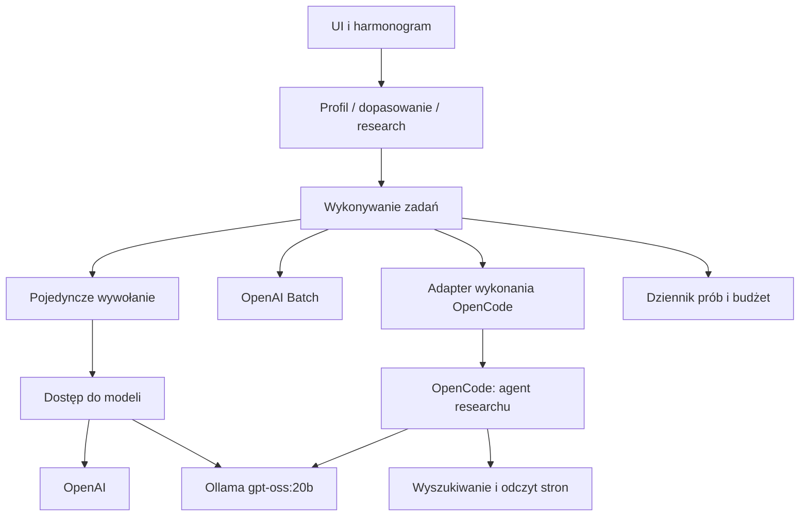

# Lokalne AI — granice i projekt przekrojowy

Status: **propozycja do przeglądu**, 2026-11-04. [Wymagania LA-01–LA-10](requirements.md) określają zachowanie; [plan](README.md) opisuje kolejność. Dokument utrzymuje granice przekrojowe. Na zlecenie właściciela przygotowano osobne [Requirements/SD wszystkich dziewięciu etapów](README.md#requirements-i-sd-każdego-etapu); są propozycjami do przeglądu przed kodem.

Potwierdzona aktualizacja: lokalny model `gpt-oss:20b`, agent OpenCode i brak kwot korzystania z Ollamy. Wcześniejsza propozycja własnej pętli agenta oraz limitów rund/wywołań jest zastąpiona tym wyborem. Nie powielamy pętli OpenCode w aplikacji.

## Obserwowany stan

Migawka lokalnego katalogu z 2026-11-04, z istniejącymi niezacommitowanymi zmianami; nie jest to opis wyłącznie HEAD.

| Miejsce | Obecna odpowiedzialność i sprzężenie |
| --- | --- |
| [profile/ai.ts](../../../lib/profile/ai.ts) | `AiConfiguration`, ceny, `chargeCeiling`, `budgetMonth`, `reserve`, przygotowanie i wykonanie profilu. Konfiguracja wymaga klucza OpenAI, a wykonanie zna Responses API. |
| [matching/store.ts](../../../lib/matching/store.ts) | Przygotowanie danych, rezerwacja, wykonanie partii i publikacja ocen są blisko siebie. `prepareMatching` zapisuje payload OpenAI i tworzy `matching_batches`. |
| [matching/groups.ts](../../../lib/matching/groups.ts) | Komenda grupowa ma idempotencję, atomowe finansowanie i stan wysyłki Batch; nie jest jeszcze neutralną grupą lokalnych zadań. |
| [matching/batch.ts](../../../lib/matching/batch.ts) | Buduje instrukcje i schemat oceny oraz obsługuje pliki, tworzenie partii i odczyt wyników OpenAI. |
| [companies/research-provider.ts](../../../lib/companies/research-provider.ts) | Wyszukiwanie OpenAI, dowody z adnotacji, synteza, telemetria i koszt dwóch wywołań. |
| [companies/research.ts](../../../lib/companies/research.ts) | Trwałe komendy researchu, kolejka, budżet, wykonanie i historia raportów. |
| [worker/index.ts](../../../worker/index.ts) | Rejestracja kolejek i okresowe recovery. Obecne wygaśnięcia pracy są skończone; wymagają ponownego dobrania dla lokalnego wykonania. |

`ai_attempts` jest wspólnym dziennikiem prób i kosztów. Nie zastępujemy go drugą, konkurencyjną tabelą historii. Zachowujemy bieżące archiwum diagnostyczne Batch i jego kontrolę dostępu; nie rozszerzamy automatycznie archiwizacji na pełną treść stron i rozmów agenta.

## Docelowy podział odpowiedzialności

Moduły domenowe pozostają w jednym projekcie. Worker zleca lokalny research runtime OpenCode, który komunikuje się z Ollamą i wykonuje narzędzia. To integracja gotowego procesu wykonawczego; nie wydzielamy domeny do mikroserwisów. Bieżący research OpenAI może pozostać złożonym wykonawcą korzystającym z wbudowanego wyszukiwania. Profil i oceny korzystają bezpośrednio z adaptera modelu; OpenCode jest wykonawcą researchu.

Wspólna architektura zapisuje D-05 jako dotychczasowy wybór OpenAI. Potrzeba Ollamy pochodzi z nowej prośby właściciela; ten dokument proponuje rozszerzenie D-05 o drugiego dostawcę, nie usunięcie OpenAI. Przy przeglądzie etapu 5 uaktualnić zapis D-05 i powiązane SD zgodnie z przyjętym zakresem. Do tego czasu diagram jest projektem docelowym, a nie opisem już wdrożonej architektury.

| Moduł | Posiada | Nie posiada |
| --- | --- | --- |
| Profil / dopasowanie / research | Sens zadania, minimalizacja danych, instrukcje, schemat, walidacja semantyczna, publikacja wyniku i historia domenowa. | Protokół dostawcy i pętla narzędzi. |
| Wykonywanie zadań | Claim, zapisany wybór wykonawcy, próby, checkpointy, dostarczenie, polityki usług płatnych i współpraca z budżetem. | Interpretacja poprawności dopasowania lub raportu. |
| Dostęp do modeli | Tłumaczenie komunikatów, schematów i wywołań narzędzi, HTTP, odmowa/obcięcie, telemetria dostawcy. | Narzędzia wykonawcze, zapis raportów, rating. |
| Adapter wykonania OpenCode | Zlecenie celu, konfiguracja dedykowanego agenta, ID sesji, obserwacja, anulowanie i odbiór wyniku. | Własna pętla planowania i bezpośrednie mutacje domenowe. |
| OpenCode | Pętla agenta, rozmowa z Ollamą, wywołania dozwolonych narzędzi i stan sesji. | Decyzja o publikacji raportu w danych aplikacji. |
| Narzędzia researchu | Zapytania, kontrolowany odczyt publicznych stron, ekstrakcja tekstu, adres/czas/typ dowodu. | Samodzielne zatwierdzanie twierdzeń i dostęp do sekretów aplikacji. |
| Dziennik prób i budżet | Dokładna arytmetyka, miesiąc rezerwacji, rezerwy, rozliczenie i koszt nieznany. | Stan gotowości propozycji profilu lub jakości raportu. |

Nazwy katalogów poniżej są propozycją, nie istniejącymi modułami: `lib/ai/configuration.ts`, `lib/ai/budget.ts`, `lib/ai/models/`, `lib/ai/execution/`, `lib/ai/opencode/`, `lib/companies/research-tools/`. Wydzielamy je wtedy, gdy przenosimy realne zachowanie. Nie tworzymy pustych warstw.

## Pierwszy etap — wydzielenie konfiguracji i budżetu bez zmiany zachowania

Szczegółowy zakres ma jedno miejsce utrzymania: [Requirements etapu 1](etapy/01-konfiguracja-budzet/requirements.md) i [SD etapu 1](etapy/01-konfiguracja-budzet/solution-design.md). Etap pozostaje wydzieleniem bez zmiany zachowania, formatu konfiguracji ani migracji. Zachowano ten nagłówek dla wcześniejszych odnośników.

## Kontrakty dalszych etapów — zarys przekrojowy

- Zlecenie zawiera niezmienne wejście i wybór wykonania. Nowa wersja konfiguracji ma jawny numer; brak znacznika w starym rekordzie oznacza dotychczasowe OpenAI i sposób wykonania wynikający z typu operacji. Nie przepisujemy JSON istniejących zadań przy odczycie. Sekrety rozwiązujemy z konfiguracji serwera, bez utrwalania kluczy.
- Oddzielić `provider` modelu (`openai`/`ollama`), sposób wykonania (`direct`/`batch`/`agent`), zdolności modelu oraz politykę kosztową. Nie wszystkie kombinacje są dozwolone. OpenAI Batch zachowuje odrębny kontrakt upload/create/poll/results/cleanup; nie implementujemy fikcyjnego Batch na Ollamie.
- Wynik modelu rozróżnia treść, wywołania narzędzi i przyczynę zakończenia; użycie może być nieznane. Wynik wykonania rozróżnia oczekiwanie i zakończenie, a dziennik kosztów osobno rozliczone/nieznane. Proponowane typy opisują SD etapów 2–5; zweryfikować je przed kodem; nie wymuszać jednego nowego zestawu stanów na wszystkich starych tabelach.
- Wspólna infrastruktura ma zapewniać claim i rozliczenie, ale zapisu oceny i raportu dokonuje odpowiedni moduł domenowy. Duplikat dostarczenia nie publikuje ponownie; wynik starszych wersji wejścia nie wypiera aktualnego wyniku.
- Lokalna grupa jest komendą grupującą niezależne zadania; każde ma osobny trwały stan i wynik. Wykonanie ocen jest porcjowane. Zadanie kolejki researchu uruchamia lub obserwuje sesję OpenCode; wygaśnięcie dostarczenia pg-boss nie jest deadline sesji ani powodem rozpoczęcia drugiego przebiegu.
- Lokalny koszt modelu jest znany i równy zero niezależnie od nieznanego użycia. Nie blokujemy takiej operacji ujemnym saldem płatnego budżetu. Research z płatnym wyszukiwaniem nadal wymaga pokrycia kosztów narzędzi, także przy lokalnym modelu.
- Nie narzucamy lokalnej Ollamie kwot tokenów, wywołań, rund, stałego czasu całej pracy ani sztucznej współbieżności 1. Rzeczywisty kontekst i obsługa żądań wynikają z konfiguracji modelu/serwera. Aplikacja obserwuje postęp i pozwala anulować pracę. Heartbeat/lease zapobiega duplikatom workera, nie ogranicza liczby inferencji.
- OpenCode utrzymuje sesję; aplikacja zapisuje powiązanie operation ID → session ID i metadane wykonania. Restart sprawdza tę sesję i jej aktywność przed wznowieniem; nie używa globalnego „ostatniego czatu”. Niepewne płatne wywołanie narzędzia nadal zatrzymuje do wyjaśnienia. Zachowanie wznowienia musi być zweryfikowane na wybranej wersji OpenCode, bez obietnicy exactly-once dla narzędzi.
- Dowody mają identyfikatory nadawane przez aplikację, tekst/fragment, URL, tytuł, czas i typ `page`/`search_snippet`, zgodnie z bieżącym modelem researchu. Model nie tworzy dowolnych adresów jako potwierdzonych źródeł. Pełny odczyt to dowód `page` tylko po faktycznym pobraniu. Zapisujemy wybrane fragmenty i ograniczone metadane checkpointu, nie domyślnie pełne strony i rozmowy.
- Osobny końcowy krok syntezy zwraca strukturę zgodną z modelem researchu. Wyszukiwanie i użycie narzędzi nie wymagają jednoczesnego wymuszania finalnego schematu. `validateResearch` nadal sprawdza odwołania i cytaty; zgodność cytatu ze stroną nie jest gwarancją prawdziwości twierdzenia.
- Narzędzie WWW blokuje prywatne IP, loopback, adresy metadanych i przekierowania do nich; kontrola obejmuje IPv4/IPv6, DNS i właściwe połączenie. Skonfigurowany przez właściciela endpoint Ollamy jest osobną zależnością, nie wyjątkiem udostępnionym agentowi.

## Integracja OpenCode — kierunek etapu 8

Potwierdzony wybór to OpenCode; szczegółowy sposób osadzenia podlega próbie integracyjnej. Propozycja startowa: headless `opencode serve` z adapterem HTTP/sesji, ponieważ worker musi umieć obserwować i anulować długą pracę po restarcie. CLI `opencode run --format json` nadaje się do sprawdzenia protokołu i pilota; JSON oznacza strumień zdarzeń, nie automatycznie poprawny raport domenowy. Nie traktować zakończenia procesu lub HTTP200 jako dowodu poprawnej syntezy.

Konfiguracja modelu runtime wskazuje `ollama/gpt-oss:20b` i lokalny endpoint Ollamy. Nie używamy kont płatnych ani wariantu `-cloud`. Dedykowana konfiguracja researchu nie dziedziczy osobistych sekretów, pluginów, MCP ani instrukcji repozytorium. OpenCode ma własny katalog danych/sesji z kontrolowaną retencją, bez dostępu narzędzi agenta do plików projektu. Nie zmieniamy globalnych ustawień OpenCode właściciela.

Wywołujący przechowuje ID sesji i wersję runtime, obsługuje wynik końcowy, błąd, przerwanie i wznowienie. Zmapowanie zlecenia na sesję wymaga weryfikacji awarii pomiędzy utworzeniem sesji a zapisem jej ID; recovery nie może zgadywać i uruchamiać drugiego researchu. Dostęp do procesu headless ograniczyć do wykonawcy, z uwierzytelnieniem przy połączeniu między kontenerami/hostem.

Uprawnienia dedykowanego agenta: domyślnie odmowa, jawnie włączone wyłącznie uzgodnione narzędzia researchu; bez `bash`, edycji/odczytu plików projektu, delegacji zadań i pytań interaktywnych. Dostęp przez narzędzia custom/MCP ustalić w etapie 7, zachowując pochodzenie dowodów i kontrolowany odczyt WWW. Wbudowane `websearch`/`webfetch` można wykorzystać po sprawdzeniu zgodności z tym kontraktem, a nie zakładać ich równoważności.

Brak kwot lokalnej inferencji jest ustalony. Nie oznacza to nieograniczonego fizycznego kontekstu: aktualna dokumentacja integracji Ollamy wskazuje okno kontekstu 64k+ dla OpenCode. W pilocie ustawić i sprawdzić parametry zestawu `gpt-oss:20b` oraz pamięć hosta, bez cichego ucięcia wejścia. Nie otwierać ponownie wyboru modelu jako warunku rozpoczęcia planu.

## Migracja i uruchomienie

Migracje dodające pola/tabele tworzymy dopiero dla konkretnego etapu; bez edycji wykonanych migracji. Sprawdzamy ograniczenia stanów i indeksy aktywnych zleceń w `matching_requests` oraz `matching_groups`. Nie usuwamy starych tabel ani pól potrzebnych do odbioru partii. Nie wprowadzamy obowiązku opróżnienia kolejki jako zamiennika obsługi kompatybilności.

Domyślne wykonanie istniejących instalacji pozostaje przy OpenAI. Jawne włączenie Ollamy dotyczy nowych zleceń. Po wdrożeniu stare partie mogą być nadal odbierane i sprzątane przez swój adapter; nowe zadania trafiają zgodnie z nową konfiguracją. Powrót do OpenAI zmienia trasowanie nowych zadań, nie usuwa lokalnej historii. Przy migracji forward-only nie obiecujemy zgodności starego obrazu aplikacji z każdym nowym stanem — to osobny test wdrożenia.

Na macOS preferowana do pilota jest Ollama uruchomiona na hoście, aby zmierzyć dostępne przyspieszenie. Adres dla kontenera musi być sprawdzony z workera; `localhost` w kontenerze wskazuje kontener. Dokładny adres, wersję i model zapisujemy w instrukcji po próbie. Konfigurację przekazujemy zarówno WWW, jak i workerowi, bo oba odczytują gotowość i konfigurację zadań.

## Źródła techniczne

Odczyt 2026-11-04: natywne [chat API](https://docs.ollama.com/api/chat) obsługuje schemat odpowiedzi, komunikaty, narzędzia i telemetrię. [Structured outputs](https://docs.ollama.com/capabilities/structured-outputs) pozwalają przekazać schemat JSON; aplikacja nadal musi walidować wynik. [Tool calling](https://docs.ollama.com/capabilities/tool-calling) opisuje przekazanie wyników narzędzia w kolejnej turze. Dokumentacja możliwości nie dowodzi ich jakości na dowolnym modelu i sprzęcie — to cel pilota O-L1.

OpenCode: [integracja z Ollamą](https://docs.ollama.com/integrations/opencode), [headless server i sesje](https://opencode.ai/docs/server/), [CLI i JSON events](https://opencode.ai/docs/cli/), [uprawnienia](https://opencode.ai/docs/permissions/) i [narzędzia](https://opencode.ai/docs/tools/). Dokumentacja narzędzi opisuje osobne warunki dostępności `websearch` z lokalnym dostawcą; dlatego O-L2 pozostaje decyzją o wyszukiwaniu, niezależną od wybranego modelu. Są to źródła możliwości integracji; wersję zainstalowanego runtime i kontrakt zdarzeń trzeba potwierdzić w pilocie.
