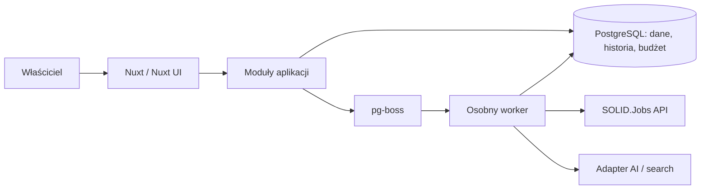

# Architektura i kontrakty wspólne

Status: **kierunek architektury i robocze propozycje kontraktów**, 2026-10-31. Uzupełnienie projektów funkcjonalności pod [PRD](PRD.md), nie solution design całej wersji. Granice i odnośniki: [indeks](README.md). Potwierdzone wybory pochodzą z decyzji właściciela, propozycje SD wymagają przeglądu. Nazwy encji i komend opisują plan, nie istniejący kod.

## Decyzje i granice

| ID | Stan | Decyzja i konsekwencje |
| --- | --- | --- |
| D-01 | Potwierdzone | Nuxt + TypeScript + Nuxt UI; przeglądarkowy interfejs jednego właściciela. Kierunek A dla ofert, C dla firm, bez tablicy B w v1. |
| D-02 | Potwierdzone | Jeden projekt z modułami, wspólna baza PostgreSQL i osobny proces workera pg-boss. Nie wprowadzamy mikroserwisów. |
| D-03 | Potwierdzone | Docker Compose: WWW, worker, PostgreSQL. Trwały wolumen bazy. Local loopback; później VPS przez SSH tunnel. Backup poza aplikacją. |
| D-04 | Potwierdzone | SOLID.Jobs API jako pierwszy adapter. Kolejne źródła później. |
| D-05 | Potwierdzone | OpenAI Responses API, startowo `gpt-6-luna`, modele konfigurowalne według etapu; wyszukiwanie tylko w researchu. Dostęp konta i jakość do sprawdzenia. |
| D-06 | Potwierdzone | Reguły domenowe, wersje, historia i koszty w danych aplikacji, niezależnie od retencji pg-boss. Sieć poza transakcją. |
| D-07 | Propozycja SD | SQL przez `pg` i wersjonowane migracje SQL, bez ORM w pierwszym szkicu. Ułatwia wspólną transakcję danych i zlecenia pracy; kosztem ręcznego mapowania i walidacji typów. |
| D-08 | Propozycja SD | Jeden wykonawca płatnej pracy na start; pobieranie źródła ma odrębnego wykonawcę. Zmniejsza ryzyko kosztowe bez blokowania bezpłatnej synchronizacji. |

Potwierdzone wybory zastępują wcześniejsze rozważania Django/Huey, SvelteKit i SQLite. bethinkpl/design-system pominięty na życzenie właściciela. Uzasadnienie PostgreSQL/pg-boss z rozmowy: gotowa trwała kolejka i możliwość atomowego zlecenia wraz z danymi, za cenę obsługi PostgreSQL. Nie przenosimy marketingowego „exactly once” kolejki na płatne wywołania zewnętrzne.

## Moduły i przepływ

Diagram pokazuje logiczne zależności; schemat pg-boss mieści się w tym samym PostgreSQL. Moduły są wspólne dla WWW i workera, ale wywołania zewnętrzne wykonuje worker.

| Moduł | Odpowiedzialność |
| --- | --- |
| Źródła | Adapter, zakresy, przebiegi, identyfikatory i wersje ogłoszeń, dostępność i sugestie podobieństwa. |
| Profil i dopasowanie | Wersje profilu, kryteria, kwalifikacja, triage, kalkulacja i historia ocen. |
| Firmy i research | Organizacje/marki/grupy/role, twierdzenia i dowody, technologie, raporty i przygotowania. |
| Rekrutacje | Własna decyzja, aplikacje, rozmowy, zadania, kontakty, notatki, tagi. |
| Operacje i budżet | Zlecenia, próby, rezerwacje, koszty, priorytety, harmonogram i podsumowanie błędów. |

Przebieg: synchronizacja → zachowanie danych → kwalifikacja → triage → kalkulacja → ewentualny podstawowy research firmy. Ręczne przygotowanie korzysta z aktualnych, jawnie wskazanych wersji researchu i oferty; nie uruchamia automatycznie ponownego badania firmy.

## Wspólne konwencje danych

Propozycja SD: wewnętrzne identyfikatory UUID, daty zdarzeń jako UTC `timestamptz`, kwoty jako dokładne wartości dziesiętne lub jednostki całkowite o jawnej skali, nigdy zmiennoprzecinkowe pieniądze. Miesiąc budżetowy i godzina harmonogramu wyznaczane w `Europe/Warsaw`, a nie strefie kontenera. Wszystkie rekordy należą do jednego właściciela; brak modelu tenantów.

| Encja wspólna | Kontrakt |
| --- | --- |
| DomainEvent | Typ, czas, autor, podmiot, operation id i zmienione wartości/powiązania. Zapis atomowy z mutacją; nie pełny event sourcing. |

Propozycja SD: komendy aktualizacji są częściowe — pominięte pole oznacza „bez zmiany”; jawne `null` oznacza „wartość nieznana/wyczyszczona”, wyłącznie w polach dopuszczających brak. W danych domenowych `[]` oznacza potwierdzony pusty zbiór, `null` brak wiedzy. Adapter nie zamienia pominiętej listy technologii na „brak technologii”. Nie używać tego samego `null` do braku wiedzy i błędu ekstrakcji: błąd należy do stanu operacji.

Mutacje właściciela przekazują oczekiwaną wersję rekordu. Konflikt równoległych zmian zwraca jawny konflikt i bieżącą wersję, zamiast cicho nadpisać notatkę. Odniesienia do źródeł/dowodów muszą istnieć; daty i skale walidowane po stronie serwera.

Kontrakty konkretnych encji należą do projektów funkcjonalności; nie utrzymujemy drugiego pełnego modelu w tym pliku.

## Wspólny adapter AI

D-05 zapisuje wybór, nie nową weryfikację dostępu do API. Podstawa dokumentacyjna i ograniczenia przechowywania: [weryfikacja usług](../../research/ai-uslugi-weryfikacja.md). Dawne kalkulacje w [badaniu budżetu](../../research/ai-research-budzet.md) są scenariuszami, nie aktualną ofertą cenową. Bieżący cennik i dostęp konta wymagają sprawdzenia przed płatnymi próbami. Niniejszy szkic nie utrwala stawek na stałe.

Propozycja SD: adapter AI oddziela:

- ekstrakcję z opisu, tylko gdy dane strukturalne nie wystarczają;
- triage — profil zawodowy i dane ogłoszeń bez narzędzi WWW;
- research — pozyskanie i syntezę z cytowaniami;
- przygotowanie — oferta/aplikacja i wskazane raporty firmy, nowe badanie firmy tylko na żądanie.

Wejście jest budowane z jawnej listy pól profilu; surowy CV nie jest bezpośrednio przekazywany do usługi. Treść ogłoszeń i stron jest niezaufanym materiałem, nie instrukcją sterującą workerem. Model nie otrzymuje sekretów ani narzędzi do mutacji aplikacji/kontaktowania się z firmą.

Wyjście przechodzi walidację schematu oraz semantyki: liczby 0–100 lub jawny brak, istnienie wskazanych wersji/dowodów, zakres organizacji/projektu, poprawne rodzaje twierdzeń. Sama zgodność JSON nie dowodzi prawdziwości. Odmowa, obcięcie, niepoprawny wynik i błąd transportu to odrębne przyczyny nieukończenia, nie „niedopasowana oferta”.

Kalkulator i historia ocen: [dopasowanie](features/dopasowanie/solution-design.md). Cykl raportów i dowody: [firmy i research](features/firmy-research/solution-design.md).

## Wspólny kontrakt komend

Propozycja SD: operacje asynchroniczne zwracają status przyjęcia i identyfikator; UI odczytuje trwały stan. Dostęp lokalny bez logowania (decyzja 2026-10-31), niepoprawne dane — błąd walidacji, konflikt wersji — konflikt, brak budżetu — jawne oczekiwanie zamiast nieudanego dopasowania. Odświeżenie strony po komendzie nie może samo zlecać drugiej płatnej pracy.

Komendy domenowe są opisane wyłącznie w odpowiednich projektach funkcjonalności. Sesje i konfigurację usług określa [uruchomienie](features/uruchomienie/solution-design.md); trwałe wykonanie i transakcje określają [operacje](features/operacje/solution-design.md).

## Moment dopracowania kontraktów

Wybrane technologie i jawnie potwierdzone decyzje pozostają aktualne. Pozostałe wspólne konwencje są robocze; dopracowujemy je na potrzeby podejmowanej funkcjonalności, przed jej kodowaniem, zamiast finalizować cały model na zapas. Przed zmianą kontraktu sprawdzamy wpływ na już istniejące moduły. Obowiązuje [cykl pracy](README.md#cykl-pracy-nad-funkcjonalnością).
