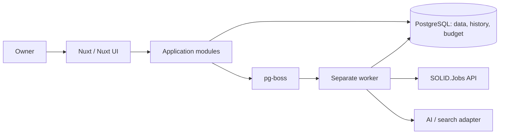

# Architecture and shared contracts

Status: **architecture direction and working contract proposals**, 2026-10-31. A supplement to the feature designs under the [PRD](PRD.md), not a solution design for the whole version. Boundaries and links: [index](README.md). Confirmed choices come from the owner's decisions; SD proposals require review. Entity and command names describe the plan, not existing code.

## Decisions and boundaries

| ID | State | Decision and consequences |
| --- | --- | --- |
| D-01 | Confirmed | Nuxt + TypeScript + Nuxt UI; a browser interface for one owner. Direction A for offers, C for companies, no board B in v1. |
| D-02 | Confirmed | One project with modules, a shared PostgreSQL database and a separate pg-boss worker process. We do not introduce microservices. |
| D-03 | Confirmed | Docker Compose: WWW, worker, PostgreSQL. A persistent database volume. Local loopback; later a VPS through an SSH tunnel. Backup outside the application. |
| D-04 | Confirmed | SOLID.Jobs API as the first adapter. Further sources later. |
| D-05 | Confirmed | OpenAI Responses API, initially `gpt-6-luna`, models configurable per stage; search only in research. Account access and quality to be checked. |
| D-06 | Confirmed | Domain rules, versions, history and costs in the application's data, independent of pg-boss retention. Network outside the transaction. |
| D-07 | SD proposal | SQL through `pg` and versioned SQL migrations, no ORM in the first draft. Makes a shared transaction of data and work requests easier, at the cost of manual mapping and type validation. |
| D-08 | SD proposal | One executor of paid work to start; source fetching has a separate executor. Reduces cost risk without blocking free sync. |

The confirmed choices replace earlier considerations of Django/Huey, SvelteKit and SQLite. bethinkpl/design-system was skipped at the owner's request. The rationale for PostgreSQL/pg-boss from the conversation: a ready, durable queue and the ability to enqueue a request atomically together with the data, at the cost of running PostgreSQL. We do not carry the queue's marketing "exactly once" over to paid external calls.

## Modules and flow

The diagram shows logical dependencies; the pg-boss schema lives in the same PostgreSQL. The modules are shared by WWW and the worker, but the worker makes the external calls.

| Module | Responsibility |
| --- | --- |
| Sources | Adapter, scopes, runs, ad identifiers and versions, availability and similarity suggestions. |
| Profile and matching | Profile versions, criteria, qualification, triage, calculation and assessment history. |
| Companies and research | Organisations/brands/groups/roles, claims and evidence, technologies, reports and preparations. |
| Recruitments | Own decision, applications, interviews, tasks, contacts, notes, tags. |
| Operations and budget | Requests, attempts, reservations, costs, priorities, schedule and error summary. |

Flow: sync → saving data → qualification → triage → calculation → possible basic research of the company. Manual preparation uses the current, explicitly indicated versions of the research and the offer; it does not automatically start a new study of the company.

## Shared data conventions

SD proposal: internal UUID identifiers, event dates as UTC `timestamptz`, amounts as exact decimal values or integer units with an explicit scale, never floating-point money. The budget month and the schedule time are determined in `Europe/Warsaw`, not in the container's time zone. All records belong to one owner; there is no tenant model.

| Shared entity | Contract |
| --- | --- |
| DomainEvent | Type, time, author, subject, operation id and changed values/links. Saved atomically with the mutation; not full event sourcing. |

SD proposal: update commands are partial — an omitted field means "no change"; an explicit `null` means "value unknown/cleared", only in fields that allow absence. In domain data `[]` means a confirmed empty set, `null` means no knowledge. The adapter does not turn an omitted technology list into "no technologies". Do not use the same `null` for no knowledge and for an extraction error: the error belongs to the operation's state.

Owner mutations pass the expected record version. A conflict of concurrent changes returns an explicit conflict and the current version, instead of silently overwriting a note. References to sources/evidence must exist; dates and scales are validated on the server side.

The contracts of specific entities belong to the feature designs; we do not maintain a second full model in this file.

## Shared AI adapter

D-05 records the choice, not a new verification of API access. Documentary basis and storage limitations: [service verification](../../research/ai-uslugi-weryfikacja.md). The old calculations in the [budget study](../../research/ai-research-budzet.md) are scenarios, not a current price offer. The current price list and account access need to be checked before paid trials. This draft does not fix rates permanently.

SD proposal: the AI adapter separates:

- extraction from the description, only when structured data is not enough;
- triage — the professional profile and ad data, without web tools;
- research — gathering and synthesis with citations;
- preparation — the offer/application and the indicated company reports; a new study of the company only on demand.

The input is built from an explicit list of profile fields; the raw CV is not passed directly to the service. The content of ads and pages is untrusted material, not an instruction that controls the worker. The model receives no secrets and no tools for mutating the application or contacting a company.

The output goes through schema and semantic validation: numbers 0–100 or an explicit absence, existence of the indicated versions/evidence, organisation/project scope, correct kinds of claims. JSON conformance alone does not prove truth. A refusal, a truncation, an invalid result and a transport error are separate reasons for non-completion, not a "non-matching offer".

Calculator and assessment history: [matching](features/dopasowanie/solution-design.md). Report cycle and evidence: [companies and research](features/firmy-research/solution-design.md).

## Shared command contract

SD proposal: asynchronous operations return an acceptance status and an identifier; the UI reads the durable state. Local access without login (decision 2026-10-31), invalid data — validation error, version conflict — conflict, no budget — explicit waiting instead of a failed match. Refreshing the page after a command must not by itself request a second paid piece of work.

Domain commands are described only in the relevant feature designs. Sessions and service configuration are set by [launch](features/uruchomienie/solution-design.md); durable execution and transactions are set by [operations](features/operacje/solution-design.md).

## When contracts are refined

The chosen technologies and explicitly confirmed decisions remain current. The other shared conventions are working ones; we refine them for the feature being taken up, before it is coded, instead of finalising the whole model in advance. Before changing a contract we check its impact on modules that already exist. The [work cycle](README.md#feature-work-cycle) applies.
